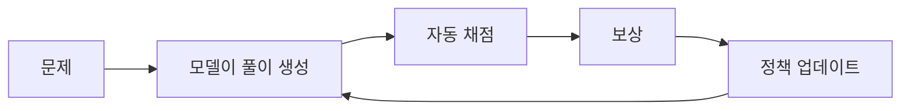
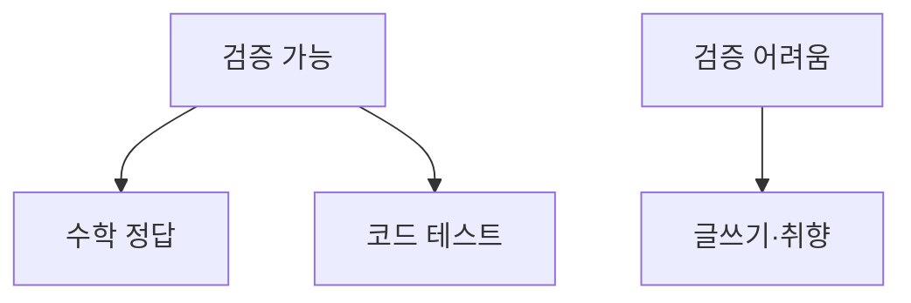

# 검증 가능한 보상 강화학습(RLVR)

> **정답을 자동으로 채점할 수 있는 문제**(수학·코딩 등)에서 강화학습의 보상을 그 자동 채점 결과로 주어 추론 능력을 키우는 훈련.

## 쉽게 말하면
채점 답안지가 있는 문제집을 주고, 맞으면 칭찬(보상), 틀리면 무보상으로 스스로 풀이 방법을 찾게 하는 것이다. 사람이 풀이 과정을 일일이 가르치지 않는다.

## 자세히
- DeepSeek-R1(arXiv 2501.12948)의 초록 기준: 사람이 쓴 추론 예시 **없이 강화학습만으로** 추론 능력을 개발할 수 있다는 주장. 자동 검증이 가능한 과제를 대상으로 한다.
- 보고된 창발 행동: 스스로 추론을 점검하고, 결과를 확인하고, 문제 풀이 중 전략을 바꾼다. 수학·경쟁 코딩·STEM에서 사람 시연으로 지도학습한 모델보다 낫다고 보고(초록에 수치는 없음).
- 증류: 큰 모델의 추론 패턴으로 작은 모델을 개선할 수 있다고 초록은 언급(방법·수치는 본문 확인 필요, 나는 초록만 읽음).
- "검증 가능"의 의미: 정답 비교, 단위 테스트 통과, 형식 검사처럼 **기계가 판정**하는 보상. 글쓰기·창의성처럼 정답이 없는 영역에는 바로 적용하기 어렵다(한계, 내 정리).
- 주의: 보상을 속이는 해결책(리워드 해킹) 가능성, 검증기가 틀리면 잘못 학습. 이 부분은 이 출처에서 확인하지 못했으므로 일반 지식으로 표시한다.
- 연결: [테스트 시점 연산](#test-time-compute)과 함께 "생각하는 모델" 흐름의 두 축(훈련 방식 / 추론 방식).

## 그림으로 보기

## 예시
- 코딩 문제에 단위 테스트 통과 여부를 보상으로 사용.
- 교육: "채점 기준이 명확한 업무는 AI 개선이 빠르다"는 업무 선정 기준.

## 헷갈리는 것과 비교
| 개념 | 차이 |
|---|---|
| RLVR | 자동 검증 보상 |
| RLHF | 사람 선호로 학습한 보상모델 |
| 지도 미세조정 | 정답 예시를 따라 하기 |

## 더 읽을거리
- [DeepSeek-R1 논문](https://arxiv.org/abs/2501.12948) — RL만으로 추론 개발(초록 읽음).
