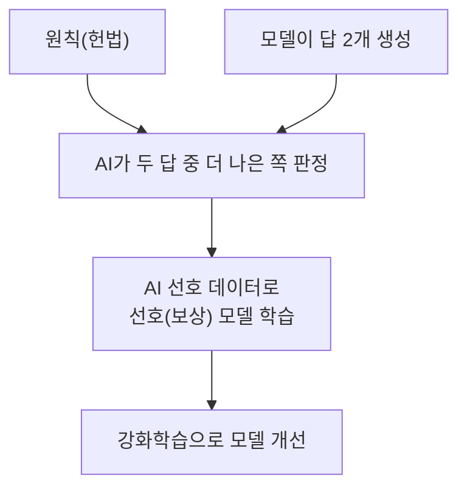
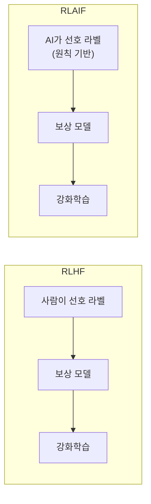

# RLAIF (AI 피드백 강화학습)

> 사람 대신 AI가 "어느 답이 더 낫다"를 판정해 만든 선호 데이터로 모델을 강화학습하는 방식. 사람 라벨링 비용을 줄이면서 RLHF와 비슷한 성능을 목표로 한다.

## 쉽게 말하면
작문 선생님이 학생 글 수천 편에 일일이 순위를 매기기엔 시간이 부족하다. 그래서 채점 기준표(원칙)를 정해 주고 조교(다른 AI)에게 순위를 매기게 한다. 선생님은 기준표만 만든다. 조교가 일정 수준 이상만 해 주면 훈련 효과는 비슷하지만 훨씬 싸다.

## 자세히
- **Constitutional AI(CAI)**: Anthropic의 Bai 외(arXiv 2212.08073, 2022년 12월). 해로운 출력에 대한 사람 라벨 없이, **헌법(constitution)이라 부르는 서면 원칙**만으로 무해한 어시스턴트를 학습한다. 두 단계:
  1. **지도 단계**: 모델이 답을 만들고 스스로 비판·수정한 뒤, 수정된 답으로 원래 모델을 미세조정한다([SFT](#sft)).
  2. **강화학습 단계**: 모델이 두 답 중 더 나은 쪽을 판정하고, 이 **AI 선호**로 선호 모델을 학습해 보상 신호로 쓴다(**RLAIF**). 결과로 무해하면서도 회피하지 않고, 해로운 질문에 거절 이유를 설명하며 응하는 모델을 얻었다고 보고했다. 사고 사슬 추론이 투명성과 사람 평가 성능을 높일 수 있다는 점도 언급한다.
- **RLAIF vs RLHF**(Lee 외, Google, arXiv 2309.00267, ICML 2024): 요약·도움이 되는 대화·무해 대화에서 "RLAIF가 RLHF와 **비슷한 성능**"을 냈다. AI 라벨러가 정책 모델과 같은 크기이거나 **같은 체크포인트**여도 지도 미세조정 기준선보다 낫다(자기 개선). **직접 RLAIF(d-RLAIF)**는 보상 모델 학습을 건너뛰고 기성 LLM에서 학습 중 직접 보상을 받으며, 정식 RLAIF보다 낫다고 보고했다.
- **장점**: 라벨링 확장성, 원칙을 명시해 두면 판단 기준이 투명하고 수정이 쉽다.
- **위험**: 판정 AI의 편향이 그대로 증폭될 수 있고([LLM 심판 편향](#llm-as-judge)), 원칙이 잘못 쓰이면 목표가 어긋난다. 사람 감독은 원칙 작성·점검 단계로 이동할 뿐 사라지지 않는다. [보상 해킹](#reward-hacking) 위험도 그대로 있다.
- **쓰임 확장**: Anthropic의 Constitutional Classifiers는 원칙으로 합성 데이터를 만들어 방어 필터를 학습시킨다([탈옥](#jailbreak)).

## 그림으로 보기

## 예시
- 기업이 사내 상담 모델을 다듬을 때, 상담 품질 원칙(공손함, 근거 제시, 개인정보 노출 금지)을 문장으로 적고 판정 모델이 답 쌍을 평가하게 한다. 사람은 일부 표본만 점검한다.
- 교육 활용: 수강생이 "우리 회사 AI 응대 원칙 10가지"를 직접 써 보고 AI 판정으로 결과가 어떻게 달라지는지 비교한다.

## 헷갈리는 것과 비교
| 개념 | 차이 |
|---|---|
| [RLHF](#rlhf) | 선호 라벨을 사람이 만듦 |
| RLAIF | 선호 라벨을 AI가 만듦 |
| Constitutional AI | 원칙으로 AI 피드백을 이끄는 Anthropic의 방법(지도+RLAIF 두 단계) |
| [DPO](#dpo) | 보상 모델·RL 없이 선호 쌍으로 직접 학습. 선호 쌍의 출처는 사람이든 AI든 상관없음 |
| [LLM 심판](#llm-as-judge) | 평가용으로 AI에 채점시키는 것. RLAIF는 그 결과를 학습에 사용 |

## 더 읽을거리
- [Constitutional AI (arXiv 2212.08073)](https://arxiv.org/abs/2212.08073) — 두 단계 방식과 헌법
- [RLAIF vs. RLHF (arXiv 2309.00267)](https://arxiv.org/abs/2309.00267) — 성능 비교와 d-RLAIF
