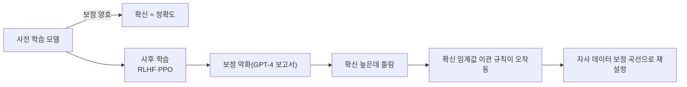

# RLHF 과신

> 사람 피드백 강화학습(RLHF) 등 사후 학습을 거친 모델이 **실제 정확도보다 더 높은 확신을 보이는 경향**. GPT-4 기술 보고서는 사전 학습 모델은 보정이 잘 되어 있었지만 사후 학습 뒤 보정이 크게 나빠졌다고 보고한다.

## 쉽게 말하면
시험 준비를 막 마친 학생은 자기 실력을 비교적 정직하게 안다. 그런데 "자신 있게 답하면 점수를 더 주는" 교육을 받으면 모르는 문제에도 자신 있는 말투가 늘어난다. 말투가 정답률과 따로 노는 것이다.

## 자세히
출처: GPT-4 Technical Report(arXiv 2303.08774, PDF를 텍스트로 변환해 한계 절과 Figure 8 캡션 직접 확인), Tian 외 arXiv 2305.14975 초록(확인), 2026-11-18. 원인 설명(보상 모델 편향)은 [신뢰도 보정과 이관](#confidence-calibration-handoff) 노드가 인용한 별도 연구에 기댄 것이라 여기서는 직접 확인하지 않았다.
- **GPT-4 보고서의 서술**: GPT-4는 "확신을 갖고 틀릴 수 있다". 흥미롭게도 **사전 학습 모델은 높게 보정**되어 있었다(예측 확신이 정답 확률과 대체로 일치). 그러나 **사후 학습 과정을 거치면 보정이 줄어든다**(Figure 8).
- **Figure 8 설명**: MMLU 일부 문제에서 선택지 A/B/C/D에 대한 모델의 로그 확률 구간별로 실제 정확도를 그린 보정 곡선. 대각선이 완벽한 보정이고 캡션은 사후 학습이 보정을 "크게 해친다"고 쓴다. 보고서 본문에는 ECE 같은 수치가 적혀 있지 않았다.
- **말로 한 확신은 다르다(Tian 외 초록)**: RLHF 모델의 조건부 확률이 보정이 나쁘다는 선행 연구가 있었으나, 모델이 출력 텍스트로 직접 말한 확신 점수가 그 확률보다 대체로 더 잘 보정되어 기대 보정 오차(ECE)를 상대적으로 약 50% 줄이는 경우가 많다고 보고했다. 대상은 ChatGPT, GPT-4, Claude, 데이터셋은 TriviaQA, SciQ, TruthfulQA.
- **해석**: 토큰 확률과 말로 한 확신은 서로 다른 신호이고, 어느 쪽이 더 믿을 만한지는 모델·과제에 따라 다르다. 모델 버전이 바뀔 때마다 다시 측정해야 한다.
- **운영 시사점(제안)**: ①확신 임계값으로 사람에게 넘기는 규칙은 자사 데이터의 보정 곡선을 그려 임계값을 정한다 ②확신 대신 검색 근거 유사도 등 다른 신호를 병행한다([검색 점수 기반 이관](#retrieval-score-handoff)) ③모델·프롬프트 변경 때 재보정.
- **한계**: GPT-4 보고서의 결과는 객관식(MMLU) 로그 확률 기준이며, 상담 같은 서술형 답변의 확신 보정은 별개 문제다. 최신 모델에서 같은 현상이 같은 크기인지는 확인하지 못했다.

## 그림으로 보기


## 예시
```python
import numpy as np
def calibration_bins(conf, correct, k=10):
    bins = np.linspace(0, 1, k + 1)
    idx = np.digitize(conf, bins) - 1
    return [(bins[i], correct[idx == i].mean(), (idx == i).sum())
            for i in range(k) if (idx == i).any()]
```
구간별 평균 확신과 실제 정답률이 대각선에서 벗어난 정도를 본다. 교육 활용: "AI가 90% 확신한다"는 문구를 보면 보정 곡선이 있는지 묻는 습관을 연습.

## 헷갈리는 것과 비교
| 개념 | 차이 |
|---|---|
| 보정(calibration) | 확신과 실제 정확도가 맞는 정도 |
| 정확도 | 맞힌 비율, 확신과 무관 |
| RLHF 과신 | 사후 학습으로 확신이 정확도보다 커지는 현상 |
| [신뢰도 보정과 이관](#confidence-calibration-handoff) | 보정을 이관 규칙에 쓰는 법 |

## 더 읽을거리
- [GPT-4 Technical Report](https://arxiv.org/abs/2303.08774) — 한계 절의 보정 서술과 Figure 8
- [Just Ask for Calibration (arXiv 2305.14975)](https://arxiv.org/abs/2305.14975) — 말로 한 확신의 보정
