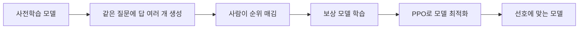
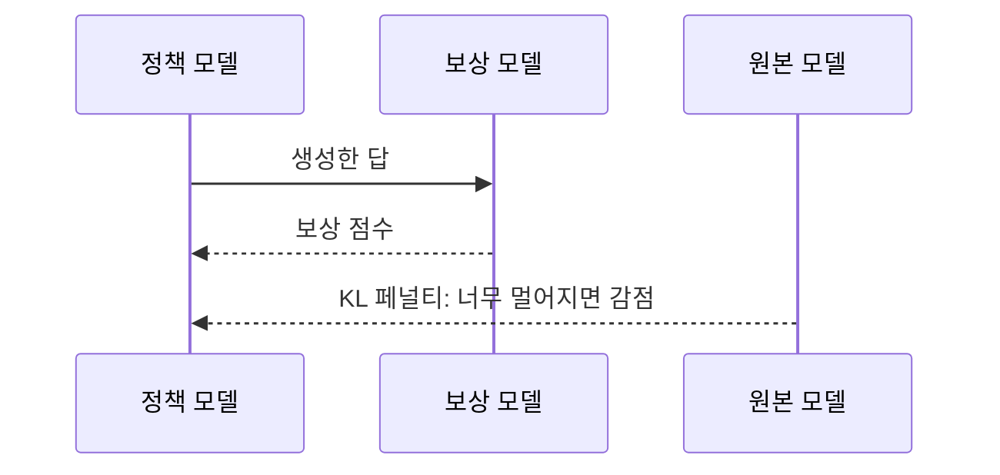

# RLHF

> RLHF(Reinforcement Learning from Human Feedback, 사람 피드백 강화학습)는 사람이 매긴 선호도로 보상 모델을 만들고, 그 보상을 높이는 방향으로 언어 모델을 다듬어 "사람이 좋아하는 답"을 하게 만드는 학습법이다.

## 쉽게 말하면
신입 작가에게 한 질문에 답안을 여러 개 쓰게 한 뒤, 편집자가 "이 답이 더 낫다"고 순위를 매긴다. 편집자의 취향을 흉내 내는 채점 로봇(보상 모델)을 만들고, 작가는 그 로봇에게 높은 점수를 받도록 연습한다. 단, 로봇 눈에만 좋아 보이는 이상한 글로 빠지지 않도록 원래 문체에서 너무 멀어지지 않게 고삐를 쥔다.

## 자세히
Hugging Face 해설(2022 기준 글)의 3단계:
1. **사전학습**: 다양한 지시에 잘 반응하는 기반 언어 모델을 준비한다(InstructGPT는 더 작은 GPT-3, Anthropic은 1천만~520억 파라미터 모델).
2. **보상 모델 학습**: 프롬프트마다 여러 답을 생성하고 사람이 **순위**를 매긴다. 점수보다 순위가 일관적이라고 한다. 이를 하나의 스칼라 보상 값으로 변환해 학습한다.
3. **RL 미세조정**: 모델 복사본을 **PPO**로 보상 모델 점수가 높아지게 최적화한다. **KL 발산 페널티**로 원래 모델에서 멀어지는 것을 막아, 보상 모델만 속이는 횡설수설을 방지한다.
- **쓰임**: InstructGPT·ChatGPT, Anthropic의 helpful·honest·harmless 어시스턴트. 오픈소스 도구로 TRL, TRLX, RL4LMs.
- **한계**: 여전히 틀리거나 해로운 글을 불확실하다는 표시 없이 낼 수 있다. 사람 피드백은 비싸고 평가자끼리 의견이 갈린다. RL 설계 선택은 아직 덜 탐구됐다.

## 그림으로 보기

## 예시
- 챗봇이 같은 질문에 "정중하고 정확한 답" vs "장황하고 틀린 답"을 내면 사람이 앞의 것을 고르고, 그 선호가 학습에 반영된다.
- 직접 해 보려면 TRL 라이브러리로 작은 모델에 보상 모델과 PPO를 시험할 수 있다.

## 헷갈리는 것과 비교
| 개념 | 차이 |
| --- | --- |
| [강화학습](#reinforcement-learning) | 상위 개념. RLHF는 보상을 사람 선호에서 얻는 응용 |
| [자기지도학습](#self-supervised) | 사전학습 단계. 라벨 없이 데이터에서 배움 |
| 지도 미세조정(SFT) | 모범 답을 따라 쓰게 함. RLHF는 "더 나은 쪽"을 보상으로 학습 |

## 더 읽을거리
- [Hugging Face: Illustrating RLHF](https://huggingface.co/blog/rlhf) — 3단계와 한계 정리
