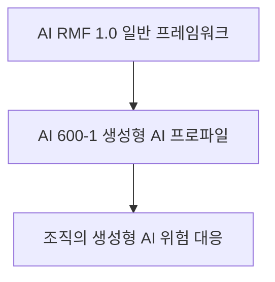

# 생성형 AI 프로파일

> **NIST AI 600-1 생성형 AI 프로파일**은 NIST AI 위험관리 프레임워크(AI RMF 1.0)를 생성형 AI에 적용하는 부속 지침으로 2024년 7월 26일 공개됐다.

## 쉽게 말하면
AI RMF가 "안전 점검 일반 매뉴얼"이라면, 이 프로파일은 "생성형 AI 전용 체크 항목집"이다. 환각, 정보 오염 같은 생성형 AI 고유 위험에 맞춰 일반 매뉴얼을 구체화했다.

## 자세히
(NIST 출판 페이지 확인)
- 행정명령 14110(안전·보안·신뢰 가능한 AI)에 따라 작성한 **분야 공통 프로파일**.
- AI RMF는 **자발적** 프레임워크로, 제품 설계·개발·사용·평가에 신뢰성 고려를 넣도록 돕는다.
- 위험 범주의 구체 목록은 해당 페이지에 없어 확인하지 못했다. 전문은 https://doi.org/10.6028/NIST.AI.600-1 에 있다. 행정명령 14110은 이후 폐지됐다는 보도가 있으나 이 글에서 확인하지 않았다.

## 그림으로 보기

## 예시
- 사내 생성형 AI 도입 시 프로파일의 위험 항목을 체크리스트로 삼아 [AI 위험 대장](#ai-risk-register)에 옮겨 적는다.

## 헷갈리는 것과 비교
| 개념 | 차이 |
|---|---|
| AI RMF 1.0 | 일반 프레임워크 |
| AI 600-1 | 생성형 AI 전용 프로파일 |
| [ISO/IEC 42001](#iso-42001) | 인증 가능한 경영시스템 표준 |

## 더 읽을거리
- [NIST: AI RMF Generative AI Profile](https://www.nist.gov/publications/artificial-intelligence-risk-management-framework-generative-artificial-intelligence)
