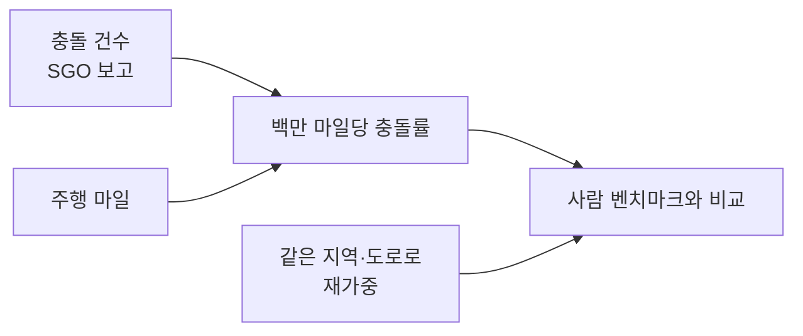
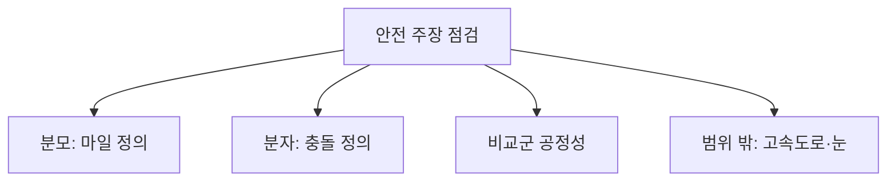

# 로보택시 안전 지표

> 로보택시가 "사람보다 안전한가"를 **주행거리당 충돌률**로 비교하는 방법. 숫자는 인상적이지만, 비교 기준(벤치마크)과 범위가 결과를 크게 좌우한다.

## 쉽게 말하면
두 운전자의 안전을 비교하려면 "누가 더 오래 운전했나"가 아니라 "100만 km당 사고가 몇 번인가"를 봐야 한다. 그런데 한 사람은 맑은 날 시내만 달리고 다른 사람은 눈길 고속도로를 달렸다면 공정한 비교가 아니다.

## 자세히
- Waymo 안전 페이지(2026-06까지 데이터, 열람 2026-11-28): 무인 주행 약 **2.713억 마일**(피닉스 92.1M·샌프란시스코 82.4M·LA 67.1M·오스틴 21.1M·애틀랜타 8.6M).
- Waymo 주장: 사람 벤치마크 대비 **심각한 부상 이상 충돌 약 95% 적음**, 부상 충돌 약 82%, 보행자 부상 충돌 약 93%, 자전거 86% 적음. 백만 마일당 부상 충돌률 0.67 vs 3.77.
- 방법: 충돌은 NHTSA SGO 보고에서, 사람 기준은 경찰 신고 충돌과 주행거리(승용차, 비고속도로)에서 산출. 운행 구역 비중에 맞춰 재가중하고, 부상 기준에는 과소신고 32% 보정을 넣었다. 신뢰구간은 포아송 정확법 등.
- **한계(페이지가 직접 밝힘)**: 고속도로 제외, 눈 오는 도시 없음, 사망 단독 결과는 표본 부족, 과실 여부는 평가 안 함. 또 이 비교만으로 "충분히 안전"을 증명하지 못한다고 명시.
- 읽는 요령: 분모(마일 정의), 분자(충돌 정의·신고 기준), 비교군(같은 도로·같은 지역인가), 자기 보고 여부(회사 발표, 다른 곳 검증 필요)를 확인한다.

## 그림으로 보기

## 예시
- 보도에서 "충돌 95% 감소"를 보면 "어떤 충돌, 어떤 도로, 무엇 대비?"를 되묻는다.
- 교육: 기업 AI 도입 효과 수치를 읽는 비판적 사고 연습 자료.

## 헷갈리는 것과 비교
| 개념 | 차이 |
|---|---|
| 충돌률 비교 | 사람과 비교한 사고 빈도 |
| 안전 사례(Safety Case) | 시스템이 충분히 안전하다는 종합 논증 |
| [롱테일 문제](#long-tail-problem) | 드문 상황이 안전 한계를 만든다 |

## 더 읽을거리
- [Waymo Safety Impact](https://www.waymo.com/safety/impact/) — 수치와 방법·한계(읽음, 회사 발표).
