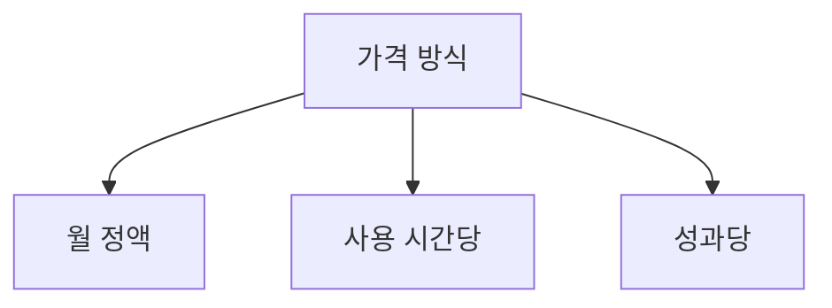

# 서비스형 로봇(RaaS)

> 로봇을 사지 않고 **월 구독·사용량 과금**으로 쓰는 도입 방식. 초기 투자(CapEx)를 운영비(OpEx)로 바꾼다.

## 쉽게 말하면
자동차를 사는 대신 렌터카나 구독 서비스를 쓰는 것과 같다. 정비·소프트웨어 업데이트가 요금에 포함되어 큰 목돈이 필요 없다.

## 자세히
- 요금 유형(Robotomated 가이드 요약): ① 로봇당 **월 정액**(가동률과 무관) ② **사용량 기반**(예: Formic은 로봇 시간당 $8~15) ③ 성과 기반(픽·배송·생산 단위당, 초기 단계).
- 사례 수치(벤더 발표·2차 정리, 검증 필요): Brightpick은 로봇당 월 $1,900~2,200에 소프트웨어·24/7 원격 지원·현장 정비·예방 정비 포함. 팔레트 이송 배치에서는 로봇당 월 약 $3,537이라는 수치도 있다. DHL Makro 사례는 Locus 로봇 123대에 월 $81,342(연 약 $976,100).
- 계약 요소: 인수 옵션, 경쟁사가 더 싸게 제시하면 맞출 권리 등. 한 자료는 RaaS 가격이 연 5~10% 하락한다고 주장한다.
- 장점: 목돈 불필요, 유지보수 위탁, 규모 조절 쉬움. 단점: 장기 총비용이 구매보다 클 수 있고 벤더 종속.
- 주의: 대부분 업체 마케팅 자료이므로 지표는 참고용이다.

## 그림으로 보기

## 예시
- 물류센터가 피크 시즌에만 로봇 수를 늘려 구독.
- 교육: 기업 AI 도입 시 "구매 vs 구독" 비교 워크시트.

## 헷갈리는 것과 비교
| 개념 | 차이 |
|---|---|
| RaaS | 서비스 계약으로 사용 |
| 구매 | 자산으로 소유, 초기 비용 큼 |
| [휴머노이드 단가와 ROI](#humanoid-unit-economics) | 도입 타당성 계산 틀 |

## 더 읽을거리
- [Brightpick RaaS 설명](https://brightpick.ai/resources/how-brightpicks-raas-works/) — 벤더 설명(검색 결과 확인).
- [Robotomated RaaS 가이드](https://robotomated.com/learn/market/robotics-as-a-service-raas-guide) — 과금 유형(검색 요약).
