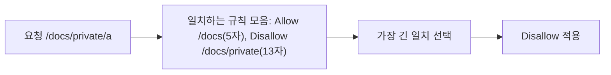
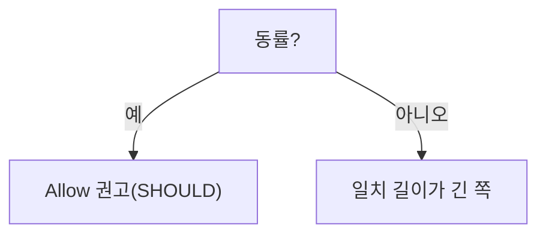

# 가장 긴 일치 규칙

> robots.txt에서 Allow와 Disallow가 같은 주소에 동시에 걸릴 때, **경로가 가장 구체적인(글자 수가 가장 많은) 규칙을 따르는** 해소 방식이다. 줄 순서가 아니라 일치한 길이로 정한다(RFC 9309).

## 쉽게 말하면
건물 출입 규칙이 "3층은 출입 금지"와 "3층 회의실은 허용"으로 겹치면, 더 구체적인 "3층 회의실은 허용"을 따르는 것이 합리적이다. 큰 범위 규칙보다 세부 규칙이 우선이다.

## 자세히
- 규정(RFC 9309 §2.2.2, 2026-11-27 열람): "가장 구체적인 일치가 사용되어야 한다(MUST)." 구체성은 **일치한 옥텟(바이트) 수가 가장 많은 것**이다. Allow와 Disallow가 동등하면 "Allow를 사용해야 한다(SHOULD)" — 동률일 때는 허용이 권고이며 필수는 아니다. 경로 일치는 대소문자를 구분하는 것이 권장(SHOULD)이다.
- 예(`User-agent: *`):
  | 규칙 | 요청 주소 | 결과 |
  |---|---|---|
  | `Allow: /docs` + `Disallow: /docs/private` | `/docs/private/a` | **Disallow**(더 긴 `/docs/private` 일치) |
  | `Disallow: /docs` + `Allow: /docs/public` | `/docs/public/a` | **Allow**(더 긴 `/docs/public`) |
  | `Allow: /p` + `Disallow: /p` (동률) | `/p` | Allow(RFC 권고) |
- 와일드카드: `*`는 0개 이상의 문자, `$`는 일치 끝을 뜻하며 크롤러는 둘 다 지원해야 한다(§2.2.3). 문자 그대로 쓰려면 `%2A`·`%24`로 인코딩한다.
- 직접 확인(파이썬 `urllib.robotparser`, 같은 규칙을 두 버전에서 실행): 파이썬 3.13.18은 위 표대로 RFC 방식으로 동작했다(첫 행 `can_fetch=False`, 둘째 행 `True`). 파이썬 3.11.18은 **줄 순서대로 첫 번째 일치**를 따라 정반대 결과(첫 행 `True`, 둘째 행 `False`)를 냈다. 자세한 차이는 [robots 파서 해석 차이](#robots-parser-differences).
- 실무 의미(제안): 직접 크롤러·데이터 수집 코드를 쓸 때는 사용하는 파서가 길이 기준을 따르는지 시험하고, 사이트 운영자는 규칙을 **긴 경로를 구체적으로** 써서 파서별 해석 차이를 줄인다.
- 한계: RFC는 크롤러가 "해야 할 일"을 규정할 뿐 준수를 강제하는 법적 장치가 아니다([robots.txt 기초](#robots-txt-basics) 참고).

## 그림으로 보기



## 예시
```
User-agent: *
Disallow: /private/
Allow: /private/press/
```
→ `/private/press/2026.html`은 허용, `/private/secret.html`은 금지(RFC 방식 파서 기준).

## 헷갈리는 것과 비교
| 개념 | 차이 |
|---|---|
| 가장 긴 일치 | 일치 길이로 우선순위 결정(RFC 9309) |
| 첫 번째 일치 | 파일 안 줄 순서로 결정(일부 구형 파서) |
| 동률 | Allow 권고 |

## 더 읽을거리
- [RFC 9309: Robots Exclusion Protocol](https://www.rfc-editor.org/rfc/rfc9309.html) — §2.2.2 가장 구체적인 일치(읽음).
- 직접 실행: 파이썬 3.11.18·3.13.18 robotparser 비교.
