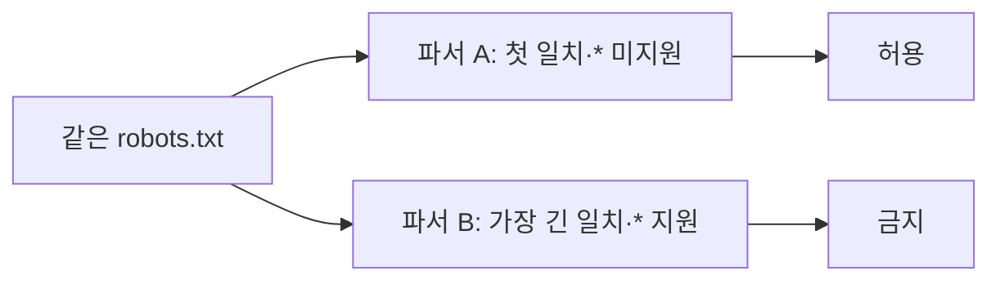
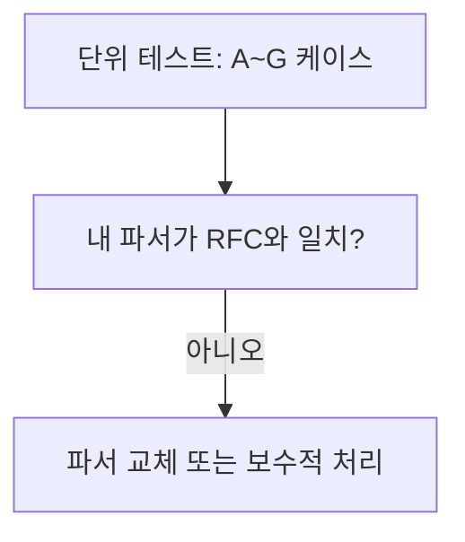

# robots 파서 해석 차이

> 같은 robots.txt라도 **어떤 파서·어떤 버전을 쓰느냐에 따라 "허용/금지" 판정이 달라질 수 있다.** 크롤러를 만드는 쪽은 사용하는 파서가 RFC 9309를 어디까지 따르는지 직접 시험해야 한다.

## 쉽게 말하면
같은 교통 표지판을 운전자마다 다르게 읽으면 사고가 난다. 표지판(robots.txt)은 하나인데 읽는 사람(파서)이 규칙을 다르게 알고 있으면 같은 길에 어떤 차는 들어가고 어떤 차는 못 들어간다.

## 자세히
- 직접 실행(2026-11-27, 파이썬 표준 `urllib.robotparser`, `User-agent: *` 규칙, 같은 코드로 두 버전 비교). `can_fetch` 결과:
  | 시험 | RFC 9309 기대 | 파이썬 3.11.18 | 파이썬 3.13.18 |
  |---|---|---|---|
  | A: `Allow /docs` + `Disallow /docs/private`, 주소 `/docs/private/a` | 금지(더 긴 일치) | **True(허용)** | False |
  | B: `Disallow /docs` + `Allow /docs/public`, 주소 `/docs/public/a` | 허용 | **False(금지)** | True |
  | C: 동률 `Allow /p`가 먼저, `Disallow /p` | Allow 권고 | True | True |
  | D: 동률 `Disallow /p`가 먼저, `Allow /p` | Allow 권고 | **False** | True |
  | E: `Disallow /*.pdf`, 주소 `/files/a.pdf` | 금지(`*` 지원) | **True(허용)** | False |
  | F: `Disallow /*.pdf$`, 주소 `/files/a.pdf?x=1` | 허용(`$`: 끝이 아님) | True | True |
  | G: `Disallow /Private`, 주소 `/private` | 허용(대소문자 구분) | True | True |
- 읽는 법: **3.11.18은 줄 순서대로 첫 일치를 따르고 `*`를 지원하지 않는** 결과를 냈고(A·B·D·E가 RFC와 다름), 3.13.18은 같은 시험을 RFC 기대와 일치하게 처리했다. 어느 버전부터 바뀌었는지는 이번에 확인하지 못했다(버전별 변경 기록 미열람).
- 파서 차이가 생기는 지점(RFC 9309 기준 점검 항목): ① 가장 구체적인(긴) 일치 우선([가장 긴 일치 규칙](#robots-longest-match)) ② `*`·`$` 지원 ③ 대소문자 구분 ④ 파일 크기 상한(크롤러는 최소 500KiB까지 파싱해야 함) ⑤ 리다이렉트(최소 5회까지 따라가기) ⑥ 4xx(없음으로 간주, 접근 가능)와 5xx(완전 금지로 간주)의 구분([robots.txt 상태별 동작](#robots-unavailable-status)) ⑦ 캐시(24시간 초과 사용 지양, 접근 불가일 때 예외).
- 실무(제안): 데이터 수집기는 ① 파서 버전을 고정하고([의존성 버전 고정](#pin-dependency-versions)) ② 위 표 같은 시험 케이스를 단위 테스트로 두며 ③ 의심되면 보수적으로 **금지**로 처리한다. 사이트 운영자는 **구체적이고 겹치지 않는 규칙**을 쓰고 대표 파서 2~3개로 검증한다.
- 한계: 이 비교는 표준 라이브러리 두 버전만 대상이다. 다른 파서(Google의 오픈소스 파서 등)와의 차이는 확인하지 않았다.

## 그림으로 보기



## 예시
```python
import urllib.robotparser as rp
p = rp.RobotFileParser(); p.parse(open("robots.txt").read().splitlines())
p.can_fetch("MyBot", "https://x.com/docs/private/a")
```
- 교육: "표준이 있어도 구현이 다르다"는 사례. 두 파이썬 버전 결과를 표로 비교하는 실습.

## 헷갈리는 것과 비교
| 개념 | 차이 |
|---|---|
| RFC 9309 | 표준 규칙 |
| 파서 구현 | 표준의 일부만 지원할 수 있음 |
| 사이트 운영자 의도 | 사이트가 원하는 접근 정책(파서와 어긋날 수 있음) |

## 더 읽을거리
- [RFC 9309: Robots Exclusion Protocol](https://www.rfc-editor.org/rfc/rfc9309.html) — 규칙 전체(읽음).
- 직접 실행: 파이썬 3.11.18·3.13.18 robotparser 시험 7건.
