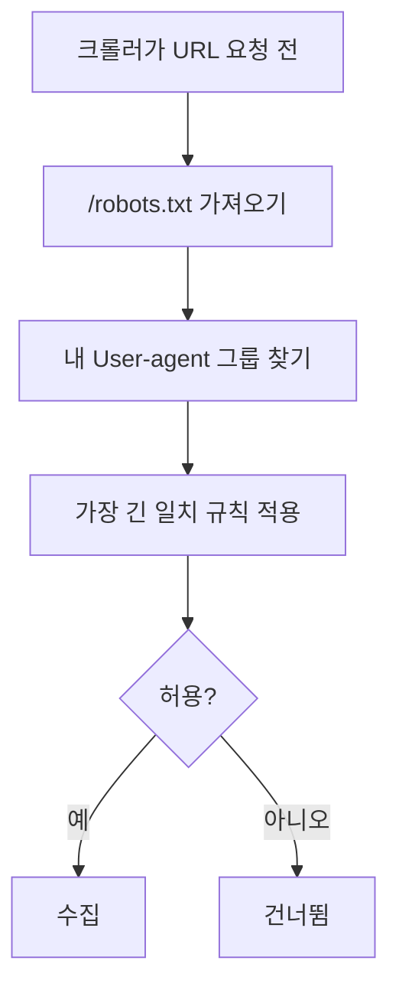
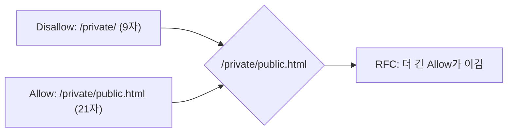

# robots.txt 기본

> 웹사이트가 크롤러에게 **"어느 경로를 가져가도 되는지"를 알리는 텍스트 파일**(사이트 최상위 `/robots.txt`)이다. 강제력은 없는 약속이지만 Common Crawl 같은 크롤러는 지키며, 해석 규칙은 RFC 9309에 정리돼 있다.

## 쉽게 말하면
건물 입구 안내판이다. "방문자 A는 3층 출입 금지, 단 3층 휴게실은 가능"처럼 적혀 있고, 예의 바른 방문자는 따른다. 하지만 문을 잠그는 장치는 아니다.

## 자세히
(RFC 9309 본문을 직접 읽고, 파이썬 `urllib.robotparser`로 직접 실행)
- 구성: `User-agent:`로 대상 크롤러 그룹을 정하고 `Allow:`/`Disallow:` 경로 규칙을 적는다. 크롤러는 자기 제품 이름(예: `CCBot`)과 **대소문자 무시**로 맞는 그룹을 찾아 그 규칙만 따른다. 해당 그룹이 없으면 `*` 그룹을 쓴다.
- 규칙 해석(RFC 9309): 경로 매칭은 대소문자를 구분(SHOULD)하고 **가장 구체적인(가장 긴) 일치 규칙이 이긴다.** `Allow`와 `Disallow`가 같은 길이면 `Allow`가 우선(SHOULD). 일치 규칙이 없으면 허용.
- 파일 상태: 파일이 **없음(4xx)**이면 크롤러가 모든 자원에 접근해도 된다(MAY). 서버 오류로 접근 불가인 경우는 별도 규정이 있다. 최소 **500KiB**까지는 파싱해야 한다(MUST).
- 직접 실행(파이썬 3.13 표준 라이브러리): 파일에 `CCBot`에 `Disallow: /private/`와 `Allow: /private/public.html`을 순서대로 적고 `*`에 `Disallow: /tmp`, `Crawl-delay: 5`를 넣어 시험했다.
  - `CCBot /private/a.html` → 거부, `CCBot /index.html` → 허용, `OtherBot /tmp/x` → 거부, `OtherBot /private/a.html` → 허용
  - `ccbot`(소문자)도 같은 그룹 적용 → 거부
  - **`CCBot /private/public.html` → 거부**: RFC의 "가장 긴 일치" 규칙대로면 `Allow: /private/public.html`이 더 구체적이라 **허용**이어야 하지만, 이 파서는 파일 순서상 먼저 나온 `Disallow`를 적용했다. 파서마다 해석이 다를 수 있으므로 중요한 규칙은 크롤러가 실제로 쓰는 파서로 검증해야 한다.
  - `Crawl-delay`: `OtherBot`은 5, `CCBot`은 None(RFC 9309에는 정의되지 않은 비표준 지시어).
- 한계: robots.txt는 접근 통제나 보안 수단이 아니라 협조를 요청하는 규약이다. AI 학습용 크롤러 차단에도 쓰지만 이미 수집된 데이터에는 소급되지 않는다([옵트아웃의 한계](#opt-out-limits-existing-data)).

## 그림으로 보기



## 예시
```
User-agent: CCBot
Disallow: /

User-agent: *
Allow: /
```
- 학습용 크롤러(예: CCBot)만 차단하고 다른 봇은 허용하는 설정([CCBot 옵트아웃](#ccbot-opt-out)).
- 교육: "웹의 예의 규약"으로서의 robots.txt와 그 한계.

## 헷갈리는 것과 비교
| 개념 | 차이 |
|---|---|
| robots.txt | 크롤링 허용 범위 안내(권고) |
| 인증·방화벽 | 실제 접근 차단 |
| noindex 메타 태그 | 검색 색인 제외, 크롤링 자체와 별개 |
| [TDM 유보](#tdm-reservation-protocol) | 데이터 마이닝 권리 유보 신호 |

## 더 읽을거리
- [RFC 9309: Robots Exclusion Protocol](https://www.rfc-editor.org/rfc/rfc9309.txt) — 그룹 매칭·가장 긴 일치·500KiB(본문 읽음).
