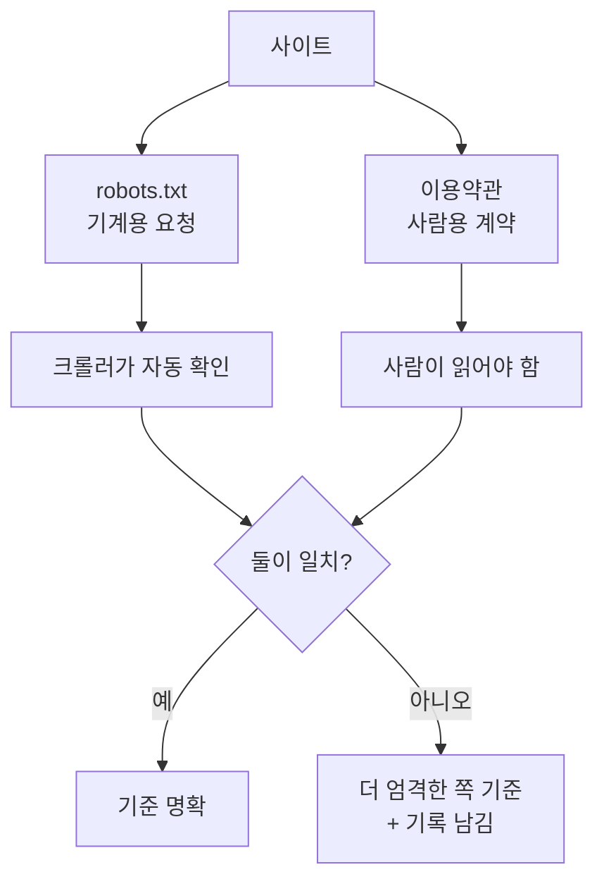
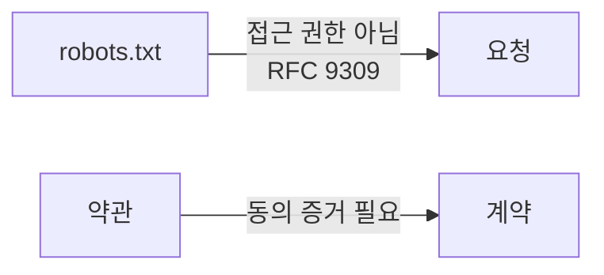

# robots.txt와 이용약관 불일치

> 사이트의 robots.txt(기계가 읽는 크롤링 요청)와 이용약관(사람이 읽는 계약 조항)이 서로 다른 말을 하거나, 둘 다 법적 효력이 불분명해서 "이 데이터를 AI 학습에 써도 되는가"를 판단하기 어려운 상황이다.

## 쉽게 말하면
가게 문 앞에 "관계자 외 출입 금지" 푯말(robots.txt)이 있고, 계산대 뒤에 깨알 같은 영업 규칙(이용약관)이 붙어 있다고 하자. 푯말은 문이 열려 있어도 "들어오지 말라"는 부탁이고, 규칙은 들어와 거래한 사람에게 묻는 계약이다. 푯말은 무시해도 처벌이 어렵지만, 규칙은 "읽었다고 볼 수 있느냐"가 쟁점이다. 두 문서가 서로 다른 말을 하면 어느 쪽을 따라야 할지 모호하다.

## 자세히
- **robots.txt의 성격**: RFC 9309(Robots Exclusion Protocol, 직접 열어 확인)는 규칙이 크롤러에게 "준수를 요청하는" 것이며 "접근 권한 부여(access authorization)의 한 형태가 아니다"라고 쓴다. 보안 수단이 아니고, 경로를 적으면 오히려 노출된다고 경고한다. 실제 접근 통제는 HTTP 인증 같은 방법으로 하라고 안내한다.
- **이용약관의 성격**: 계약이므로 구속력이 있을 수 있으나, 사용자가 동의했다는 증거(로그인·체크박스 같은 clickwrap)가 있어야 강하다. 페이지 아래 링크만 있는 browsewrap은 고지·동의 여부에 따라 무효로 본 판례도 있다(검색 요약, 로펌 원문은 접근 차단으로 직접 확인 못함).
- **불일치 유형**: ① robots.txt는 허용인데 약관은 스크래핑 금지 ② robots.txt는 특정 봇만 막고 약관은 침묵 ③ robots.txt는 전체 금지인데 약관엔 언급 없음 ④ 서브도메인·제3자 호스팅마다 규칙이 다름. 크롤러는 보통 robots.txt만 자동 확인하므로 약관 위반은 사람이 따로 봐야 한다.
- **학계 주장**: Atkinson(arXiv 2504.00961, 초록 확인)은 약관이 스크래핑·AI 학습을 금지하고 봇이 그래도 수집했다면 실제 고지가 있었으므로 계약 위반 청구가 가능하다고 주장한다. 이는 한 논문의 논거이며 확정된 법리가 아니다.
- **미국 판례 맥락(2차 요약, 확인 필요)**: hiQ v. LinkedIn에서 공개 데이터 스크래핑은 CFAA상 무단 접근이 아니라고 봤지만, 약관 위반(계약) 판단은 별개로 hiQ에 불리했다고 요약된다. robots.txt의 구속력을 다룬 Ziff Davis v. OpenAI의 판단 내용은 이번에 원문을 열지 못했다.
- **실무 원칙**: 법률 자문이 아니다. 수집 시 robots.txt와 약관을 둘 다 기록하고, 더 엄격한 쪽을 기준으로 삼는 보수적 접근이 안전하다([데이터 출처 탐색기](#data-provenance-explorer)).

## 그림으로 보기

## 예시
- 뉴스 사이트 A: robots.txt는 GPTBot 차단, 약관은 "상업적 이용 금지". 둘 다 AI 학습에 부정적이므로 수집 대상에서 제외.
- 커뮤니티 B: robots.txt에는 규칙이 없지만 약관에 "AI 학습 금지"가 있다. 크롤러만 봐서는 통과하지만 약관이 걸린다 → 수집 전 사람이 약관을 확인하는 단계 필요.
- 교육 소재: "허용 여부 판단표"를 만들어 두 문서를 비교하는 실습.

## 헷갈리는 것과 비교
| 개념 | 차이 |
|---|---|
| robots.txt | 크롤러에 대한 요청, 권한 부여 아님 |
| 이용약관 | 계약, 동의 증거에 따라 효력 |
| [AI 크롤러 차단](#ai-crawler-blocking) | 서버 단 차단(UA·IP) |
| [데이터셋 라이선스 체크리스트](#dataset-license-checklist) | 이미 모은 데이터의 사용 조건 확인 |

## 더 읽을거리
- [RFC 9309: Robots Exclusion Protocol](https://www.rfc-editor.org/rfc/rfc9309.html) — robots.txt가 접근 권한이 아니라는 표준 문구(직접 확인).
- [Putting GenAI on Notice (arXiv 2504.00961)](https://arxiv.org/abs/2504.00961) — 약관과 스크래핑의 계약법 논거(초록 확인).
