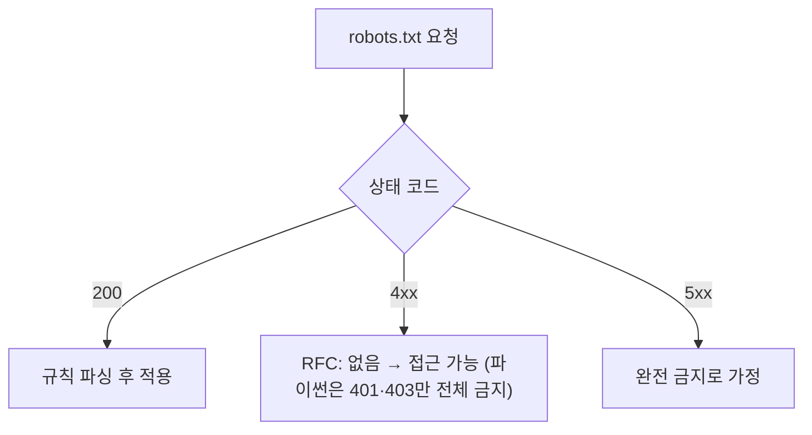

# robots.txt 상태별 동작

> robots.txt를 가져오려 할 때 서버가 돌려주는 HTTP 상태 코드에 따라 **"모두 허용으로 볼지, 모두 금지로 볼지"**가 달라진다. RFC 9309는 4xx(없음)와 5xx(접근 불가)를 구분하고, 파서 구현은 이와 다를 수 있다.

## 쉽게 말하면
출입 안내문을 보러 갔는데 안내문이 없다(4xx)면 "특별한 제한 없음"으로 볼 수 있지만, 사무실 문이 닫혀 안내문을 못 읽었다(5xx)면 안전하게 "들어가지 말자"로 판단하는 것이 합리적이다.

## 자세히
- 규정(RFC 9309 §2.3.1, 2026-11-27 열람):
  - **4xx "unavailable"**(400~499): robots.txt가 없다고 보고 크롤러는 **그 서버의 리소스에 접근할 수 있다**(제한 없음 취급).
  - **5xx "unreachable"**(500~599): 크롤러는 **완전 금지(complete disallow)로 가정해야 한다(MUST)**. 오랫동안(예: 30일) 접근 불가가 이어지면 없는 것으로 보거나 캐시본을 쓸 수 있다.
  - **리다이렉트**: 최소 5회 연속 리다이렉트를 (다른 권한 영역이어도) 따라가야 하며(SHOULD), 5회를 넘으면 접근 불가로 가정할 수 있다(MAY).
  - **크기**: 파싱 상한은 최소 500 KiB여야 한다(MUST). **캐시**: 24시간을 넘겨 쓰지 않는 것이 권장(SHOULD NOT)이며 접근 불가일 때는 예외.
- 직접 실행(지역 가짜 서버가 `/robots.txt`에 코드별 응답, 본문은 `Disallow: /private/`, 파이썬 `urllib.robotparser.read()`; 3.11.18·3.13.18에서 결과 동일):
  | robots.txt 상태 | `/page` | `/private/x` | RFC 기대와 비교 |
  |---|---|---|---|
  | 200(정상) | 허용 | 금지 | 일치 |
  | 401 / 403 | **금지** | 금지 | **RFC와 다름**: RFC는 4xx를 없음(접근 가능)으로 봄 — 파이썬은 401·403을 전체 금지로 처리 |
  | 404 / 410 | 허용 | 허용 | 일치(없음 = 제한 없음) |
  | 500 / 503 | 금지 | 금지 | 일치(접근 불가 = 완전 금지) |
- 해석: 파이썬 표준 파서는 **401·403을 전체 금지**로 보는 보수적 구현이고(사이트가 접근을 막은 것으로 해석), 나머지 4xx는 전체 허용, 5xx는 아무 것도 파싱되지 않아 금지로 나온다. RFC보다 엄격한 방향이라 크롤러 입장에서는 "안전한 쪽"이지만, 의도와 다른 수집 누락이 생길 수 있다.
- 실무(제안): 수집 로그에 robots.txt 상태 코드를 기록하고, 5xx 반복 시 재시도 간격을 늘리며 사람이 확인한다. 403이 로봇 차단(WAF)에서 나온 것인지 정책인지 구분해 본다.
- 한계: 로컬 서버 시험이라 실제 사이트의 리다이렉트·캐시 동작은 확인하지 않았다.

## 그림으로 보기

## 예시
- 신규 사이트가 robots.txt를 아직 만들지 않았다면 404 → 제한 없음(RFC), 일시 서버 장애로 503이면 → 금지로 간주하고 나중에 재시도.
- 교육: 같은 "파일이 없다"도 상태 코드에 따라 해석이 달라진다는 HTTP 읽기 연습.

## 헷갈리는 것과 비교
| 개념 | 차이 |
|---|---|
| 4xx unavailable | 없다 → 제한 없음 |
| 5xx unreachable | 읽을 수 없다 → 금지 가정 |
| [파서 해석 차이](#robots-parser-differences) | 구현마다 위 규칙 적용이 다를 수 있음 |

## 더 읽을거리
- [RFC 9309](https://www.rfc-editor.org/rfc/rfc9309.html) — §2.3.1 접근 결과 처리(읽음).
- 직접 실행: 로컬 서버로 7개 상태 코드 시험.
