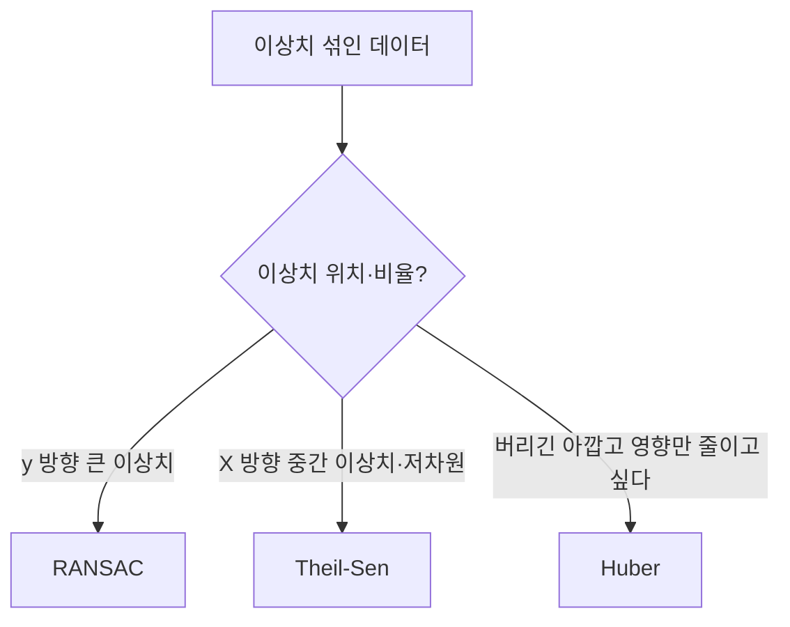

# 강건 회귀 (Robust Regression)

> 이상치(outlier)가 섞여 있어도 적합 결과가 크게 흔들리지 않도록 설계한 회귀 기법 모음이다.

## 쉽게 말하면
평균은 한 명의 억만장자가 들어오면 확 달라지지만 중앙값은 거의 안 변한다. 강건 회귀는 회귀에서 "중앙값 같은 태도"를 취하는 방법이다.

## 자세히
scikit-learn 문서 1.1.14절(2026-11 확인):
| 방법 | 방식 | 특징 |
|---|---|---|
| [RANSAC](#ransac) | 무작위 부분집합 적합 후 inlier 최다 모델 | y 방향 큰 이상치에 최선, 큰 표본에 잘 확장, 비결정적 |
| Theil-Sen | 공간 중앙값(다차원 중앙값의 일반화) | 단변량 선형 회귀에서 붕괴점 약 **29.3%**, X 방향 중간 이상치에 강함, 차원이 커지면 OLS 수준으로 약화, 조합 수 때문에 큰 문제에 비쌈 |
| HuberRegressor | inlier엔 제곱 손실, 이상치엔 선형 손실(`epsilon`) | 이상치를 버리지 않고 **가중을 낮춤**, `epsilon=1.35`가 95% 통계 효율 |
- 문서의 경고: 고차원에서 강건 적합은 매우 어렵고 이 모델들이 잘 작동하지 않을 수 있다. 붕괴점은 "얼마나 많은 오염 데이터를 견디나"의 척도.
- `HuberRegressor`는 `SGDRegressor(loss="huber")`보다 스케일 불변이고 작은 데이터에 효율적.
- 이상치가 실제 의미 있는 신호(사기 거래 등)일 수 있으므로 무작정 약화하지 말고 원인을 먼저 본다(일반 조언).

## 그림으로 보기


## 예시
```python
from sklearn.linear_model import RANSACRegressor, TheilSenRegressor, HuberRegressor
for est in (RANSACRegressor(random_state=0), TheilSenRegressor(random_state=0), HuberRegressor(epsilon=1.35)):
    est.fit(X, y)
```

## 헷갈리는 것과 비교
| 개념 | 차이 |
|---|---|
| 강건 회귀 | 모델이 이상치에 둔감 |
| [이상치 처리](#outlier-handling) | 이상치를 찾아 제거·보정 |
| [Huber 손실](#huber-loss) | 강건 회귀의 대표 손실 함수 |

## 더 읽을거리
- [scikit-learn Linear Models §1.1.14](https://scikit-learn.org/stable/modules/linear_model.html#robustness-regression-outliers-and-modeling-errors) — 세 방법 비교.
