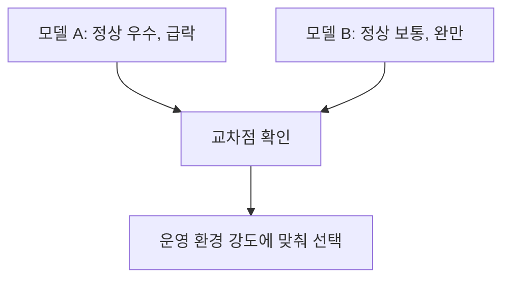

# 견고성 곡선

> **견고성 곡선(robustness curve)**은 입력 변형의 강도(가로축)에 따라 모델의 성능(세로축)이 어떻게 변하는지 그린 그래프다. "정상 점수"만으로는 안 보이는 **임계점과 열화 속도**를 보여 준다.

## 쉽게 말하면
자동차 안전 시험에서 충돌 속도를 20→40→60km/h로 올리며 파손 정도를 기록한다. 속도별 파손을 이어 그린 선이 견고성 곡선이다. 어느 속도부터 급격히 위험해지는지, 두 차 중 어느 쪽이 더 완만한지 한눈에 보인다.

## 자세히
(Hendrycks & Dietterich, 「Benchmarking Neural Network Robustness to Common Corruptions and Perturbations」(ICLR 2019, arXiv 1903.12261) PDF 본문을 직접 읽어 확인.)
- **데이터 구조(논문)**: ImageNet-C는 **15개 손상 유형 × 5단계 강도**(총 75종)다. 손상은 노이즈·블러·날씨·디지털 4범주로 나뉜다. 곡선의 x축 = 강도 s=1~5, y축 = 그 단계의 오류율 E_{s,c}.
- **한 숫자로 요약**: 손상 c의 Corruption Error는 5단계 오류를 합산해 AlexNet의 합산값으로 나눈 것이고, 15개를 평균하면 mCE다. 곡선을 한 숫자로 압축한 값이다.
- **Relative mCE의 의미(논문)**: 정상 오류 대비 얼마나 **더 나빠지는지**(`Σ(E_s,c − E_clean)`)를 AlexNet과 비교한다. 곡선의 "기울기"에 해당한다. 논문은 정상 오류가 낮지만 손상에서 급락하는 모델이, 손상에 완만히 열화하는 모델보다 mCE가 낮을 수 있다고 지적하며 이를 보완하려 Relative mCE를 도입했다.
- **논문 발견**: 구조가 발전할수록 mCE는 좋아졌지만, 이는 대부분 **정확도 향상 때문**이었다. Relative mCE는 AlexNet보다 나빠진 모델이 많아 **AlexNet→ResNet 구간에서 견고성 자체는 거의 안 변했다**고 결론낸다. 예: ResNet-50 → DenseNet-121로 mCE 76.7% → 73.4%, Relative mCE 105.0% → 92.8%.
- **곡선 읽는 법(해석)**: 완만한 하강=점진적 열화, 특정 단계 급락=임계점, 두 선이 교차=강도에 따라 유리한 모델이 다름. 강도 간격은 사람이 정한 것이어서 유형 간 "3단계"가 같은 난이도라는 보장은 없다. → [변형 강도 단계](#perturbation-severity-levels)

## 그림으로 보기

## 예시
- 공장 카메라 모델: 블러 강도 1~5에서 오류율을 그려, 현장 카메라 수준(강도 2~3)에서 어느 모델이 유리한지 고른다.
- 교육 활동: 같은 질문에 오타 0·1·3·5개를 넣고 정답률 곡선을 직접 그려 본다.

## 헷갈리는 것과 비교
| 개념 | 차이 |
|---|---|
| 견고성 곡선 | 강도별 성능 전체 모양 |
| mCE | 곡선을 AlexNet 기준 한 숫자로 압축 |
| Relative mCE | 정상 대비 하락폭(기울기) 중심 |
| [섭동 최악 사례 정확도](#worst-case-over-perturbations) | 여러 변형 중 최저값만 보는 점수 |

## 더 읽을거리
- [Benchmarking Neural Network Robustness to Common Corruptions and Perturbations (arXiv 1903.12261)](https://arxiv.org/abs/1903.12261) — ImageNet-C, mCE·Relative mCE 정의와 결과(PDF 직접 확인).
