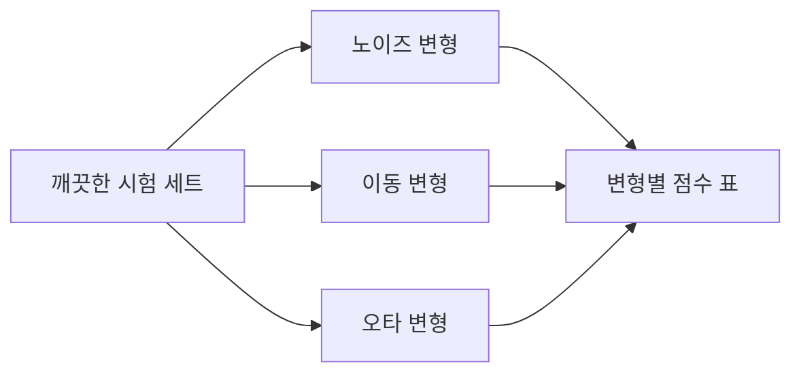
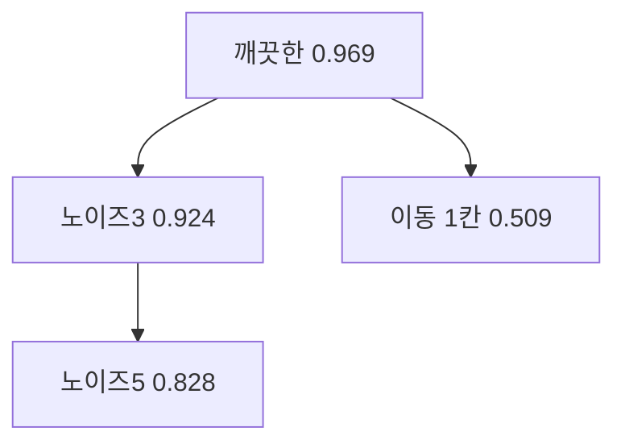

# 견고성 평가셋

> 견고성 평가셋은 깨끗한 시험 데이터에 노이즈·오타·회전·이동 같은 현실적인 변형을 가해 따로 만든 평가 세트다. 깨끗한 데이터 점수만으로는 보이지 않는 "조금만 달라져도 무너지는" 약점을 드러낸다.

## 쉽게 말하면
조용한 교실에서만 시험을 보면 학생의 실력은 알지만, 옆에서 공사 소음이 나는 상황에서 얼마나 버티는지는 모른다. 소음이 낀 시험지를 따로 만들어 보면 평소 점수와 실전 점수의 차이가 보인다.

## 자세히
- **대표 사례(Hendrycks & Dietterich, ImageNet-C·P, arXiv 1903.12261 초록, 열람)**: ImageNet-C는 이미지 분류기의 손상(corruption) 견고성 연구를 표준화했고, ImageNet-P는 흔한 변형에 대한 반응을 시험한다. 최악의 적대적 공격이 아니라 흔한 손상·변형을 다룬다고 강조한다. AlexNet 계열에서 ResNet 계열로 가도 상대적 손상 견고성은 거의 변하지 않았다고 보고한다. 구체적 손상 종류는 초록에 없어 확인하지 못했다.
- **직접 해 본 실험(숫자 손글씨 랜덤 포레스트, 시험 719개)**: 깨끗한 시험 0.969, 노이즈(표준편차 3) 0.924, 노이즈(표준편차 5) 0.828, 이미지를 한 칸 옮긴 시험 0.509였다. 같은 모델인데 깨끗한 점수만 보면 0.97이지만, 한 칸 이동에서는 거의 동전 던지기 수준이었다. 변형별 점수 표가 있어야 약점이 보인다.
- **만드는 법(해석)**: ① 실제 서비스에서 일어날 변형 목록(오타, 스캔 노이즈, 조명, 약어) ② 변형을 코드로 재현해 시험 세트마다 고정 시드로 생성 ③ 변형 강도를 여러 단계로 ④ 라벨이 변하지 않는 변형만 쓴다([TTA](#test-time-augmentation)의 라벨 보존 변형과 같은 기준) ⑤ 깨끗한 점수와 변형별 점수를 한 표로 보고.
- **주의**: 변형을 학습에도 썼다면 그 평가는 견고성이 아니라 학습 내용 점검이다. 변형 평가셋은 학습에서 쓰지 않은 변형으로 만들어야 한다.
- **언어 모델에서도(해석)**: 오타·어순 변경·표현 바꾸기(의역) 평가셋으로 같은 아이디어를 쓴다.

## 그림으로 보기

## 예시
- 고객 문의 분류기: 오타를 5% 넣은 시험, 존댓말을 반말로 바꾼 시험을 별도로 만들어 정확도 하락폭을 보고한다.
- 교육 활용: 깨끗한 점수와 변형 점수를 나란히 놓고 "점수 하나만 보고하는 것의 위험"을 토론한다.

## 헷갈리는 것과 비교
| 개념 | 차이 |
| --- | --- |
| 견고성 평가셋 | 변형에 대한 성능 측정 |
| 데이터 증강 | 학습 데이터를 늘리는 방법 |
| [테스트 시 증강(TTA)](#test-time-augmentation) | 예측 때 변형을 모아 결합 |
| 적대적 평가 | 최악의 공격을 가정 |

## 더 읽을거리
- [Benchmarking Neural Network Robustness to Common Corruptions and Perturbations (arXiv 1903.12261)](https://arxiv.org/abs/1903.12261) — ImageNet-C·P
