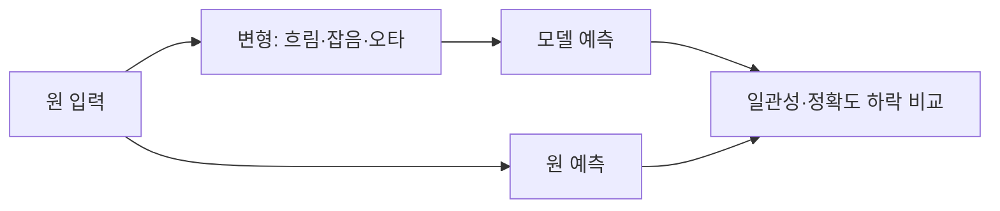
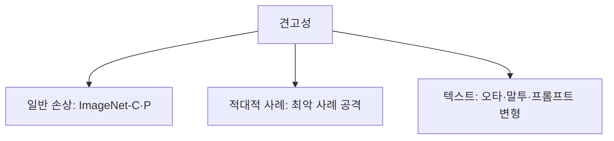

# 견고성 테스트

> 입력이 조금 바뀌어도(흐려짐·잡음·오타·미세한 조작) 모델의 답이 안정적인지 확인하는 평가다. 흔히 일어나는 변형(일반 손상)에 대한 견고성과, 일부러 만든 최악의 변형(적대적 공격)에 대한 견고성은 서로 다른 시험이다.

## 쉽게 말하면
자동차 충돌 테스트와 비슷하다. 평소 도로의 노면 충격(일반 손상)을 견디는지, 일부러 가장 약한 지점을 노린 공격(적대적 사례)에도 버티는지를 따로 시험한다. 둘은 통과 기준도 대응 방법도 다르다.

## 자세히
(두 논문의 초록을 직접 확인.)
- **일반 손상·섭동 견고성 — ImageNet-C·ImageNet-P(Hendrycks·Dietterich, ICLR 2019, arXiv:1903.12261, 초록 확인)**: ImageNet-C는 이미지 손상에 대한 분류기 견고성 평가를 표준화·확장했고 안전이 중요한 용도에 적합한 분류기를 가려내는 데 도움이 된다고 한다. ImageNet-P는 점진적인 흔한 섭동에 대한 견고성을 시험한다. 저자들은 이 벤치마크가 **최악 사례 적대적 섭동이 아니라 흔한 손상·섭동**을 평가한다고 밝힌다. 주요 발견: AlexNet에서 ResNet으로 구조가 발전해도 **상대적 손상 견고성은 거의 변하지 않았다**. 견고성을 높이는 방법들을 찾았고, 우회된 적대적 방어도 일반 섭동에는 상당한 견고성을 준다고 보고한다.
- **적대적 사례 — Goodfellow·Shlens·Szegedy(arXiv:1412.6572, 초록 확인)**: 신경망이 적대적 섭동에 취약한 이유를 비선형성이나 과적합이 아니라 주로 **선형적 성질**로 설명하는 주장을 한다. 이 관점은 적대적 사례가 구조·학습 세트를 넘어 일반화되는 이유도 설명한다고 한다. 간단하고 빠른 적대적 사례 생성법이 이 관점에서 나오며, 이를 이용한 적대적 학습으로 MNIST의 maxout 네트워크 시험 오류를 줄였다고 한다(초록은 방법의 이름·세부를 적지 않는다).
- **텍스트·LLM 쪽**: 오타·말투 변형·프롬프트 변형에 대한 안정성을 시험하는 방식이 쓰인다. NLP 행동 테스트 도구는 [데이터 슬라이싱](#data-slicing)에서 다룬 CheckList가 있다. LLM 탈옥·프롬프트 주입 같은 공격 평가는 안전 가지의 노드에서 다룬다.
- **시험 설계(제안)**: ① 서비스에서 실제로 생길 변형 목록(해상도·조명·오타·전사 오류) ② 변형 강도를 여러 단계로 ③ 정답이 안 바뀌는 변형만([라벨 보존 변환](#label-preserving-transform)) ④ 변형 전후 예측 일관성과 정확도 하락을 같이 보고.
- **데이터 증강과의 관계**: 학습 때 같은 변형을 증강으로 쓰면 견고성이 오를 수 있지만 시험은 학습에 쓰지 않은 변형으로 해야 한다(제안, [데이터 증강](#data-augmentation)).

## 그림으로 보기

## 예시
- 영수증 OCR 분류 모델: 조명 어둡게·기울임·압축 노이즈 5단계로 변형한 시험 세트를 만들어 정확도 하락 곡선을 그린다.
- 상담 챗봇: 같은 문의를 오타·반말·이모지 섞기 변형으로 바꿔 분류 결과가 바뀌는 비율을 센다.

## 헷갈리는 것과 비교
| 개념 | 차이 |
|---|---|
| 일반 손상 견고성 | 흔한 변형에 안정적인가 |
| 적대적 견고성 | 최악 사례 공격에도 버티는가 |
| [분포 밖 평가](#ood-evaluation) | 환경 자체가 달라진 데이터 |
| [데이터 증강](#data-augmentation) | 학습 단계의 변형 사용 |

## 더 읽을거리
- [Benchmarking Neural Network Robustness to Common Corruptions and Perturbations (arXiv:1903.12261)](https://arxiv.org/abs/1903.12261) — ImageNet-C·P(초록 직접 확인).
- [Explaining and Harnessing Adversarial Examples (arXiv:1412.6572)](https://arxiv.org/abs/1412.6572) — 적대적 사례와 선형성 주장(초록 직접 확인).
