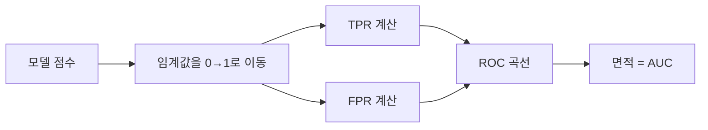

# ROC·AUC

> ROC 곡선은 임계값을 바꿔 가며 거짓 양성률(FPR)과 진짜 양성률(TPR)을 그린 곡선이고, AUC는 그 곡선 아래 면적으로 분류기의 임계값 무관 성능을 한 숫자로 요약한다.

## 쉽게 말하면
문 지키는 경비원의 엄격함 다이얼을 0에서 100까지 돌려 가며 "진짜 도둑을 잡은 비율"과 "무고한 사람을 막은 비율"을 기록한 그래프다. 다이얼 위치와 상관없이 전반적으로 얼마나 구분을 잘하는지 면적 하나로 말한다.

## 자세히
scikit-learn 문서(1.9.1, 2026-11 확인):
- `roc_curve`는 TPR(민감도)을 FPR(1−특이도)에 대해 임계값별로 그린다. 입력은 참 이진 라벨과 **연속 점수**(확률·결정값).
- `roc_auc_score`: 곡선 아래 면적(AUROC). 이진은 `predict_proba(X)[:, 1]` 또는 `decision_function(X)`를 넣는다. 예: 유방암 데이터 0.99.
- **다중 클래스**: `multiclass='ovo'`(쌍별 평균, macro는 Hand & Till 2001 지표)나 `'ovr'`(한 클래스 vs 나머지, macro·weighted·micro 지원).
- `max_fpr`: 높은 FPR을 허용할 수 없는 응용에서 일정 FPR까지만 요약.
- 해석(일반): 0.5는 무작위, 1.0은 완벽 구분. 확률의 교정(calibration) 여부는 반영하지 않는다.
- 극단적 불균형에서는 FPR이 작게 유지되어 AUC가 낙관적으로 보일 수 있으므로 [정밀도-재현율](#precision-recall-tradeoff) 곡선도 함께 본다(일반 조언).

## 그림으로 보기


## 예시
```python
from sklearn.metrics import roc_auc_score
roc_auc_score(y_true, clf.predict_proba(X)[:, 1])
```
두 모델의 AUC를 비교해 임계값 결정 전 순위 매기는 능력을 평가.

## 헷갈리는 것과 비교
| 개념 | 차이 |
|---|---|
| ROC-AUC | TPR-FPR, 임계값 무관 요약 |
| PR 곡선·AP | 정밀도-재현율, 불균형에 민감 |
| 정확도 | 임계값 하나에서의 맞힌 비율 |
| [혼동 행렬](#confusion-matrix) | 임계값 하나에서의 결과표 |

## 더 읽을거리
- [scikit-learn: Model evaluation — ROC](https://scikit-learn.org/stable/modules/model_evaluation.html) — roc_curve·roc_auc_score 다중 클래스 옵션.
