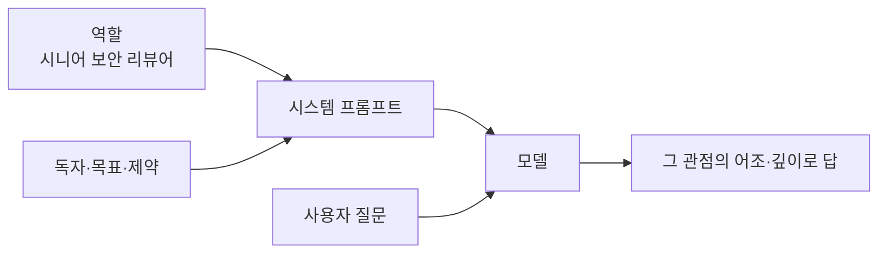

# 역할 부여 프롬프트

> 시스템 프롬프트나 첫 문장에 "너는 ○○ 전문가야"처럼 역할을 정해, 모델의 관점·어조·깊이를 그 용도에 맞게 모으는 기법이다.

## 쉽게 말하면
같은 질문도 의사, 변호사, 초등 교사에게 물으면 답의 방식이 다르다. 역할을 주면 모델이 "누구의 목소리로 답할지"를 정하고, 그 분야의 용어와 우선순위를 더 잘 꺼낸다.

## 자세히
Anthropic 공식 문서(2026-11 확인): 시스템 프롬프트에 역할을 두면 Claude의 행동과 어조가 용도에 집중되며, **한 문장만으로도 차이**가 난다(예: "You are a helpful coding assistant specializing in Python.").
- 역할만 쓰지 말고 **대상 독자·목표·제약**을 함께 준다. "전문가"라는 말보다 "초보 신입에게 설명하는 시니어 개발자"가 구체적이다.
- 역할은 정확도를 마법처럼 올리지 않는다. 사실 확인·근거 요구·예시는 별도로 필요하다. 주장: 역할만으로 성능이 크게 오른다는 믿음은 과장되기 쉽다.
- 사실이 아닌 권위("너는 의사다")로 위험한 조언을 하게 만드는 용도는 안전 문제를 만든다.
- 자리: API에서는 `system` 파라미터, 채팅에서는 첫 메시지.

## 그림으로 보기


## 예시
```
system: 너는 10년차 데이터 분석가다. 비전공 임원이 읽을 보고서를 쓴다. 전문용어는 한 줄로 풀어 쓴다.
user: 지난달 이탈률 상승 원인을 정리해 줘.
```
```python
client.messages.create(model="claude-sonnet-5-5", max_tokens=1024,
  system="You are a helpful coding assistant specializing in Python.",
  messages=[{"role":"user","content":"딕셔너리 리스트를 키로 정렬하려면?"}])
```

## 헷갈리는 것과 비교
| 개념 | 차이 |
|---|---|
| 역할 부여 | 관점·어조를 정함 |
| [few-shot](#few-shot-prompting) | 견본으로 형식을 정함 |
| [XML 태그](#xml-tag-prompting) | 내용 구분 |
| [프롬프트 엔지니어링](#prompt-engineering) | 이 셋을 포함한 상위 개념 |

## 더 읽을거리
- [Prompting best practices — Give Claude a role](https://platform.claude.com/docs/en/build-with-claude/prompt-engineering/claude-prompting-best-practices) — 한 문장 역할의 효과.
