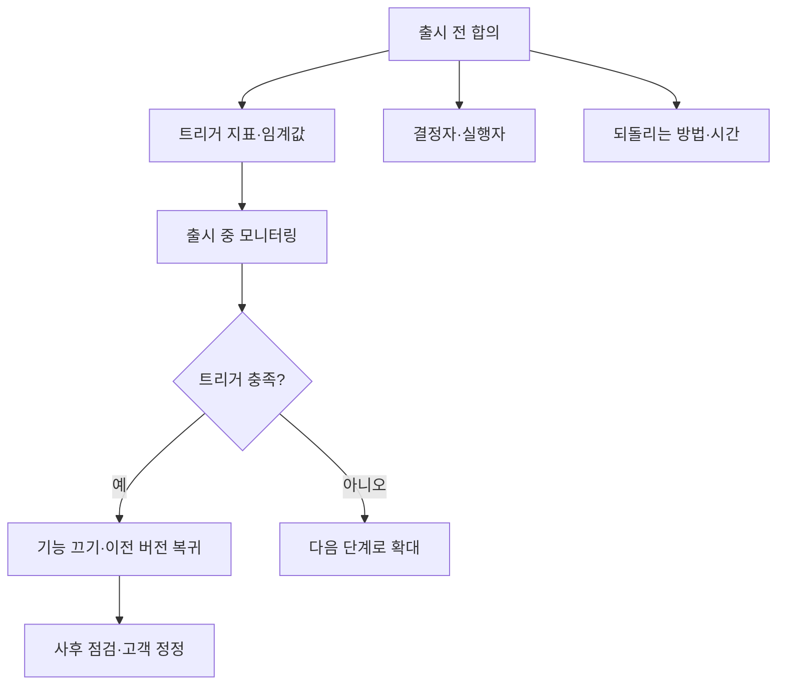

# 롤백 계획

> AI 기능을 출시하기 **전에** "어떤 숫자가 어떻게 되면 누가 되돌린다"를 미리 합의해 문서로 두는 것. 문제가 생긴 뒤 회의로 정하면 늦고, 판단이 흔들린다.

## 쉽게 말하면
비행 전 점검표에 "이 경고등이 켜지면 회항한다"를 미리 적어 두는 것이다. 하늘 위에서 처음 토론하면 이미 늦는다.

## 자세히
출처: Google SRE Workbook "Canarying Releases"(본문 확인, 2026-11-18)와 [섀도 모드](#shadow-mode) 노드의 Tian Pan 글. AI 상담 출시에 대한 구체 항목은 이 자료들을 바탕으로 한 제안이다.
- **카나리의 전제(SRE)**: 카나리는 변경의 일부·시간 제한 배포와 그 결과 평가이고, 나머지(대조군)와 비교한다. 카나리의 오류율이 대조군과 크게 다르면 나쁘다고 보고 **중단·롤백·사람에게 상향** 중 하나를 한다. 비슷하면 진행한다. 챕터는 "얼마나 다르면 나쁜가"의 숫자를 주지 않는다.
- **상대+절대**: 두 집단이 함께 나빠질 수 있으므로 SLO 같은 절대 기준도 함께 본다.
- **작게 시작**: 카나리가 오류 예산에 미치는 영향은 받는 트래픽 비율에 비례한다. 예: 카나리 5%에서 오류율 20%면 전체 약 1%. 다만 대표성을 가질 만큼은 커야 한다.
- **한 번에 하나**: 카나리를 겹쳐 돌리면 신호가 오염된다. 소요 시간은 출시 주기에 따라 다르다.
- **지표 선택**: 사용자가 느끼는 문제를 잘 보여 주는 지표 위주로 많아야 십여 개. 지표 창은 카나리 시간보다 길면 안 된다. 출시 전후 비교는 시간대·요일 효과에 오염되기 쉽다.
- **AI 출시용 항목(제안)**: ①롤백 **트리거**(정답률 하한, 위험 답변 건수, 이관율 폭증, 고객 불만, 규정 위반) ②**누가** 결정·실행하는가(단일 담당자 + 대체자) ③**어떻게** 되돌리나(기능 플래그 끄기, 이전 모델·프롬프트로 전환, 상담사 수동 전환) ④**얼마 안에**(분·시간) ⑤되돌린 뒤 데이터·고객 대응(이미 나간 답변 정정) ⑥사후 점검.
- **예시 임계값(글의 예)**: p99 지연 40% 초과, 거절률 5% 초과, 건당 비용 예산 초과 시 자동 롤백을 권하는 서술이 있다(Tian Pan 블로그 예시, 표준 아님).
- **기능과 배포 분리**: SRE 챕터는 기능 출시를 배포와 분리해 플래그로 켜고 끄라고 한다. 되돌리기가 쉬워진다.
- **한계**: 임계값은 서비스마다 달라 사전에 과거 데이터로 정하고 주기적으로 재검토해야 한다.

## 그림으로 보기

## 예시
| 항목 | 예시(설명용) |
|---|---|
| 트리거 | 위험 답변 1건 이상 즉시, 정확도 표본이 하한 미만 2일 연속 |
| 결정자 | 상담 운영 책임자(대체: 품질 책임자) |
| 방법 | 기능 플래그 OFF → 상담사 직접 응대 |
| 목표 시간 | 30분 이내 |
교육 활용: 출시 계획서의 "되돌리기 조건" 칸을 직접 채워 보는 실습.

## 헷갈리는 것과 비교
| 개념 | 차이 |
|---|---|
| 롤백 계획 | 되돌리는 조건·담당·방법의 사전 합의 |
| [섀도 모드](#shadow-mode) | 사용자 영향 없이 먼저 시험 |
| [단계 전환 기준](#rollout-gates) | 다음 단계로 확대하는 조건 |
| 사고 대응 | 이미 난 사고를 수습, 롤백은 그중 한 수단 |

## 더 읽을거리
- [Google SRE Workbook: Canarying Releases](https://sre.google/workbook/canarying-releases/) — 카나리·대조군·롤백 판단·지표 선택
- [Tian Pan: LLM 점진적 출시](https://tianpan.co/blog/2026/04/09/llm-gradual-rollout-shadow-canary-ab-testing) — 임계값·자동 롤백 예시
