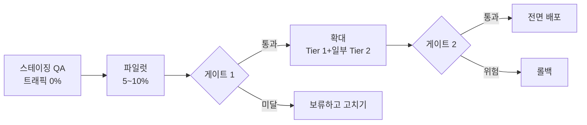

# 단계 전환 기준

> AI 응대를 5% 파일럿 → 확대 → 전면으로 넓힐 때, 다음 단계로 가도 되는지 판단하는 숫자 조건. 시작 전에 숫자로 정해 두지 않으면 "통과 못 하는 기준"이 되지 못한다.

## 쉽게 말하면
신제품 시식 행사와 같다. 먼저 직원끼리 맛보고, 일부 손님에게 내고, 반응이 기준 이상일 때만 전 매장으로 간다. 기준은 시식 전에 정해 둬야 결과를 보고 기준을 바꾸는 일이 없다.

## 자세히
- **구조(Fini 용어집)**: 3~5단계, 6~12주. 단계는 대상(내부→베타→전체), 트래픽 비율(보통 5~10%부터), 문의 유형, 채널(채팅→이메일→음성), 자율성(초안→승인 후 발송→단독)으로 나눈다. 각 단계의 결말은 **확대 / 보류하고 고치기 / 롤백** 셋 중 하나.
- **게이트 지표**: 해결률 하한, 라벨 표본 대비 정확도 하한, 규정 위반·위험 답변 상한, CSAT, 이관율(이관 사유 기록), 거절·이관 규칙 유지 확인, 중단 권한이 있는 담당자 지정. 최소 표본 수는 직접 정해야 하며 글은 구체 수치를 주지 않는다.
- **예시 수치(Kustomer 플레이북, 벤더의 예시일 뿐 표준 아님)**
  - Phase 1: 트래픽 5~10%, Tier 1만, 2~3주. 통과: containment 70% 초과, CSAT가 출시 전 기준선 대비 5점 이내, 이관율 20% 미만.
  - Phase 2: Tier 1 전체 + 일부 Tier 2, 4~6주. 이관율 25% 초과 시 중단·검토. Phase 3로 가는 기준은 글에 없어 스스로 정해야 한다.
  - Phase 3: 전면, 월간 검토와 분기별 분류 점검.
- **롤백 신호**: Tier 1 범주의 CSAT 하락, deflection은 높은데 containment는 낮음(사람 연결을 늦추는 중), 이관 후 고객이 같은 말을 반복.
- 롤백 계획도 출시 전에 합의한다.

## 그림으로 보기

## 예시
- "파일럿 2주 후 CSAT가 기준선보다 7점 낮음" → 확대 대신 보류, 낮은 범주부터 원인 분석.
- 교육 실습: 자기 팀 챗봇 도입안에 단계별 통과 숫자 3개와 롤백 담당자를 적어 보게 한다.

## 헷갈리는 것과 비교
| 개념 | 차이 |
|---|---|
| 단계 전환 기준 | 전체 서비스의 단계를 넘기는 조건 |
| [문의 위험 등급화](#risk-tiered-intents) | 문의 유형별 자율성 승급 조건 |
| [응대 전환율 deflection](#deflection-rate) | 게이트에 넣을 때 해결률과 함께 봐야 하는 지표 |
| [이관 트리거 신호](#escalation-triggers) | 이관율 게이트의 분자를 만드는 신호 |

## 더 읽을거리
- [Kustomer: CX Ops Playbook](https://www.kustomer.com/resources/blog/cx-ops-playbook/) — 단계별 예시 수치(벤더)
- [Fini: Phased deployment](https://www.usefini.com/glossary/phased-deployment) — 게이트 구성 원칙(벤더)
