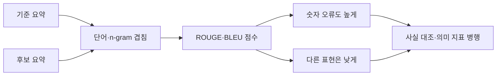

# ROUGE·BLEU의 한계

> ROUGE와 BLEU는 **정답 문장과 단어(n-gram)가 얼마나 겹치는지**를 재는 지표다. 표현이 달라도 뜻이 같은 요약은 낮게, 단어는 거의 같은데 숫자 하나가 틀린 요약은 높게 줄 수 있어 요약 품질, 특히 사실 정확성을 재는 데는 한계가 크다.

## 쉽게 말하면
정답지와 글자가 얼마나 같은지만 세는 채점이다. "300만 원"을 "30만 원"으로 틀려도 나머지 글자가 같으면 높은 점수를, 같은 뜻을 다른 말로 쓰면 낮은 점수를 준다.

## 자세히
출처: 검색 결과 요약(SummEval 논문 arXiv 2007.12626의 서술, 관련 연구 인용; 2026-11-18). 논문 본문 표는 열지 못했다. 아래 한국어 예시는 직접 계산했다.
- **원리**: 후보 요약과 기준 요약의 단어 겹침으로 정밀도·재현율·F를 계산(ROUGE-1은 낱말, ROUGE-2는 두 낱말 연속, ROUGE-L은 최장 공통 부분열). 표면 형태만 본다.
- **SummEval 서술**: 14개 자동 지표를 전문가·크라우드 주석과 재평가했고, ROUGE는 보통 크라우드 주석과 짝지어 쓰이지만 현대 모델에 대한 적합성이 의문이라고 한다. ROUGE 변형이 많이 나온 이유로 원래 설정 밖에서의 문제를 인용한다.
- **상위 시스템에서 상관 하락**: Rankel 외(2013)는 TAC 데이터에서 상위 시스템만 보면 ROUGE와 사람 판단의 상관이 떨어진다고 보고(검색 요약). 최근 모델이 이 구간에 있다.
- **추상적 요약에서 약함**: 한 비판적 평가는 CNN/DailyMail에서 추상적 모델에 대해 ROUGE가 사람 판단과 거의 상관이 없고 추출형 순위에는 더 낫다고 보고한다(검색 요약). 2차 인용으로 ROUGE-L 평균 스피어먼 0.165 대 GPT-4 평가 0.514라는 수치가 있으나 확인하지 못했다.
- **직접 계산한 예(ROUGE-1, 공백 기준)**: 기준 "고객이 환불을 요청했고 금액은 300만 원입니다".
  - 숫자 오류 "…금액은 30만 원입니다": 정밀도 0.83, 재현율 0.83, F 0.83 → **높은 점수인데 금액이 10배 틀림**.
  - 뜻은 같은 "환불 요청 건이며 삼백만 원 규모입니다": 정밀도·재현율·F 모두 0.0으로 겹침이 전혀 없어 **낮은 점수**(한국어는 조사가 붙어 단어 단위 겹침이 더 약해짐, 위 코드로 확인).
- **BLEU**: 번역용 정밀도 중심 n-gram 지표로 같은 한계를 공유한다. 이번 조사에서 BLEU 고유의 수치는 확인하지 못했다.
- **대안(제안)**: 주장 단위 사실 대조, LLM 판정자(사람 표본과 상관 확인), 의미 유사도와 규칙 기반 숫자 검사를 함께([요약 충실도 점수](#summary-faithfulness-score)).
- **그래도 쓰는 이유**: 값이 싸고 재현 가능하다. 회귀 테스트의 거친 경보로는 유용할 수 있다(해석).

## 그림으로 보기


## 예시
```python
from collections import Counter
def rouge1_f(ref, hyp):
    r, h = ref.split(), hyp.split()
    c = sum((Counter(r) & Counter(h)).values())
    p, rc = c/len(h), c/len(r)
    return 2*p*rc/(p+rc) if c else 0.0
```
교육 활용: 같은 요약 3개(정확/숫자 오류/다른 표현)를 ROUGE와 사람 평가로 각각 채점해 순위가 어떻게 갈리는지 보는 실습.

## 헷갈리는 것과 비교
| 개념 | 차이 |
|---|---|
| ROUGE | 요약의 단어 겹침(재현율 중심) |
| BLEU | 번역의 n-gram 정밀도 |
| [요약 충실도 점수](#summary-faithfulness-score) | 원문 근거 여부 |
| [의미 유사도](#semantic-similarity-edit) | 임베딩 기반 뜻 근접도 |

## 더 읽을거리
- [SummEval (arXiv 2007.12626)](https://arxiv.org/pdf/2007.12626) — 14개 지표 재평가(검색 결과로만 확인)
