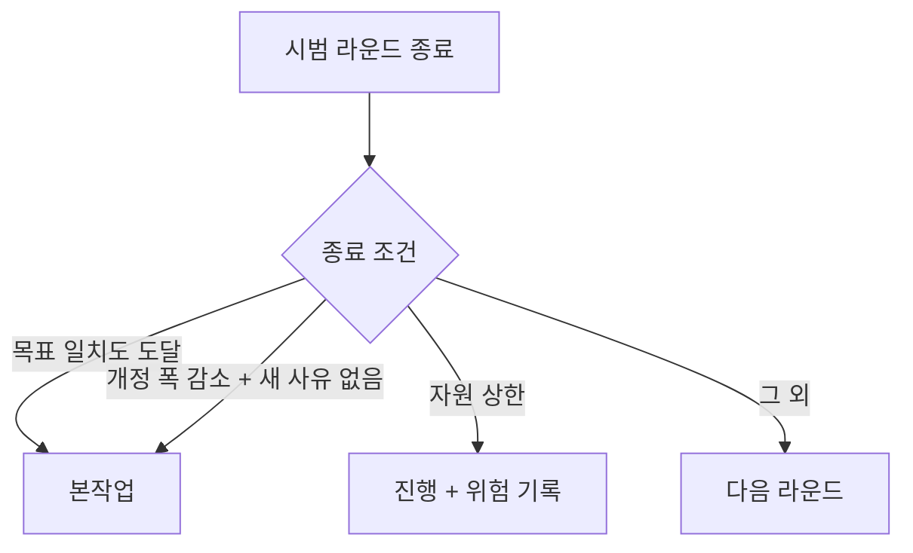
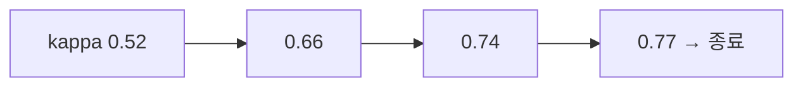

# 시범 라운드 종료 조건

> 시범 라운드 종료 조건은 지침을 고치며 시범 라벨링을 반복할 때 "이제 본작업으로 넘어가도 된다"를 판단하는 미리 정한 기준이다. 일치도가 목표에 도달했는지, 개정 폭이 줄었는지, 시간·예산 상한을 넘었는지를 본다.

## 쉽게 말하면
식당 신메뉴를 시식으로 다듬을 때 "손님 평점 4.0 이상이면 출시, 레시피 수정이 더 필요 없어 보이면 출시, 3주가 지나면 지금 상태로 출시"처럼 출시 조건을 미리 정해 두는 것과 같다.

## 자세히
- **근거(Finlayson & Erjavec, arXiv 1602.05753의 MAMA 설명)**: 프로젝트 초반 모델과 시범 주석을 오가며 주석 체계의 품질을 높이고, 점검에서 중요한 범주가 빠졌거나 IAA가 너무 낮으면 모델로 돌아간다. 즉 "점검 통과"가 다음 단계로 가는 문이다.
- **종료 조건 4가지(해석)**:
  1. **목표 일치도 도달**: 합격선을 시작 전에 정한다([목표 일치도 정하기](#target-agreement-setting), [kappa 해석표 비교](#kappa-interpretation-scales)). 표본이 작으면 구간이 걸칠 수 있어 연속 두 라운드 통과처럼 확인한다([kappa용 시범 크기](#pilot-size-for-kappa)).
  2. **개정 폭 감소**: 라운드마다 지침 수정 건수·추가 예시 수를 기록해, 수정이 거의 없고 새 사유 유형이 안 나오면 안정된 것이다.
  3. **범주 안정**: 새 범주 제안이나 범주 합치기 요구가 더 이상 안 나온다.
  4. **자원 상한**: 라운드 수(예: 최대 4회)·기간·예산 상한. 상한에 도달하면 현 지침으로 진행하되 낮은 일치도 클래스를 위험으로 기록한다.
- **로그 예(가정한 예)**:

| 라운드 | 시범 샘플 | kappa | 지침 수정 건수 | 새 사유 유형 |
| --- | --- | --- | --- | --- |
| 1 | 50 | 0.52 | 12 | 5 |
| 2 | 50 | 0.66 | 6 | 2 |
| 3 | 50 | 0.74 | 2 | 0 |
| 4 | 50 | 0.77 | 1 | 0 |

  합격선 0.75라면 3라운드는 구간이 걸치므로 4라운드까지 확인하고 종료한다.
- **주의(해석)**: 일치도가 정체하는데 개정 폭이 안 줄면 사람이 아니라 범주 설계가 문제일 수 있어 [불일치 샘플 토론](#disagreement-discussion)으로 돌아간다.

## 그림으로 보기

## 예시
- 위 표처럼 라운드별 kappa·수정 건수·새 사유 유형을 기록해 종료 시점을 합의한다.
- 교육 활용: 같은 로그를 보고 종료 시점을 학습자가 각자 정한 뒤 이유를 비교한다.

## 헷갈리는 것과 비교
| 개념 | 차이 |
| --- | --- |
| 시범 라운드 종료 조건 | 시범 반복을 끝내는 기준 |
| [검수 정지 규칙](#review-stopping-rule) | 오류 검수 작업을 멈추는 기준 |
| [MATTER·MAMA 순환](#matter-mama-cycle) | 반복 구조 |
| [라벨러 훈련 라운드](#annotator-training-rounds) | 사람 교육 반복 |

## 더 읽을거리
- [Overview of Annotation Creation: Processes & Tools (arXiv 1602.05753)](https://arxiv.org/abs/1602.05753) — MAMA와 점검 기준
