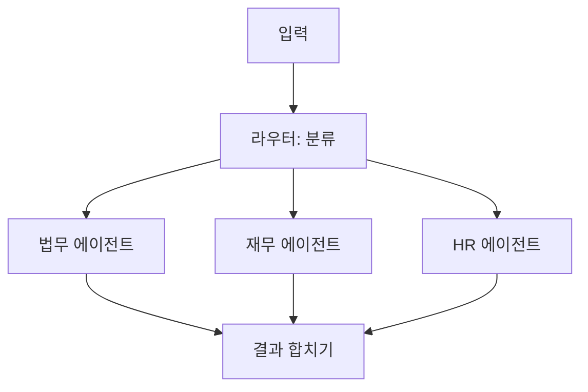
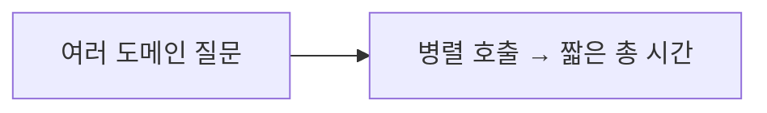

# 라우터 패턴

> **라우터 패턴**은 입력을 **분류**해 알맞은 전문 에이전트 하나 이상으로 보낸 뒤 결과를 합치는 방식이다. **상태가 없고** 병렬 실행에 강하다.

## 쉽게 말하면
안내 데스크 직원이 방문객의 용건만 듣고 "인사팀으로", "재무팀으로" 안내해 주고 끝난다. 방문객과 계속 대화하며 맡지 않는다.

## 자세히
(LangChain 멀티에이전트 문서 확인)
- **작동**: 라우팅 단계가 입력을 분류해 하나 이상의 전문 에이전트에 보내고 결과를 **결합**.
- **적합**: **병렬 실행**과 서로 독립된 도메인.
- **제한**: **상태가 없고(stateless)** 여러 단계(multi-hop) 흐름은 지원하지 않는다.
- **효율**(문서 표): 단발 3회 호출, 반복 요청(2턴) 합계 6회, 다중 도메인 5회·약 9K 토큰. 서브에이전트와 함께 다중 도메인에서 가장 효율적(병렬 실행). 반복 요청에서는 전체 흐름을 다시 실행하므로 상태 유지형보다 호출이 많다.
- 분류 기준은 규칙·분류용 LLM·임베딩 유사도 등으로 구현할 수 있다(일반 지식).

## 그림으로 보기

## 예시
- 사내 챗봇: 질문을 분류해 "휴가 규정"은 HR, "경비 처리"는 재무 지식 베이스로 보내고 한 번에 답변.

## 헷갈리는 것과 비교
| 개념 | 차이 |
|---|---|
| 라우터 | 분류 후 분배, 무상태 |
| [핸드오프](#handoff-pattern) | 상태 유지, 대화 이어짐 |
| [서브에이전트](#supervisor-pattern) | 중앙 에이전트가 도구처럼 호출 |
| [Self-Route](#self-route) | RAG vs 긴 컨텍스트 경로 선택 |

## 더 읽을거리
- [LangChain 멀티에이전트 문서](https://docs.langchain.com/oss/python/langchain/multi-agent)
