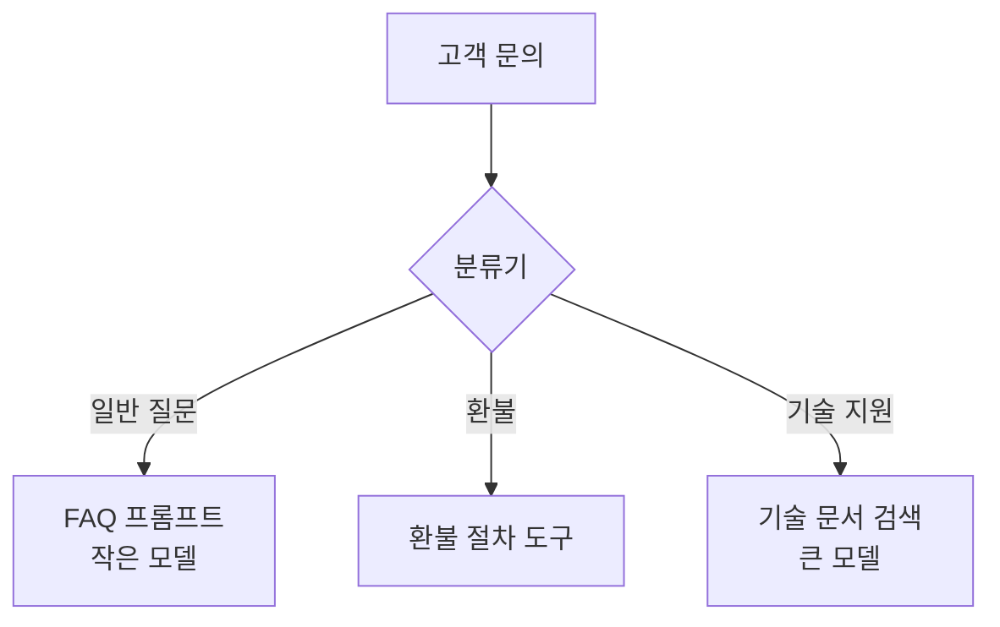

# 라우팅

> 입력을 먼저 분류하고, 분류에 맞는 전문 처리 경로(프롬프트·도구·모델)로 보내는 워크플로 패턴.

## 쉽게 말하면
병원 접수 창구다. 증상을 듣고 내과·정형외과·응급실로 안내한다. 의사 한 명이 모든 걸 보게 하지 않고 전문가에게 보낸다.

## 자세히
Anthropic "Building effective agents" 기준:
- 별도로 처리하는 편이 나은 **뚜렷한 범주**가 있고, 분류가 LLM이나 전통 분류기로 정확히 될 때 적합.
- 관심사를 분리해 더 전문화된 프롬프트를 만들 수 있고, 한 유형에 맞춘 최적화가 다른 유형을 망치는 문제를 줄인다.
- 예: 고객 문의를 일반 질문/환불/기술 지원으로 나눠 각기 다른 프로세스·프롬프트·도구로 전달. 쉬운 질문은 작고 싼 모델(문서 예: Haiku 4.5), 어려운 질문은 큰 모델(문서 예: Sonnet 4.5)로 보내 비용을 줄인다.
- 분류가 틀리면 전체가 틀어지므로 분류기를 [평가셋](#eval-set)으로 따로 점검한다.

## 그림으로 보기

## 예시
- 사내 챗봇: 인사 문의는 규정 RAG, 코드 질문은 코딩 모델로.
- 난이도 라우팅으로 비용 절감.

## 헷갈리는 것과 비교
| 개념 | 차이 |
| --- | --- |
| 라우팅 | 한 갈래만 선택 |
| 병렬화 | 여러 갈래를 동시에 실행 |
| [프롬프트 체이닝](#prompt-chaining) | 순서대로 이어 가기 |

## 더 읽을거리
- [Building effective agents (Anthropic)](https://www.anthropic.com/engineering/building-effective-agents) — 라우팅 설명
