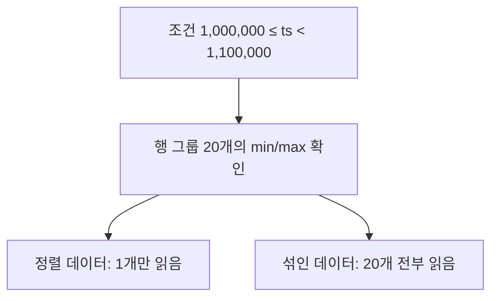
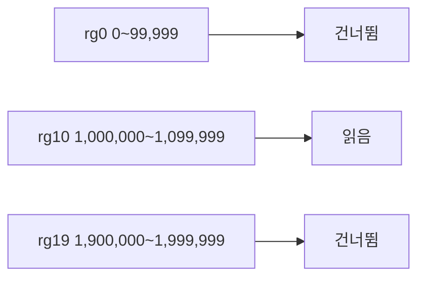

# 행 그룹 통계

> Parquet 파일은 행을 **행 그룹(row group)** 으로 나누고, 그룹마다 열별 **최솟값·최댓값**을 메타데이터에 저장한다. 질의 조건과 범위가 겹치지 않는 행 그룹은 **열어 보지 않고 건너뛴다.**

## 쉽게 말하면
서류철마다 겉에 "이 철: 번호 0~99,999"라고 적어 두면 150,000번 서류를 찾을 때 0~99,999 철은 열 필요가 없다. 다만 번호가 철마다 뒤죽박죽 섞여 있으면 모든 철에 "0~2,000,000"이라고 적혀 있어 하나도 건너뛸 수 없다.

## 자세히
(Athena 최적화 문서에서 파일 메타데이터의 최솟값·최댓값과 정렬의 관계를 직접 읽었고, 행 그룹 수·건너뛰기·읽기 시간은 이 세션에서 **pyarrow 26.0.1**로 직접 측정했다. 합성 데이터·한 환경이다.)
- **원리(Athena 문서)**: 컬럼형 파일 메타데이터에는 데이터 페이지의 최솟값·최댓값이 들어 있어, 질의 값이 범위 밖이면 그 페이지를 건너뛸 수 있다. 데이터가 정렬돼 있으면 `created_at` 같은 조건에서 불필요한 부분을 건너뛰기 쉽다. Parquet은 row group, ORC는 stripe가 내부 단위이고 기본 크기는 각각 128MB·64MB이다(같은 문서).
- **직접 측정(200만 행, 행 그룹 20개(각 10만 행), zstd, 4열)**
  - 정렬된 `ts`(0~1,999,999): 첫 행 그룹의 `ts` 최솟값·최댓값은 **0과 99,999**. 조건 `1,000,000 ≤ ts < 1,100,000`에 **맞을 수 있는 행 그룹은 20개 중 1개**였고, `pq.read_table(filters=...)`로 읽으면 **0.0097초**에 10만 행을 가져왔다.
  - 같은 데이터에서 `ts` 순서를 **섞어** 다시 저장: 첫 행 그룹의 `ts` 범위가 **8~1,999,987**로 거의 전체. 맞을 수 있는 행 그룹은 **20개 중 20개**였고 같은 조건의 읽기가 **0.0664초**로 약 **6.8배** 느렸다(결과 행 수는 같은 10만 행).
- **해석**: 통계는 데이터가 **정렬·클러스터링**돼 있을 때만 건너뛰기에 효과가 있다. 같은 값이 파일 전체에 흩어져 있으면 모든 행 그룹의 범위가 겹쳐 아무것도 못 건너뛴다. 그래서 [Z-order](#z-order-clustering)나 [Liquid clustering](#liquid-clustering) 같은 배치 기법이 의미를 갖는다.
- **행 그룹 크기의 절충(일반 원칙)**: 행 그룹이 작으면 건너뛰기 단위가 촘촘하지만 메타데이터와 열기 오버헤드가 늘고, 크면 반대다. 앞서 읽은 Parquet 문서는 row group 512MB~1GB를 권장했다(이번 실험은 10만 행 단위로 작게 둠).
- **한계**: 최솟값·최댓값만으로는 범위 안의 값 존재 여부를 알 수 없다. 같은 행 그룹에 조건에 맞는 행이 있을 수도 없을 수도 있어 해당 그룹은 읽어서 확인해야 한다.

## 그림으로 보기



## 예시
```python
import pyarrow.parquet as pq
f = pq.ParquetFile("a.parquet")
s = f.metadata.row_group(0).column(0).statistics
print(s.min, s.max)                         # 0, 99999
pq.read_table("a.parquet",
  filters=[("ts", ">=", 1_000_000), ("ts", "<", 1_100_000)])
```
- 교육 소재: 서류철 라벨 비유로 "정렬이 왜 중요한가".

## 헷갈리는 것과 비교
| 개념 | 차이 |
|---|---|
| 행 그룹 통계 | 행 그룹별 min/max로 건너뜀 |
| [열 가지치기](#column-pruning) | 필요한 열만 읽음 |
| [데이터 스킵 통계](#data-skipping-statistics) | Delta의 파일 단위 통계 스킵 |
| 파티션 가지치기 | 폴더 단위로 건너뜀 |

## 더 읽을거리
- [Optimize data (AWS Athena)](https://docs.aws.amazon.com/athena/latest/ug/performance-tuning-data-optimization-techniques.html) — 파일 메타데이터 min/max와 정렬(직접 읽음).
- [Parquet configurations](https://parquet.apache.org/docs/file-format/configurations/) — row group 크기 권장(직접 읽음).
