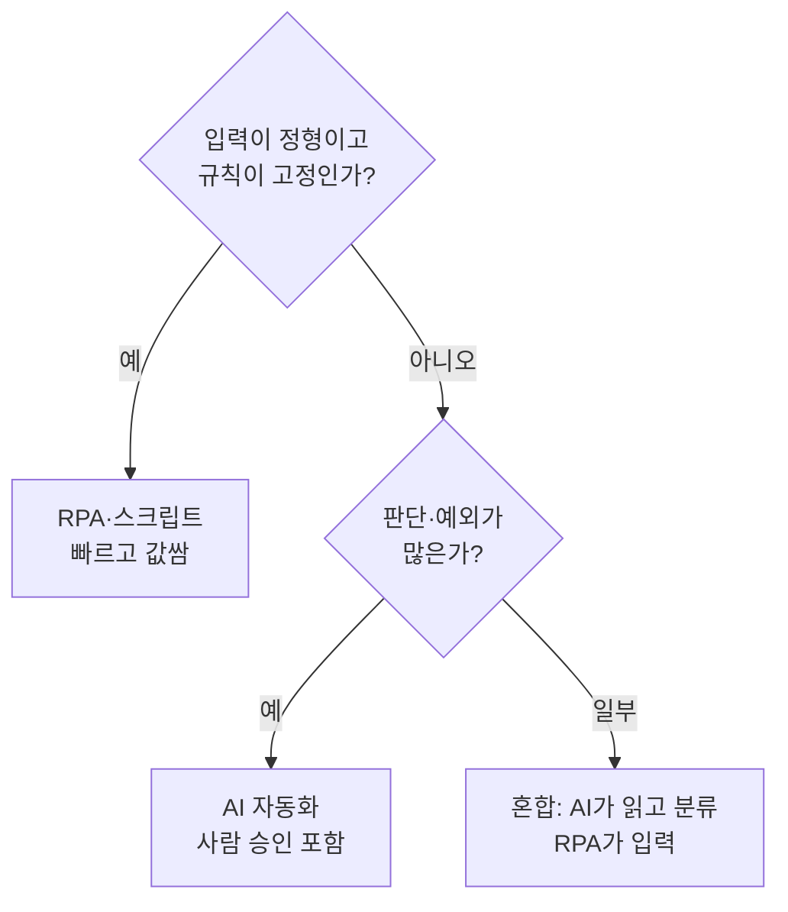
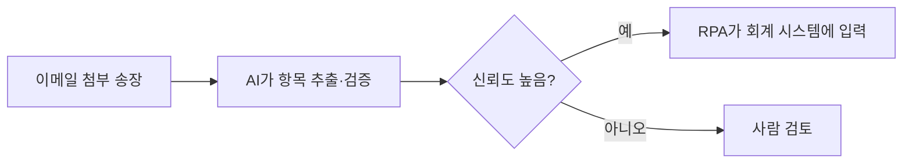

# RPA vs AI 자동화

> RPA는 사람이 화면에서 하던 클릭·입력을 미리 정한 순서대로 흉내 내는 자동화이고, AI 자동화는 모델이 내용을 이해하고 판단해 처리한다. 둘은 경쟁보다 보완 관계다.

## 쉽게 말하면
RPA는 녹음해 둔 안내 방송이다. 정해진 순서대로 정확히 반복하지만 상황이 달라지면 멈춘다. AI 자동화는 사람 상담원에 가깝다. 질문 표현이 달라져도 뜻을 파악해 대응하지만, 가끔 틀리고 비용도 든다. 실무는 안내 방송으로 되는 부분은 방송에 맡기고, 판단이 필요한 부분만 상담원이 맡는 식으로 섞는다.

## 자세히
- **RPA(Robotic Process Automation)**: 사용자가 GUI에서 작업하는 모습을 기록해 그 단계를 인터페이스에서 그대로 재현하는 스크립트형 자동화(Wikipedia). API가 없는 레거시 프로그램에서 강하다. 소프트웨어 로봇이 가상 작업 공간에서 키보드·마우스 입력을 흉내 내며 이메일의 송장을 읽어 회계 시스템에 입력하는 식의 앱 간 이동이 가능하다.
- **RPA의 약점**: 정해진 워크플로를 따르므로 화면이 바뀌면 스스로 적응하지 못해 사람의 재설정이 필요하다(Wikipedia). 비정형 문서나 예외 처리에 약하다.
- **AI 자동화**: LLM이 비정형 텍스트·이미지를 이해하고, 목표를 향해 단계를 스스로 고르기도 한다. 대신 비결정적이라 결과가 매번 같지 않고, 호출 비용·지연·오류 관리(관측성, 가드레일)가 필요하다. 업체 블로그들은 RPA가 더 빠르게 도입되고 저렴한 경우가 많다고 말한다(주장, 벤더 자료).
- **하이퍼오토메이션**: RPA에 AI·ML·프로세스 마이닝을 결합한다는 개념. Gartner는 "RPA만으로는 하이퍼오토메이션이 아니다"라고 했다(Wikipedia 인용).
- **수렴 추세**: RPA 제품군이 에이전트 기능을 내놓고, 에이전트 플랫폼은 프로세스 자동화를 내세워 경계가 흐려지고 있다(2026년 8월 블로그 주장).
- **고르는 기준**: ①입력이 정형이고 규칙이 고정 → RPA 또는 일반 스크립트 ②비정형 입력·판단·예외가 많음 → AI ③둘 다 → RPA가 반복 구간을, AI가 읽기·분류·초안 작성 구간을 맡고 사람이 승인.

## 그림으로 보기

## 예시
- 매일 같은 ERP 화면에서 같은 보고서를 내려받아 엑셀에 붙이는 일 → RPA.
- 양식이 제각각인 거래처 송장에서 금액·계좌를 읽어 분류 → AI로 추출, 입력은 RPA로.
- 고객 항의 메일을 읽고 환불 대상인지 판단해 초안 작성 → AI + 사람 승인.

## 헷갈리는 것과 비교
| 개념 | 차이 |
|---|---|
| RPA | 미리 정한 규칙·화면 동작을 반복, 결정적, 변화에 약함 |
| AI 자동화 | 내용을 이해해 판단, 비결정적, 비용·검증 필요 |
| [워크플로 vs 에이전트](#workflow-vs-agent) | AI 안에서도 코드가 흐름을 정하는지 모델이 정하는지의 구분 |
| [사람 개입](#human-in-the-loop) | 혼합 구성에서 예외·승인을 맡는 단계 |

## 더 읽을거리
- [Robotic process automation (Wikipedia)](https://en.wikipedia.org/wiki/Robotic_process_automation) — 정의·작동 방식·한계
- [Building effective agents (Anthropic)](https://www.anthropic.com/engineering/building-effective-agents) — 정해진 흐름과 에이전트를 고르는 기준
