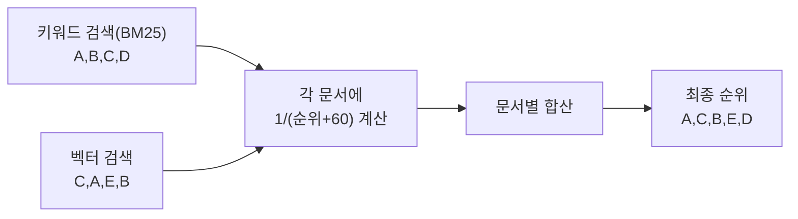
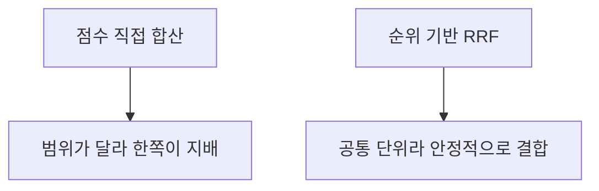

# RRF (역순위 결합)

> Reciprocal Rank Fusion. 키워드 검색과 벡터 검색처럼 점수 체계가 서로 다른 여러 검색 결과를, 점수 대신 **순위만** 써서 하나의 목록으로 합치는 간단한 방법. 공식은 문서마다 `1/(순위 + k)`를 더하는 것이다.

## 쉽게 말하면
두 심사위원이 각자 100점 만점과 5점 만점으로 점수를 매겼다면 점수를 그냥 더할 수 없다. 대신 "각자 몇 등을 줬는가"만 본다. 두 심사위원 모두에게 상위권인 참가자가 최종 1등이 된다. 한 심사위원만 극찬하는 경우보다 둘 다 괜찮다고 한 경우가 유리하다.

## 자세히
**Azure AI Search 문서(2026-09 갱신)의 설명**
1. 병렬로 실행된 여러 쿼리에서 각각 순위가 매겨진 결과를 받는다.
2. 각 목록의 문서에 `1/(rank + k)` 점수를 준다. `rank`는 목록 내 순위, `k`는 상수이며 "실험에서 k를 60처럼 작은 값으로 둘 때 가장 잘 동작한다"고 안내한다(이 k는 최근접 이웃 개수 k와 별개).
3. 문서별로 여러 목록의 점수를 **합산**한다.
4. 합산 점수로 정렬한 것이 최종 순위다.

**왜 순위만 쓰나**: 서로 점수 범위가 다르다. 같은 문서의 설명에 따르면 BM25는 상한이 없고, 벡터 유사도(코사인)는 0.333~1.00 등 범위가 정해져 있다. 점수를 직접 더하면 한쪽이 지배한다. 순위는 비교 가능한 공통 단위다.

**직접 계산한 예(k=60)**: BM25 순위 `[A, B, C, D]`, 벡터 순위 `[C, A, E, B]`일 때
- A: 1/61 + 1/62 = 0.03252
- C: 1/63 + 1/61 = 0.03227
- B: 1/62 + 1/64 = 0.03175
- E: 1/63 = 0.01587, D: 1/64 = 0.01562
→ 최종 순서 A, C, B, E, D. 두 목록에 모두 높게 있는 A·C가 위로 올라오고 한쪽에만 나온 E·D는 아래에 놓인다.

**성질**: 한 목록의 최고 기여는 대략 1/k로 제한되므로 합칠 목록이 많을수록 점수 상한이 커진다. 가중치를 줄 수도 있다(Azure는 벡터 쿼리 가중치 곱셈을 지원).

**한계**: 순위만 보므로 "1위와 2위의 점수 차가 컸다" 같은 신호가 사라진다. 두 검색기가 둘 다 약하면 합쳐도 약하다. 보통 합친 뒤 [리랭킹](#reranking)으로 정제한다.

## 그림으로 보기




## 예시
```python
def rrf(lists, k=60):
    s = {}
    for l in lists:
        for r, d in enumerate(l, 1):
            s[d] = s.get(d, 0) + 1 / (r + k)
    return sorted(s.items(), key=lambda x: -x[1])

print(rrf([["A","B","C","D"], ["C","A","E","B"]]))
```
업무 예: 사내 문서 검색에서 BM25와 임베딩 검색 결과를 RRF로 합친 뒤 상위 20개를 리랭커에 넘긴다.

## 헷갈리는 것과 비교
| 개념 | 차이 |
|---|---|
| 점수 가중 합 | 점수 스케일을 맞춰야 함(정규화 필요) |
| RRF | 순위만 사용, 스케일 문제 없음 |
| [하이브리드 검색](#hybrid-search) | 키워드+벡터를 함께 쓰는 구성. RRF는 그 결합 방법의 하나 |
| [리랭킹](#reranking) | 합쳐진 후보를 더 정교한 모델로 다시 정렬 |

## 더 읽을거리
- [Hybrid search scoring (RRF) — Azure AI Search](https://learn.microsoft.com/en-us/azure/search/hybrid-search-ranking) — 공식·k값·가중치 설명
