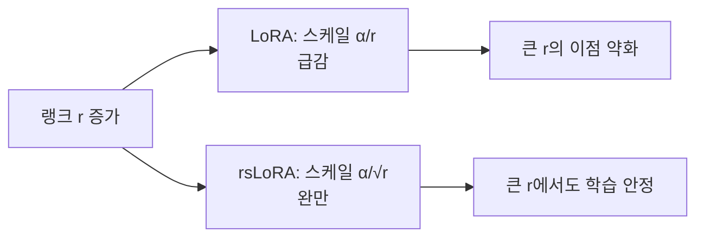

# rsLoRA

> rsLoRA(Rank-Stabilized LoRA)는 LoRA의 스케일을 `α/r` 대신 `α/√r`로 바꿔, 랭크(r)를 높여도 학습이 줄어들지 않게 안정화한 방식이다.

## 쉽게 말하면
볼륨 조절기에 비유하면, 기본 LoRA는 스피커(랭크)를 늘릴수록 전체 볼륨을 `1/r`로 줄여 소리가 작아진다. rsLoRA는 줄이는 폭을 덜 가파르게(`1/√r`) 잡아, 스피커가 많아져도 소리가 살아 있다.

## 자세히
HF PEFT 문서 기준:
- 켜는 법: `LoraConfig(use_rslora=True, ...)`.
- 표준 LoRA 스케일: `lora_alpha / r`. rsLoRA: `lora_alpha / sqrt(r)`.
- 문서 설명: 고정 스칼라가 어댑터를 안정화해 더 높은 `r`을 쓸 수 있게 한다("proven to work better"라는 문서 표현. 원 논문 수치는 이번에 확인 안 함).
- 기본값 `r=8`, `lora_alpha=8`. 랭크를 16~64 이상으로 키울 때 의미가 있다.
- 랭크가 낮으면(r≤16) 차이가 작다.

## 그림으로 보기


## 예시
```python
from peft import LoraConfig
cfg = LoraConfig(r=64, lora_alpha=16, use_rslora=True, target_modules="all-linear")
```

## 헷갈리는 것과 비교
| 개념 | 차이 |
|---|---|
| LoRA | 스케일 α/r |
| rsLoRA | 스케일 α/√r |
| [QLoRA](#qlora) | 베이스 모델을 4비트로 양자화(메모리 절감) |
| [LoRA 대상 모듈](#target-modules) | 어디에 붙이는가 |

## 더 읽을거리
- [HF PEFT LoRA 가이드](https://huggingface.co/docs/peft/developer_guides/lora) — use_rslora, r, alpha.
