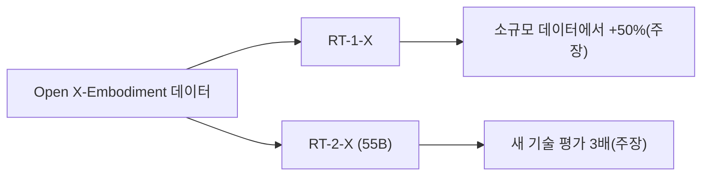
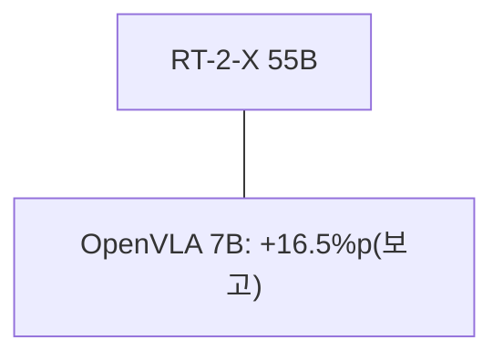

# RT-1-X와 RT-2-X

> [Open X-Embodiment](#open-x-embodiment) 데이터로 학습한 두 로봇 정책. 기존 RT-1·RT-2를 여러 로봇의 합친 데이터로 다시 학습한 계열이다. (프로젝트 페이지 열람 2026-11-28)

## 쉽게 말하면
한 학교 교재만으로 공부하던 학생(RT-1, RT-2)에게 21개 기관의 교재를 모아 줬더니 더 잘하는지 본 것이다. 접미사 X는 "여러 로봇(cross-embodiment)"을 뜻한다.

## 자세히
- 프로젝트 페이지의 결과 요약(저자 주장):
  - **RT-1-X**: 소규모 데이터 영역에서 RT-1과 원래 단일 데이터셋 방법보다 **50%** 높은 성능.
  - **RT-2-X**: 새 기술(emergent skill) 평가에서 RT-2보다 **3배**. 가장 큰 RT-2-X는 **55B** 파라미터.
- 데이터: 21개 기관, 22종 로봇, 60개 기존 데이터셋, 100만 개 이상의 실제 로봇 궤적.
- 비교 대상으로서: [OpenVLA](#openvla)는 29개 과제에서 RT-2-X(55B)보다 절대 성공률 16.5%p 높고 파라미터는 7분의 1이라고 보고했다(초록).
- 한계: 위 수치는 프로젝트 페이지 요약이며 평가 조건·기준선의 상세는 논문 본문을 확인하지 않았다. "50%"가 상대 개선인지 절대 개선인지도 이번 출처로 확인하지 못했다.

## 그림으로 보기

## 예시
- 한 연구실 로봇 데이터만 쓰던 모델보다, 여러 로봇 데이터로 학습한 모델이 새 로봇에서 더 잘 작동하는지 평가.
- 교육: "데이터를 공유하면 모두의 모델이 좋아진다"는 사례로 활용.

## 헷갈리는 것과 비교
| 개념 | 차이 |
|---|---|
| RT-1·RT-2 | 단일 로봇 데이터 기반 원 모델 |
| RT-1-X·RT-2-X | 다중 로봇 데이터로 재학습 |
| [RT-2](#rt-2) | 원 모델, 행동을 텍스트 토큰으로 |

## 더 읽을거리
- [Open X-Embodiment 프로젝트](https://robotics-transformer-x.github.io/) — 결과 요약(읽음).
