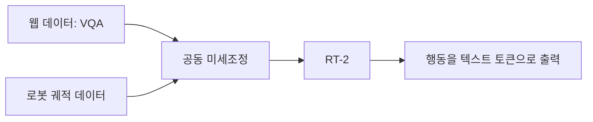
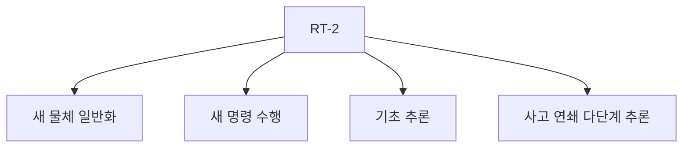

# RT-2

> Google DeepMind의 **VLA 모델.** 기존 비전-언어 모델을 로봇 궤적 데이터와 웹 규모 과제(VQA 등)로 함께 미세조정하고, **로봇 행동을 텍스트 토큰으로 표현**해 언어와 행동을 한 형식으로 다룬다. (arXiv 2307.15818, 초록 읽음)

## 쉽게 말하면
말을 아는 모델에게 "팔을 이렇게 움직인다"도 글자로 적어 가르친 것이다. 모델 입장에서 행동도 문장의 일부처럼 출력된다.

## 자세히
- 방법(초록): 웹 규모 VQA 같은 과제와 로봇 궤적 데이터로 **공동 미세조정(co-fine-tuning)**. 한 모델이 로봇 관찰에서 행동까지 end-to-end로 매핑하면서 웹 사전학습의 이점을 유지.
- **행동을 텍스트 토큰으로**: 행동을 언어 응답과 같은 형식의 토큰으로 학습 데이터에 넣는다.
- 평가(초록): **6천 번 평가 시행**. 보고된 결과 — 새 물체에 대한 일반화 향상, 로봇 학습 데이터에 없던 명령(특정 숫자·아이콘 위에 물체 놓기) 수행, 가장 작거나 큰 물체 집기 같은 기초 추론, 사고 연쇄를 쓴 다단계 의미 추론(임시 망치로 돌 고르기, 피곤한 사람에게 에너지 음료 고르기).
- 후속: [RT-1-X·RT-2-X](#rt-1-x-rt-2-x)는 Open X-Embodiment 데이터로 학습한 계열이며 RT-2-X는 55B 규모(프로젝트 페이지 요약, [Open X-Embodiment](#open-x-embodiment)). [OpenVLA](#openvla)는 7B로 RT-2-X와 비교했다.
- 한계: 초록에는 정량 성공률 수치가 없고 모델 비공개 여부·크기도 이번에 확인하지 않았다.

## 그림으로 보기

## 예시
- "에너지 음료를 피곤한 사람에게 줘"라는 명령에서 적절한 물체를 고르는 의미 추론.
- 교육: 웹 지식을 로봇 행동으로 옮기는 방식을 "책으로 배운 상식을 현장 업무에 쓰기"에 빗대어 설명.

## 헷갈리는 것과 비교
| 개념 | 차이 |
|---|---|
| RT-2 | 행동을 텍스트 토큰으로, 공동 미세조정 |
| [OpenVLA](#openvla) | 공개 7B 모델 |
| [π0](#pi0-flow-model) | 플로 매칭으로 행동 생성 |

## 더 읽을거리
- [RT-2 논문](https://arxiv.org/abs/2307.15818) — 공동 미세조정과 결과(초록 읽음).
