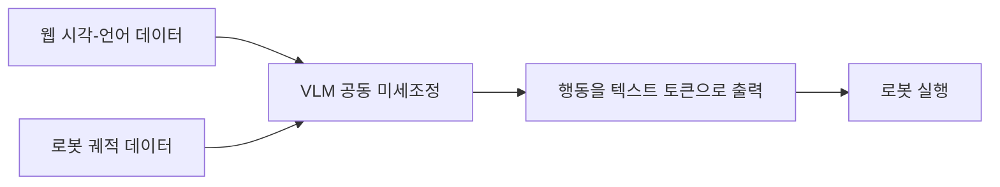
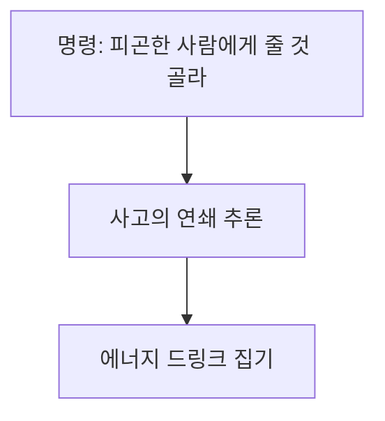

# RT-2

> **RT-2**는 웹 규모의 시각-언어 지식을 로봇 제어로 옮긴 **VLA(시각-언어-행동) 모델**이다. 로봇 행동을 **텍스트 토큰**으로 인코딩해, 언어를 다루듯 행동을 출력한다(arXiv 2307.15818, 2023).

## 쉽게 말하면
인터넷으로 세상 상식을 배운 똑똑한 학생에게 로봇 팔 조종법을 "말하듯" 가르친 것이다. 학생은 로봇 데이터에 없던 물건이나 명령도 상식으로 헤쳐 나간다.

## 자세히
(논문 초록 확인)
- **공동 학습**: 로봇 궤적 데이터와 인터넷의 시각-언어 과제(예: 시각 질의응답)를 함께 학습한다.
- **행동 = 텍스트 토큰**: 로봇 행동을 텍스트 토큰으로 표현해 언어 출력과 같은 방식으로 다룬다([행동 토큰화](#action-tokenization)).
- **결과**(저자 보고): 6,000회 평가 시행에서 새로운 물체로 일반화가 개선되고, 로봇 학습 데이터에 없던 명령(특정 숫자·아이콘 위에 물체 놓기)을 수행한다. 가장 작은/큰 물체나 어떤 물체에 가장 가까운 물체 고르기 같은 **기초 추론**을 보이고, **사고의 연쇄**를 쓰면 즉석 망치로 돌 고르기, 피곤한 사람에게 에너지 드링크 고르기 같은 다단계 문제도 푼다.
- [OpenVLA](#openvla)는 이 계열의 오픈 모델로, 논문 초록은 55B RT-2-X보다 +16.5%p라고 보고한다.

## 그림으로 보기

## 예시
- "가장 작은 물체를 집어" 같은, 로봇 데이터에는 없던 추상 명령을 수행.
- 교육 활용: "웹 지식이 로봇 행동에 전이된다"는 VLA 개념 소개.

## 헷갈리는 것과 비교
| 개념 | 차이 |
|---|---|
| RT-2 | 행동을 텍스트 토큰으로 낸 VLA |
| [OpenVLA](#openvla) | 오픈소스 7B VLA |
| [플로 매칭](#flow-matching) | 행동을 연속적으로 생성하는 다른 접근 |
| RT-1 | 이전 로봇 트랜스포머(이 글에서 미확인) |

## 더 읽을거리
- [RT-2: Vision-Language-Action Models Transfer Web Knowledge to Robotic Control](https://arxiv.org/abs/2307.15818)
