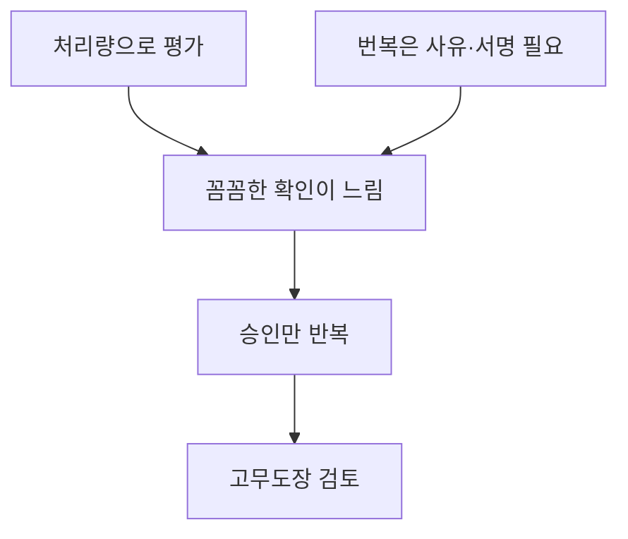
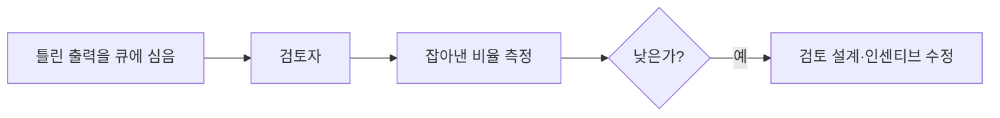

# 고무도장 검토

> 고무도장 검토(rubber-stamping)는 사람이 AI의 판정을 실제로 따져 보지 않고 거의 그대로 승인하는 현상이다. "사람이 검토한다"는 통제가 서류상으로만 존재하게 된다.

## 쉽게 말하면
결재 서류가 올라오면 내용을 읽지 않고 도장만 찍는 팀장과 같다. 도장을 찍는 데는 클릭 한 번이 들지만, 반려하려면 사유를 쓰고 윗사람의 서명까지 받아야 한다면 누구든 도장을 찍게 된다.

## 자세히
- **왜 생기나(Corporate Compliance Insights 글, 열람)**: 초기에 정확도가 높으면 신뢰가 생겨 확인 습관이 약해지고, 검토자가 처리량으로 평가받으면 꼼꼼한 확인이 저성과로 보이며, 동의는 한 번에 끝나지만 번복은 정당화가 필요하고, 틀린 모델에 동의하면 책임이 흩어지지만 번복이 틀리면 혼자 책임진다. 이 글은 사람이 있다고 통제가 되는 것은 아니며 가장 자주 주장되지만 가장 덜 검증된 통제라고 쓴다. 다만 해당 글은 의견 칼럼이다.
- **동의율만으로는 모른다**: 동의율 99%는 모델이 강해서일 수도, 도장일 수도 있다.
- **탐지법(같은 글)**: ① 같은 사례에서 검토자 단독·모델 단독·결합 성능을 비교 ② 일부러 틀린 출력을 실제 큐에 심어 잡아내는 비율을 핵심 지표로 삼음(피싱 모의훈련과 비슷) ③ 번복의 정밀도(번복이 맞은 비율)와 재현율(진짜 오류 중 잡아낸 비율) ④ 최소 체류 시간·근거 자료 열람 로그 ⑤ 모델 답을 보기 전에 검토자 판단을 먼저 기록하고 동의·번복의 노력을 비슷하게 만들기.
- **실험 근거(Beck 등, arXiv 2509.08514, 2025-09, 초록 열람)**: 참가자 2,784명 무작위 실험에서 AI 오류를 고치도록 강제하자 오히려 참여가 줄고 틀린 제안을 더 받아들였다. AI에 회의적인 태도의 참가자가 오류를 더 잘 찾았고, AI에 호의적인 참가자는 과의존했다. 구체 수치는 초록에 없다.
- **대응 방향(같은 글)**: 검토 계층 자체를 감사하고, 결합 방식이 대안보다 나을 때만 유지한다. 건별 의미 있는 검토가 불가능한 규모·속도·되돌릴 수 없는 행동에서는 검토 단계를 두기보다 사전 평가·지속 모니터링·이의 제기 절차에 자원을 옮기라고 권한다.
- **[과의존](#undertrust-ai)과의 관계(해석)**: 고무도장은 과의존이 조직 수준에서 굳어진 형태다.

## 그림으로 보기

## 예시
- 대출 승인 AI가 거절을 제안하는 큐에 매주 알려진 오류 5건을 섞어, 검토자가 몇 건을 잡는지 본다. 잡는 비율이 낮으면 도장일 가능성이 크다.
- 교육 활용: "AI 결과를 사람이 확인한다"는 문장이 통제인지 구호인지를 판별하는 체크리스트로 쓴다.

## 헷갈리는 것과 비교
| 개념 | 차이 |
| --- | --- |
| [검토 큐 설계](#review-queue-design) | 상위 주제. 고무도장은 큐가 운영될 때 생기는 실패 |
| 자동화 편향(automation bias) | 개인의 심리 경향. 고무도장은 제도·인센티브까지 포함 |
| [검토의 수확 체감](#diminishing-returns-review) | 검토를 해도 이득이 작은 구간. 도장은 검토가 형식뿐인 경우 |

## 더 읽을거리
- [Corporate Compliance Insights: Is human-in-the-loop just another rubber stamp?](https://www.corporatecomplianceinsights.com/human-in-loop-just-another-rubber-stamp/) — 원인·탐지 지표(의견 칼럼)
- [Bias in the Loop (arXiv 2509.08514)](https://arxiv.org/abs/2509.08514) — 2,784명 무작위 실험
