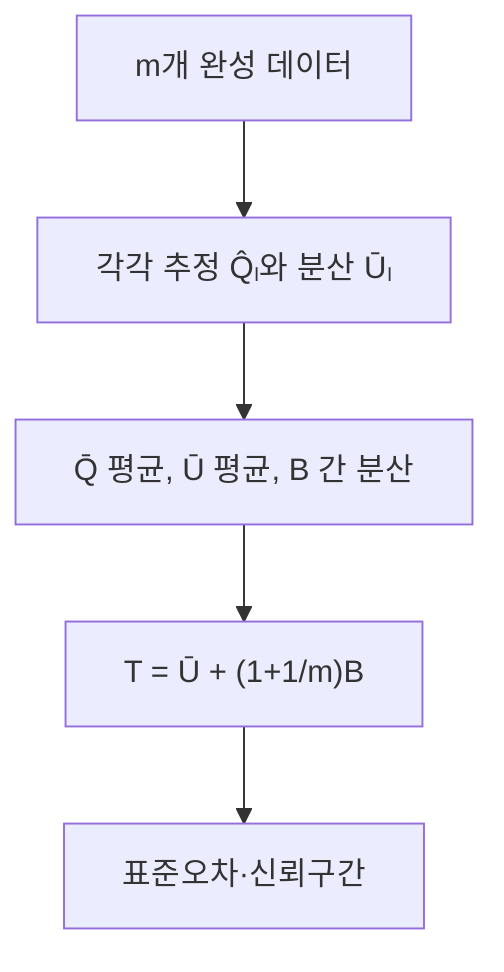
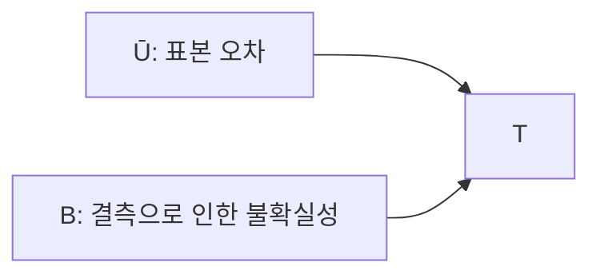

# Rubin의 합치기 규칙

> 다중 대체로 만든 m개의 완성 데이터에서 얻은 추정값을 하나로 합치는 공식이다. 대체 내 분산과 대체 간 분산을 합쳐 결측 때문에 생긴 불확실성까지 표준오차에 반영한다.

## 쉽게 말하면
같은 문제를 m명의 채점자가 각자 다른 가정으로 풀고 평균을 낸다. 답이 서로 얼마나 다른지(대체 간 분산)도 오차에 더해 "결측 때문에 이만큼 불확실하다"고 알려 준다.

## 자세히
(van Buuren, Flexible Imputation of Missing Data 2판 2.3절을 하위 에이전트가 WebFetch 요약으로 읽은 노트. 수식 인쇄 오타 여부는 **미확인**.)
- **기호**: m개 대체, 대체 l의 추정값 Q̂ₗ, 그 분산 Ūₗ.
- **합친 추정**: Q̄ = (1/m) ΣQ̂ₗ.
- **대체 내 분산**: Ū = (1/m) ΣŪₗ.
- **대체 간 분산**: B = Σ(Q̂ₗ − Q̄)² / (m−1).
- **총 분산**: **T = Ū + (1 + 1/m)·B**.
- **상대 증가 r = (B + B/m)/Ū**, **결측 정보 비율 λ = (B + B/m)/T**.
- **자유도**: Barnard–Rubin 조정 ν = ν_old·ν_obs / (ν_old + ν_obs), ν_old = (m−1)/λ², ν_obs = ((ν_com+1)/(ν_com+3))·ν_com·(1−λ). 검정·구간은 t 분포 사용(2.4절은 읽지 못함).
- **예(nhanes, m=10)**: T≈5.01, λ≈0.319, ν≈12.4.
- **의미(제안)**: B가 크면 결측이 결과에 큰 불확실성을 준다는 신호. 대체를 한 번만 하면 B를 알 수 없어 표준오차가 작게 나온다([단일 대체](#single-imputation-underestimates)).

## 그림으로 보기

## 예시
- m=20회 대체 후 회귀계수를 모아 Q̄와 T로 95% 신뢰구간 계산(R의 `mice::pool`, Python `statsmodels` MICE 등).
- 교육 활용: 작은 숫자로 손계산해 B와 T의 역할을 이해.

## 헷갈리는 것과 비교
| 개념 | 차이 |
|---|---|
| Rubin 규칙 | 다중 대체 결과 합치기 |
| 부트스트랩 | 표본 재추출로 불확실성 추정 |
| [다중 대체](#multiple-imputation) | 합치기 이전 단계 |

## 더 읽을거리
- [FIMD 2.3절](https://stefvanbuuren.name/fimd/sec-whyandwhen.html) — 공식 설명(웹 요약으로 확인).
