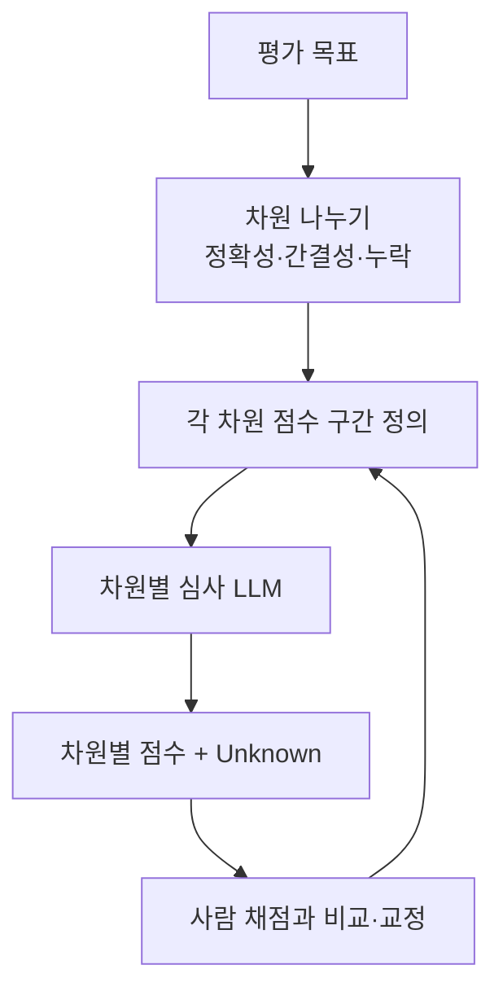

# 루브릭 설계

> 모델 답을 채점할 때 '좋은 답'의 기준을 차원별 항목과 점수 구간으로 미리 쪼개 적은 채점 기준표.

## 쉽게 말하면
논술 채점표를 떠올리면 된다. "잘 썼는가"라고만 쓰면 채점자마다 점수가 다르다. "근거 제시 / 구조 / 오탈자"처럼 항목을 나누고 각 점수가 무엇인지 적어 두면 누가 채점해도 비슷해진다. AI 심사위원에게도 마찬가지다.

## 자세히
- Anthropic의 에이전트 평가 글은 모델 채점기에 **명확하고 구조화된 루브릭**을 쓰라고 한다. 모호한 루브릭은 일관성 없는 판정을 낳는다.
- **차원마다 별도의 심사 호출**로 채점하는 편이 한 번에 전부 매기는 것보다 낫다고 권한다.
- 채점기에 "Unknown"이라는 **출구**를 주면 근거 없이 점수를 지어내는 일이 줄어든다.
- 좋은 루브릭의 요소: 차원 이름, 1~5점 각 구간의 구체적 기준, 감점 사례, 통과선.
- 사람 전문가 채점과 비교해 **교정**하고, 안정된 뒤에도 가끔 점검한다.
- 흔한 실수: 차원이 서로 겹침, 기준이 주관적("자연스럽다"), 평가 항목이 너무 많음.

## 그림으로 보기

## 예시
요약 평가 루브릭: 정확성(원문과 모순 없음 5점 / 사실 오류 1개 3점 / 2개 이상 1점), 간결성, 누락(핵심 3가지 중 몇 개 포함). 각 항목을 따로 심사 LLM에 묻고 합산한다.

## 헷갈리는 것과 비교
| 개념 | 차이 |
| --- | --- |
| 루브릭 | 채점 기준표 자체 |
| [LLM 심사위원](#llm-as-judge) | 루브릭을 적용하는 채점 주체 |
| [심사위원 편향](#judge-bias) | 루브릭이 있어도 남는 채점 버릇 |

## 더 읽을거리
- [Demystifying evals for AI agents](https://www.anthropic.com/engineering/demystifying-evals-for-ai-agents) — 모델 채점기 루브릭·교정 지침
- [Judging LLM-as-a-Judge (arXiv 2306.05685)](https://arxiv.org/abs/2306.05685) — 심사위원 방식의 원 논문
