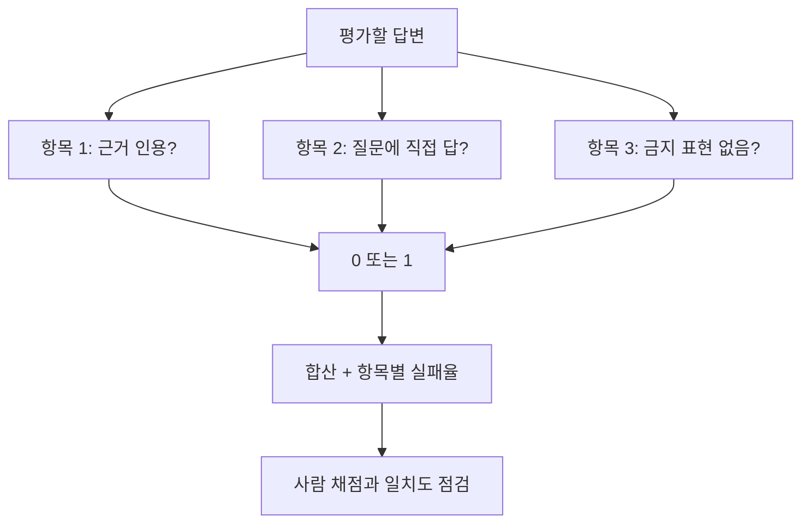

# 기준표 채점

> LLM 심판에게 "잘 썼나?"를 묻는 대신, 항목별 기준(루브릭)을 0/1 또는 짧은 척도로 쪼개 채점시켜 점수를 안정화하는 방법.

## 쉽게 말하면
논술 시험에서 "전체 인상 점수"만 매기면 채점자마다 갈리지만, "주장이 있는가 / 근거가 2개 이상인가 / 반론을 다뤘나"로 쪼개 체크하면 채점자 간 차이가 줄어든다.

## 자세히
- **Anthropic 평가 가이드(2026-11 확인, 일부만 읽음)**: 성공 기준은 구체적·측정 가능·달성 가능·관련성이 있어야 한다. 평가 방식으로 정확 일치, 임베딩 코사인 유사도, ROUGE-L, **LLM 기반 리커트 척도**(예: 응대 어조를 1~5점), **LLM 기반 이진 분류**(예: 응답에 보호 건강 정보가 있는가 yes/no)를 든다. 소량의 수작업보다 자동 채점 다량이 낫다고 권한다.
- **가이드 예시에서 보이는 루브릭 기법**: 척도 양끝을 문장으로 고정("1: 맥락을 완전히 무시", "5: 맥락을 완벽히 활용"), "숫자만 출력"처럼 파싱 가능한 출력으로 제한, 생성 모델과 다른 모델로 채점하는 것을 권장.
- **0/1 항목 분해(일반적 실무 방식, 이 글에서 단일 출처로 확인하진 않음)**: 5점 척도 하나보다 "예/아니오" 체크리스트 여러 개가 심판 간 일치도를 높이는 경향이 있다. 항목 점수를 합산하고 항목별 실패율을 보면 어디가 약한지 드러난다.
- **설계 요령**: 항목은 서로 독립, 관찰 가능한 근거로 판정(예: "인용 문장이 원문에 존재"), 모호한 형용사 금지, 판정 이유를 짧게 쓰게 한 뒤 결과만 파싱, 사람 채점과 일치도를 [Cohen's kappa](#cohens-kappa)로 점검.
- **주의**: 심판의 [위치 편향](#position-bias-judge)·장황함 편향은 루브릭을 써도 남는다. 쌍 비교면 순서를 바꿔 두 번 돌린다.

## 그림으로 보기


## 예시
고객 응대 답변 채점 프롬프트(초안):
```
다음 항목을 각각 1(충족)/0(미충족)으로 판정하고 JSON만 출력하라.
- greeted: 첫 문장에 인사가 있다
- answered: 질문에 직접 답했다
- policy_ok: 환불 정책 문구와 모순이 없다
```
항목별 통과율이 policy_ok에서만 낮으면 프롬프트의 정책 안내를 고친다.

## 헷갈리는 것과 비교
| 개념 | 차이 |
|---|---|
| 전체 점수(1~10) | 빠르지만 일관성 낮음 |
| 기준표 채점 | 항목 분해, 원인 파악 쉬움 |
| 쌍 비교 | A·B 중 우열, 위치 편향 주의 |
| [LLM 자동 평가](#llm-auto-rater) | 심판 LLM 전체 개념 |

## 더 읽을거리
- [Claude: Defining success criteria and building evaluations](https://platform.claude.com/docs/en/test-and-evaluate/develop-tests) — 평가 방식과 LLM 채점 예시(뒷부분 일부는 읽지 못함)
