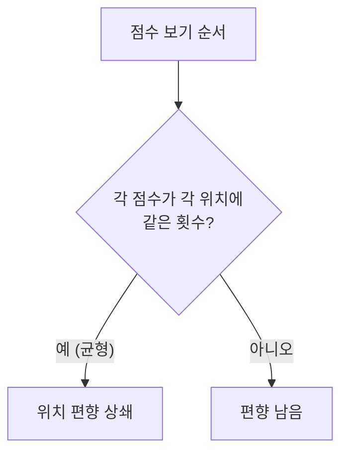

# 루브릭 순열 평균

> LLM 심판이 1~5점 같은 점수제로 채점할 때, 점수 보기(1,2,3,4,5)의 나열 순서를 바꿔 여러 번 채점하고 평균 내어 "점수 보기의 위치 편향"을 줄이는 방법.

## 쉽게 말하면
객관식 시험에서 정답 보기가 항상 ①번에 있으면 찍기만 해도 유리해진다. 보기 순서를 섞어 여러 번 풀게 하고 평균을 내면 순서 요령에 덜 흔들린다. 채점 루브릭도 점수 보기를 목록으로 보여 주므로 같은 문제가 생긴다.

## 자세히
출처는 Xu 외 "Am I More Pointwise or Pairwise? Revealing Position Bias in Rubric-Based LLM-as-a-Judge"(arXiv 2602.02219, 초록과 HTML 본문 열람).
- **문제**: 루브릭 기반 평가는 점수 보기를 고르는 객관식과 비슷해, LLM 심판이 목록의 특정 위치의 점수를 선호한다. 모델과 데이터셋에 걸쳐 일관되게 나타나지만 방향은 모델마다 다르다(어떤 심판은 첫 보기, 어떤 심판은 마지막 보기를 선호). 한 프롬프트에서 여러 기준을 동시에 채점하면 기준의 순서가 점수를 바꾸는 별도의 편향도 있다(초록).
- **균형 순열(HTML 본문)**: 1~5점 척도에서 10개의 순서를 만든다. [1,2,3,4,5]를 5번 순환 회전한 순방향 5개와 [5,4,3,2,1]을 5번 회전한 역방향 5개다(직접 생성해 확인: 각 점수가 각 위치에 정확히 두 번 나온다). 10번 채점한 점수를 평균하며, 고정 순서를 10번 반복해 평균하는 "Repeat"와 비교한다. 초록은 "무작위 순서 순열 몇 개면 충분"이라고 써, 균형 설계와 표현이 다르다. 초록에는 균형 방식이 명시돼 있지 않다.
- **실험(HTML 본문)**: GPT-4.1, GPT-4.1-mini, Qwen3-8B·32B(추론 켬/끔), GPT-OSS-120B. 사람 평가 상관은 HANNA(576개)와 SummEval(1,600개)에서 측정했다. 평균 이득: HANNA에서 Pearson +0.027·Spearman +0.032, SummEval에서 +0.018·+0.014. 가장 큰 이득은 Qwen3-32B의 HANNA Spearman +0.089. 이득은 편향이 강한 모델에서 주로 나타났다(초록).
- **예외와 한계**: Qwen3-8B는 순열이 오히려 상관을 낮췄다(HANNA Pearson −0.046, Spearman −0.052). 이 모델에서는 12345 순서가 우연히 사람 평가와 가장 잘 맞았다. 편향이 가장 적은 GPT-OSS-120B가 GPT-4.1보다 더 높은 상관을 보이지도 않았다. 10개 순열과 두 사람 주석 데이터셋만 시험했다.
- **편향 비용(Bias Cost, 라벨 없이 순서 고르기)**: Cost(π) = Σ |P(p|π_p) − 0.2|, 낮을수록 편향이 적다. 모델을 몇 개 순서로 탐침해 위치별 선택 비율을 추정하고 비용이 가장 낮은 순서를 고른다. 대부분 상관 상위 50% 안에 들었고 예로 GPT-4.1은 기본 순서에서 13.6이던 비용이 [5,4,3,2,1]에서 5.8로 줄었다.
- **트레이드오프**: 순열은 같은 항목 안에서 점수 변동(표준편차)을 키운다(예: GPT-4.1 HANNA 0.475 vs 0.204). 순서 때문에 흔들림이 드러나는 것이지 반드시 나빠진 것은 아니다.

## 그림으로 보기

## 예시
- 점수 보기를 "5점: 매우 좋음…1점: 매우 나쁨" 순서와 "1점…5점" 순서 등 10가지로 돌려 평균 점수를 최종 점수로 쓴다(논문 설계를 옮긴 예).
- 교육 실습: 같은 답변을 2개 순서로 채점해 보고 점수가 달라지는지 확인.

## 헷갈리는 것과 비교
| 개념 | 차이 |
|---|---|
| 루브릭 순열 | 점수제 평가의 보기 순서를 바꿈 |
| [판정 일관성 측정](#judge-consistency) | 쌍비교 평가의 답 순서를 바꿈 |
| Repeat(반복) | 같은 순서를 여러 번 |
| 기준 순서 편향 | 여러 기준을 동시에 채점할 때의 별도 편향 |

## 더 읽을거리
- [Am I More Pointwise or Pairwise? (arXiv 2602.02219)](https://arxiv.org/abs/2602.02219) — 초록(열람)
- [같은 논문 HTML](https://arxiv.org/html/2602.02219v1) — 균형 순열·결과(열람)
