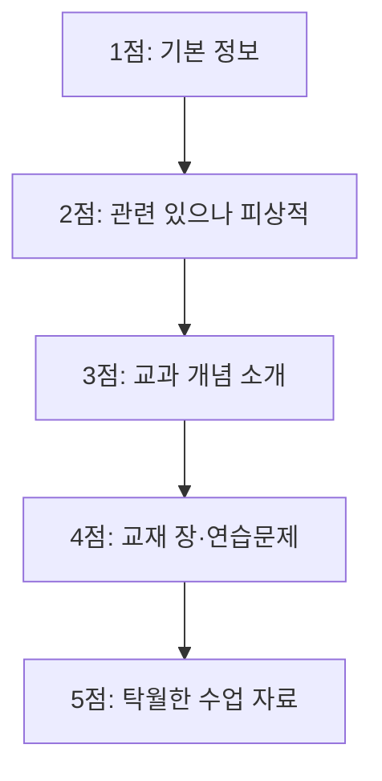

# 루브릭을 프롬프트로

> 평가 기준표(루브릭)를 **LLM이 따라 채점할 수 있는 지시문(프롬프트)으로 옮기는** 방법이다. FineWeb-Edu는 "교육적 가치"를 **가산식 5점 척도**로 적은 프롬프트로 대형 모델에게 웹 문서를 채점시켜 학습 데이터를 거른다.

## 쉽게 말하면
심사위원에게 "느낌으로 점수 주세요" 대신 "기본 정보가 있으면 1점, 교과 개념을 소개하면 +1점…"처럼 점수가 쌓이는 체크리스트를 주는 것이다. 같은 기준표를 쓰면 심사위원이 달라도 점수가 비슷해진다.

## 자세히
- 출처: FineWeb 논문(arXiv 2406.17557) 부록 F.1 "Annotation Prompt", 그리고 HuggingFace `fineweb-edu-classifier` 모델 카드(둘 다 열람). 카드에서는 프롬프트가 이미지로만 제공돼 논문 부록의 텍스트를 읽었다.
- 프롬프트 구조(요약, 원문은 영어):
  1. **과업 설명**: 웹 페이지 발췌문이 **초등~중등 수준 교육에 유용한 정도**를 "아래 **가산식 5점 척도**로 평가하라. 기준을 만족할 때마다 점수가 쌓인다."
  2. **점수 규칙 5개(누적)**:
     - 1점: 교육 주제와 관련된 기본 정보가 있다(광고 등 무관한 내용이 섞여도 됨).
     - +1점: 교육과 관련된 요소를 다루지만 교육 기준과 잘 맞지 않고, 비교육 내용이 섞이거나 피상적·비체계적이다.
     - +1점(3점): 교육용으로 적절하고 교과 핵심 개념을 소개하며 일관적이지만 포괄적이지 않거나 불필요한 정보가 있다(교재 도입부·기초 튜토리얼 수준, 초등 수준에 비해 어려운 개념 포함 가능).
     - +1점(4점): 초등~중등 이하 수준에 매우 적합하고 글이 명확·일관적이며 교재 한 장이나 튜토리얼처럼 연습문제·풀이 등 실질적 내용이 있다.
     - +1점(5점): 교육 가치가 뛰어나고 풀이 과정이 논리적이며 쉬운 글로 깊이 있는 통찰을 주고 비교육적·복잡한 내용이 없다.
  3. **출력 형식**: 점수를 **100단어 이내로 짧게 정당화**한 뒤 마지막 줄을 `Educational score: <총점>`으로 끝내라(파싱용).
- 규모와 활용(모델 카드): 이 점수로 **Llama-3 주석 450,000개**를 만들어, `Snowflake-arctic-embed`에 **회귀 출력 하나짜리 분류 헤드**를 붙인 작은 분류기를 학습시켰다(20 에폭, 임베딩·인코더 고정, 홀드아웃 46,867개). 큰 모델로 소량을 채점하고 작은 모델이 전체 웹을 채점하는 구조다. 분류기 사용 시 `int_score ≥ 3`을 임계값으로 권장하며 이진 판정 F1이 82%라고 카드가 적는다. 다섯 클래스를 개별로 맞히는 정확도는 0.71이고 **5점 클래스는 재현율 0.01**로 거의 못 맞힌다(희귀 클래스, 지지 125개).
- 루브릭 → 프롬프트 변환 원칙(이 사례에서 뽑은 것; 일반화는 제안): ① 점수 규칙을 **가산식**(기준 충족마다 +1)으로 써서 판단을 쪼갠다 ② 각 규칙에 **구체적 단서**(교재 한 장, 연습문제·풀이 포함)를 준다 ③ 대상 독자 수준을 명시한다([수준 지정 지시](#grade-level-focus-instruction)) ④ **짧은 근거 + 고정 형식의 최종 점수**로 출력해 자동 파싱한다 ⑤ 사람이 몇 개를 채점해 LLM 점수와 비교한다([LLM 채점 일관성](#llm-score-consistency)).
- 한계: 프롬프트는 영어·초중등 교육 관점으로 설계돼 다른 언어·직무 교육에 그대로 쓰면 편향이 있을 수 있다. LLM 채점 자체의 오차는 이 문서에서 측정하지 않았다.

## 그림으로 보기

## 예시
- 사내 교육 자료 선별: "직무 관련 정보 있음 +1, 실습 예시 포함 +1, 단계별 절차 +1, …"처럼 직무 교육용 가산식 루브릭으로 바꿔 LLM에게 채점시킨다.
- 교육: 같은 문서를 사람과 LLM이 각각 채점해 일치도를 비교하는 활동.

## 헷갈리는 것과 비교
| 개념 | 차이 |
|---|---|
| 가산식 척도 | 기준 충족마다 점수가 쌓임 |
| 단일 점수 요청 | "1~5로 평가" 한 번에 판단 |
| 분류기 증류 | LLM 점수로 작은 모델을 학습해 대규모에 적용 |
| [LLM 채점 일관성](#llm-score-consistency) | 같은 프롬프트의 반복·변형 시 점수 안정성 |

## 더 읽을거리
- [FineWeb 논문 (arXiv 2406.17557)](https://arxiv.org/abs/2406.17557) — 부록 F.1 주석 프롬프트(읽음).
- [fineweb-edu-classifier 모델 카드](https://huggingface.co/HuggingFaceFW/fineweb-edu-classifier) — 분류기·임계값·지표(읽음).
