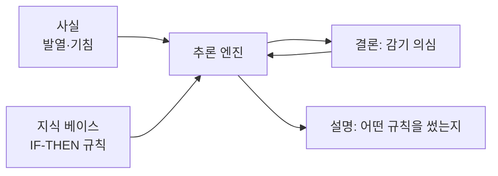
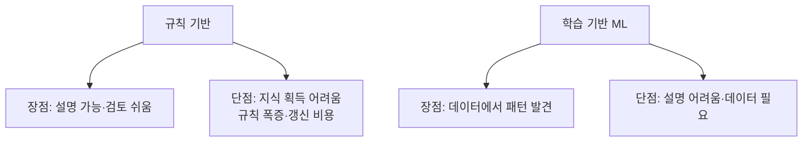

# 규칙 기반 AI와 전문가 시스템

> **사람 전문가의 지식을 "만약 ~라면 ~이다(IF-THEN)" 규칙으로 적어 두고, 추론 엔진이 그 규칙을 사실에 적용해 결론을 도출**하는 초기 AI 방식. 1980년대 기업에서 널리 쓰였고, **왜 그런 결론인지 설명할 수 있다**는 장점이 있지만 **지식을 규칙으로 뽑아내기 어렵다**는 한계로 쇠퇴했다. 지금은 기업 소프트웨어의 한 부품으로 다시 쓰인다.

## 쉽게 말하면
의사가 쓴 진료 지침서를 컴퓨터에 그대로 입력해 두고 "열이 나고 기침이 있다 → 감기 의심"처럼 규칙을 하나하나 따라가는 시스템이다. 데이터로 배우는 요즘 AI와 달리, 사람이 규칙을 직접 가르쳐 줘야 한다.

## 자세히
(Wikipedia "Expert system" 요약 + 직접 실행)
- **구성**: **지식 베이스**(사실과 규칙) + **추론 엔진**(규칙을 사실에 적용해 새 사실 도출). 더 완전한 시스템에는 설명 기능, 지식 획득 기능, 사용자 인터페이스가 있다.
- **추론 방식**: **전방 연쇄(forward chaining)** 는 알려진 사실에서 시작해 규칙을 발동시켜 결론으로 나아가고, **후방 연쇄(backward chaining)** 는 가능한 결론에서 거꾸로 필요한 사실을 찾으며 모자란 사실을 사용자에게 물을 수 있다.
- **역사**: 에드워드 파이겐바움이 이끈 스탠퍼드 휴리스틱 프로그래밍 프로젝트가 소개했고, 1980년대에 많은 대기업이 사용했다. **MYCIN**(감염 진단)과 **R1(XCON)**(DEC VAX 컴퓨터 구성)이 대표 사례다. 1990년대에 관심이 식었다가 2000년대에 비즈니스 소프트웨어의 구성 요소로 규칙 기반 시스템이 돌아왔다.
- **장점**: 규칙이 명시적이어서 검토·유지보수가 하드코딩보다 쉽고, 빠른 시제품 제작이 가능하며 **결론에 이른 과정을 설명**할 수 있다.
- **단점**: 핵심 문제는 **지식 획득**(전문가가 드물고 지식을 끌어내기 어려움). 규칙이 커지면 복잡해지고 일관성 검증·갱신 비용이 커지며 기존 시스템과의 통합도 어렵다.
- **직접 실행**(파이썬 20줄짜리 전방 연쇄 엔진): 규칙 3개(`발열+기침 → 감기 의심`, `감기 의심+호흡곤란 → 병원 방문 권고`, `발열+발진 → 홍역 의심`).

| 입력 사실 | 도출 결과 | 근거(추론 과정) |
|---|---|---|
| 발열, 기침 | 감기 의심 | 발열+기침 ⇒ 감기 의심 |
| 발열, 기침, 호흡곤란 | 감기 의심, **병원 방문 권고** | 첫 규칙의 결론이 다음 규칙의 조건이 되는 **연쇄** |
| 두통 | **없음** | 해당 규칙이 없으면 아무 답도 못 함 |

  연쇄 추론과 **근거 설명**이 자연스럽게 나오는 반면, **규칙에 없는 상황에서는 답을 못 한다**는 것을 보여 준다(이 경향의 일반 용어인 "취약성(brittleness)"은 위 위키 문서가 쓰는 말이 아니다).
- **오늘의 위치**: 법규 준수 검사, 세금·보험 계산, 안전 규칙 같은 **규칙이 명확하고 설명이 필수인 업무**에서 여전히 유효하다. 최근 에이전트 설계에서도 **결정적 규칙(린터·게이트)** 과 **LLM 판단**을 섞는 방식이 쓰인다([기계적 제약](#mechanical-constraints)).

## 그림으로 보기



## 예시
```python
rules = [({"발열","기침"}, "감기 의심"),
         ({"감기 의심","호흡곤란"}, "병원 방문 권고")]
def infer(facts):
    facts = set(facts); changed = True
    while changed:
        changed = False
        for cond, res in rules:
            if cond <= facts and res not in facts:
                facts.add(res); changed = True
    return facts
```
- 업무 예: 대출 심사 1차 규칙("소득 대비 부채 비율 > 40% → 추가 서류"), 사내 구매 승인 규칙.

## 헷갈리는 것과 비교
| 개념 | 차이 |
|---|---|
| 규칙 기반 AI | 사람이 규칙을 작성, 설명 가능 |
| 머신러닝 | 데이터에서 규칙(패턴)을 학습 |
| LLM | 대규모 학습으로 언어 패턴을 일반화, 규칙은 암묵적 |
| [학습과 추론](#training-inference) | 학습 기반의 두 단계(규칙 기반에는 학습 단계가 없음) |

## 더 읽을거리
- [Wikipedia: Expert system](https://en.wikipedia.org/wiki/Expert_system) — 구성·역사·장단점.
