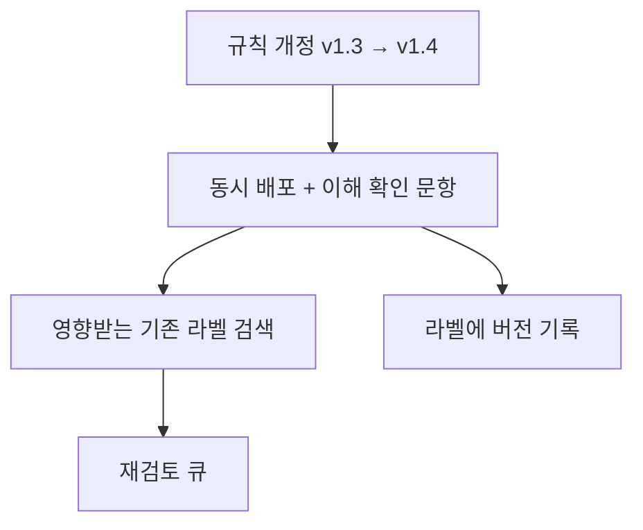
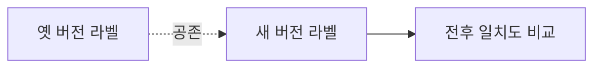

# 규칙 변경 전파

> 규칙 변경 전파는 라벨 가이드를 개정했을 때 모든 라벨러가 같은 시점에 같은 버전을 쓰게 하고, 이미 붙은 라벨 중 영향을 받는 것을 찾아 고치는 절차다. 일부 라벨러만 새 규칙을 쓰면 라벨러 간 일치도가 오히려 떨어진다.

## 쉽게 말하면
회사 규정을 바꿨는데 어떤 팀은 옛 규정, 어떤 팀은 새 규정으로 일하면 같은 사건에 다른 처리가 나온다. 개정은 "모두에게 동시에, 이전 처리분은 어떻게 할지까지" 알려야 한다.

## 자세히
- **근거(Finlayson & Erjavec, arXiv 1602.05753)**: 주석 프로젝트에서 사양서와 안내서는 여러 버전을 거치고, 새 버전을 적용할 때 코퍼스의 옛 사양 부분이 새 버전과 공존하게 된다고 한다. 주석 도구는 지금 어떤 버전이 쓰이는지 분명히 보여 주고, 주석자가 두 버전의 차이를 볼 수 있게 지원하는 것이 좋다고 한다. 주석 단계 항목에도 지침 버전 추적, 옛 사양으로 된 주석을 새 버전으로 갱신하는 일, 흔한 오류·불일치를 점검해 수정하는 일이 들어 있다.
- **절차(해석)**:
  1. **변경 기록**: 무엇이 왜 바뀌었는지 한 줄 + 전후 예시 (버전 번호 부여)
  2. **동시 배포**: 시작 시각을 정해 모두에게 알리고 그 시각 이후 항목은 새 버전만 사용
  3. **이해 확인**: 새 규칙 관련 확인 문항 5~10개(골든)로 숙지 여부 점검([골든 문항 선정](#golden-item-selection))
  4. **영향 범위 탐색**: 바뀐 규칙에 해당하는 기존 라벨을 찾아 재검토 대상으로 큐에 올린다([재검토 검색식](#relabel-query))
  5. **버전 표시**: 라벨마다 지침 버전을 저장([라벨 메타데이터 기록](#annotation-metadata-tracking))
  6. **효과 측정**: 변경 전후 일치도를 비교([주간 일치도 대시보드](#weekly-agreement-dashboard))
- **주의(해석)**: 규칙 변경 직후에는 일치도가 잠시 떨어질 수 있다. 관리도 기준선을 새로 잡고([라벨링 관리도](#control-chart-for-labeling)) 변경 이벤트를 차트에 표시한다. 너무 잦은 개정은 혼란을 부른다 — 여러 변경을 모아 정해진 주기로 배포한다.
- **공존 기간 관리(해석)**: 옛 버전 라벨을 일괄 새 버전으로 바꿀 수 있는 변경(이름만 변경)과 다시 판정해야 하는 변경(기준이 바뀜)을 구분한다.

## 그림으로 보기

## 예시
- "반어법은 부정으로" 규칙을 추가했다면 개정 시점 이후 항목은 새 규칙, 이전 라벨 중 반어법 후보(키워드·모델 의심)는 재검토 큐에 올린다.
- 교육 활용: 규칙 개정안을 직접 쓰고 "영향받는 라벨은 어떻게 찾을까"를 토론한다.

## 헷갈리는 것과 비교
| 개념 | 차이 |
| --- | --- |
| 규칙 변경 전파 | 새 규칙을 모두에게 알리고 기존 라벨 처리 |
| [재보정 조건](#recalibration-trigger) | 품질 하락 시 대응 |
| [라벨 메타데이터 기록](#annotation-metadata-tracking) | 버전 정보 저장 |
| [판정 사유 기록](#adjudication-rationale-log) | 개정의 근거 재료 |

## 더 읽을거리
- [Overview of Annotation Creation: Processes & Tools (arXiv 1602.05753)](https://arxiv.org/abs/1602.05753) — 사양서·지침 버전 관리, 옛 버전 주석 갱신
