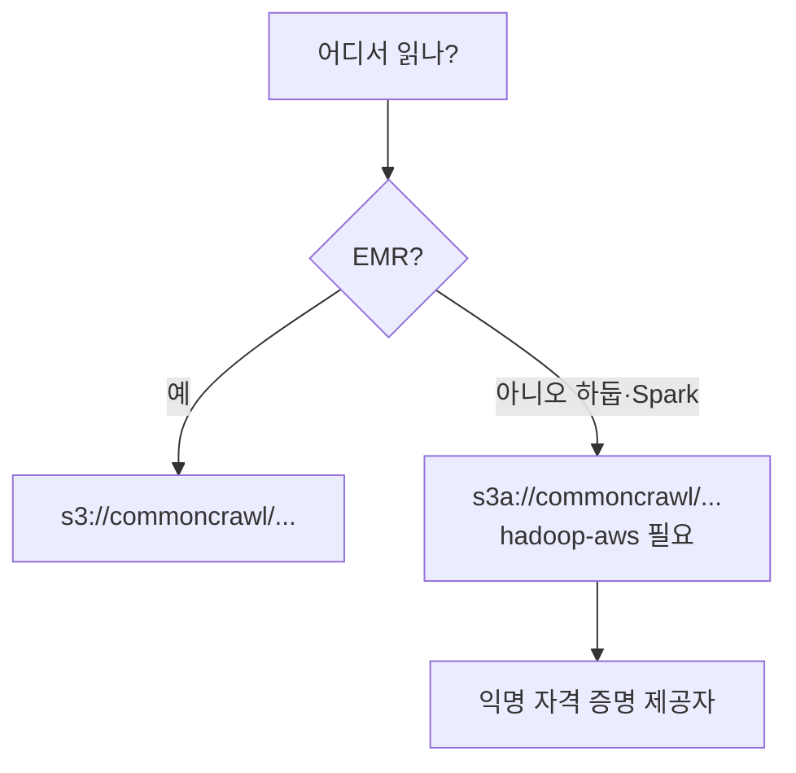
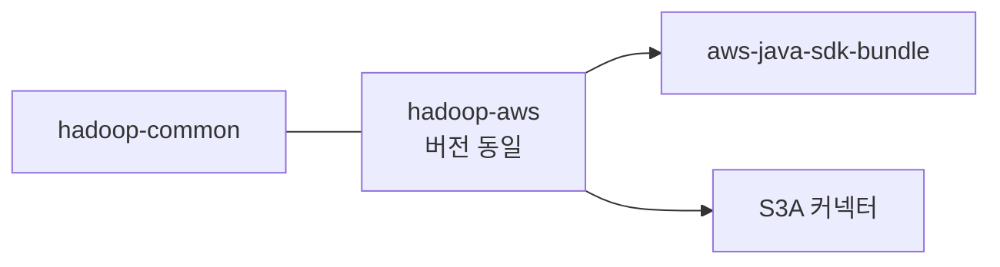

# s3a 프로토콜

> 하둡·Spark 같은 도구가 **S3 버킷을 파일 시스템처럼 읽고 쓰는 주소 방식(`s3a://버킷/경로`)**. AWS 서비스 안(EMR)이 아니라 일반 하둡·Spark에서 Common Crawl을 읽을 때 쓴다.

## 쉽게 말하면
같은 창고라도 들어가는 문이 도구마다 다르다. EMR은 `s3://` 문을 쓰고, 일반 하둡·Spark는 `s3a://` 문으로 들어간다. 문 이름만 바꾸면 같은 선반을 볼 수 있다.

## 자세히
(Common Crawl 시작하기 페이지와 Apache Hadoop `hadoop-aws` 공식 문서를 직접 읽음)
- **Common Crawl 안내**: AWS 안에서는 `s3://commoncrawl/…`을 EMR 같은 서비스에서 바로 쓰고, **하둡(EMR이 아님)이면 프로토콜만 `s3a://`로 바꾸라**고 적는다.
- **S3A란(하둡 문서)**: Hadoop의 S3 클라이언트로 S3 객체를 직접 읽고 쓰며 멀티파트 업로드·버킷별 설정을 지원한다. 하둡 프로젝트가 **현재 유지하는 커넥터는 S3A뿐**이다. `s3n:`은 더 이상 쓸 수 없고 원래 하둡의 `s3://`도 제거됐으며, EMR의 `s3://`는 EMR 팀이 따로 관리한다.
- **의존성**: `hadoop-aws` JAR와 `aws-java-sdk-bundle` JAR가 필요하고 **`hadoop-common`과 `hadoop-aws` 버전이 같아야** 한다.
- **공개 버킷 읽기(익명)**: `fs.s3a.aws.credentials.provider`를 `org.apache.hadoop.fs.s3a.AnonymousAWSCredentialsProvider`로 설정하면 자격 증명 없이 읽는다. 여러 제공자를 나열할 때는 익명 제공자를 **맨 뒤**에 둬야 한다. 특정 버킷만 지정하는 키는 `fs.s3a.bucket.<이름>.aws.credentials.provider`다. 문서는 버킷에 익명 접근을 허용하는 것이 보안상 대부분의 용도에 부적합하다고 경고한다(공개 데이터를 읽는 쪽에는 해당하지 않는다).
- **엔드포인트·리전**: 기본은 `s3.amazonaws.com`이고 `fs.s3a.endpoint`, `fs.s3a.endpoint.region`으로 바꾼다. Common Crawl은 us-east-1이므로 그 리전에서 처리해야 요금이 적다([리전 간 전송 요금](#cross-region-transfer-fees)).
- **성능**: Parquet·ORC 같은 열 기반 파일을 위한 고성능 임의 읽기 모드와, POSIX `fadvise()`와 비슷한 입력 정책을 지원한다. 색인 Parquet을 Spark로 읽을 때 유용하다([열 기반 색인](#columnar-index-parquet)).
- **Spark 예시(제안, 직접 실행하지 않음)**:
  ```python
  spark.sparkContext._jsc.hadoopConfiguration().set(
      "fs.s3a.aws.credentials.provider",
      "org.apache.hadoop.fs.s3a.AnonymousAWSCredentialsProvider")
  df = spark.read.parquet("s3a://commoncrawl/cc-index/table/cc-main/warc/crawl=CC-MAIN-2024-10/subset=warc/")
  ```
  경로의 크롤 이름과 세부 설정은 현재 문서를 확인한다.

## 그림으로 보기



## 예시
| 환경 | 주소 |
|---|---|
| EMR | `s3://commoncrawl/crawl-data/...` |
| 일반 하둡·Spark | `s3a://commoncrawl/crawl-data/...` |
| 인터넷 일반 PC | `https://data.commoncrawl.org/...` |
- 업무 장면: 데이터 엔지니어링 교육에서 같은 쿼리를 EMR(`s3://`)과 로컬 Spark(`s3a://`)에서 각각 돌려 주소만 다르다는 점을 보여 준다.

## 헷갈리는 것과 비교
| 개념 | 차이 |
|---|---|
| `s3a://` | 하둡 프로젝트가 유지하는 S3 커넥터 |
| `s3://`(EMR) | EMR이 제공하는 별도 구현 |
| `s3n://` | 더 이상 쓸 수 없음 |
| [Common Crawl 접근 방법](#cc-s3-access) | s3a는 그중 하둡용 형식 |

## 더 읽을거리
- [Common Crawl 시작하기](https://commoncrawl.org/get-started) — `s3a://` 안내(직접 읽음).
- [Hadoop-AWS: S3A 문서](https://hadoop.apache.org/docs/stable/hadoop-aws/tools/hadoop-aws/index.html) — 설정 키와 익명 접근(직접 읽음).
