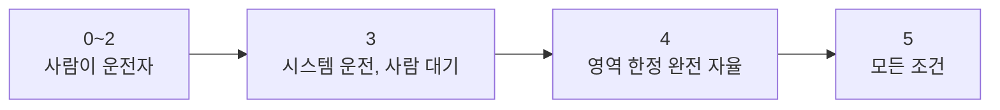
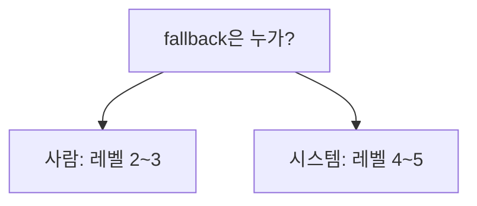

# SAE 자율주행 레벨

> 미국 자동차공학회(SAE) J3016 표준이 정한 **운전 자동화 0~5단계**. 핵심은 "얼마나 똑똑한가"가 아니라 **누가 운전 책임을 지고, 비상시 누가 대처(fallback)하는가**다.

## 쉽게 말하면
택시를 탔을 때 "기사가 핸들을 잡고 있나, 뒤에서 대기만 하나, 아예 없나"로 나누는 분류다. 차의 성능 순위표가 아니라 사람과 시스템의 **역할 분담표**다.

## 자세히
- 레벨 0~2: 사람이 운전자. 레벨 2(부분 자동화)는 시스템이 조향과 가속·감속을 함께 하지만, **나머지 모든 운전 업무와 도로 감시는 사람 몫**이다.
- 레벨 3: 정해진 조건에서 시스템이 운전 전체를 하고, 경고나 고장 시 사람이 넘겨받는 **fallback-ready user**가 있다. CMU Koopman의 J3016 사용자 가이드는 레벨 3도 "눈 떼도 됨"으로 정의되지 않는다고 지적한다.
- 레벨 4: 정해진 운행 영역(ODD) 안에서 시스템이 fallback까지 항상 수행. 로보택시가 여기에 해당한다. 레벨 5: 모든 조건에서 가능.
- 중요한 주의: 이 표준은 **서술적·기술적 분류이지 법적·안전 기준이 아니다**. 가이드는 레벨 2·3이 효과적인 운전자 감시 없이는 안전 문제를 만든다고 본다.
- 버전: 2021-04판이 널리 인용되며, ANSI에 2026판 등재가 보이고 간단한 레벨 설명 문구가 바뀌었다고 한다(나는 원문을 열람하지 못함). 정확한 표현은 현행 SAE 문서로 확인.
- 마케팅 이름(예: "Full Self-Driving (Supervised)")은 레벨이 아니다. Tesla 문서는 운전자 상시 감독을 요구한다고 밝힌다.

## 그림으로 보기

## 예시
- 차선 유지+크루즈는 레벨 2: 손을 떼도 책임은 운전자.
- 교육: 업무 자동화에도 "사람이 검토·최종 책임" 단계를 구분하는 틀로 활용.

## 헷갈리는 것과 비교
| 개념 | 차이 |
|---|---|
| SAE 레벨 | 책임 분담 분류 |
| ODD | 시스템이 작동하도록 설계된 조건 범위 |
| [로보택시 안전 지표](#robotaxi-safety-metrics) | 실제 안전성을 수치로 비교 |

## 더 읽을거리
- [SAE J3016 User Guide (CMU)](https://users.ece.cmu.edu/~koopman/j3016/index.html) — 레벨 해설과 비판(검색 요약으로 확인).
- [Tesla FSD 지원 페이지](https://www.tesla.com/support/fsd) — 감독 요구 문구(검색 결과로 확인).
