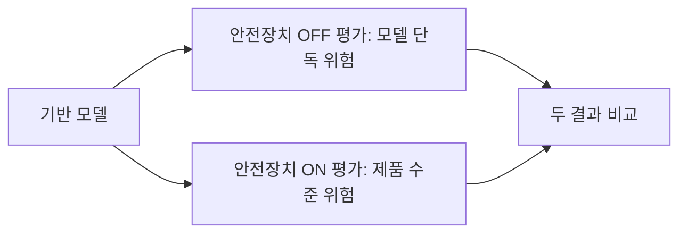
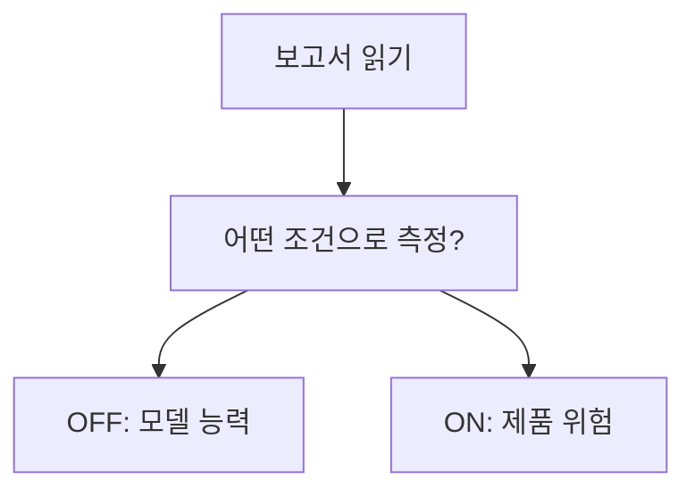

# 안전장치 ON/OFF 평가

> 모델 자체의 능력·위험과 제품에 추가된 안전장치를 켠 상태의 위험은 다르다. 평가 보고서에서 어느 조건으로 측정했는지 확인해야 한다.

## 쉽게 말하면
안전벨트를 맨 상태와 벗은 상태의 사고 피해는 다르다. 보고서가 "벨트 없이 시험"인지 "벨트 매고 시험"인지 밝혀야 결과를 올바로 읽는다.

## 자세히
(Anthropic 투명성 허브를 하위 에이전트가 WebFetch 요약으로 읽은 노트. 아래 인용은 요약 도구가 돌려준 문장이며 **원문과 대조가 필요**하다.)
- **안전장치 OFF 평가의 서술 예**: 어떤 RSP 평가 설명은 "이 평가는 기반 모델을 시험하므로 제품에 적용하는 추가 안전장치 없이 실행했다", 다른 모델 설명은 "달리 표기하지 않으면 제품의 추가 안전장치 없이 모델 단독을 측정했다"고 적는다.
- **ON/OFF 비교 예**: 한 모델에 대해 "추가 안전장치를 켠 상태와 끈 상태의 견고성을 비교"하고 "안전장치를 켜도 공격 성공률이 0.07%로 변하지 않았다"는 서술이 있다(허브 요약).
- **미확인**: Opus 4 계열의 프롬프트 인젝션 공격 성공률 71~89%(Sonnet 4는 69~86%)는 검색 스니펫만 있어 확인하지 못했다. Opus 4.1 부록에서는 안전장치 ON/OFF 비교 서술을 찾지 못했다.
- **읽는 법(제안)**: ① 모델 단독 평가는 "최악의 경우에 가까운" 능력·위험 추정 ② 제품(안전장치 포함) 평가는 실제 이용자가 마주하는 위험 ③ 두 결과를 모두 요구하고 안전장치 우회 가능성도 점검.

## 그림으로 보기

## 예시
- 공격 성공률 보고서에서 안전장치 포함 여부와 시스템 프롬프트 유무를 표로 정리.
- 교육 활용: 두 조건의 결과가 다른 이유를 토론.

## 헷갈리는 것과 비교
| 개념 | 차이 |
|---|---|
| 안전장치 OFF 평가 | 기반 모델 단독 |
| 안전장치 ON 평가 | 제품 환경 |
| [자기 보고 vs 독립 평가](#self-reported-vs-independent-eval) | 평가 주체의 축 |

## 더 읽을거리
- [Anthropic 투명성 허브](https://www.anthropic.com/transparency) — 평가 조건 서술(요약으로 확인).
