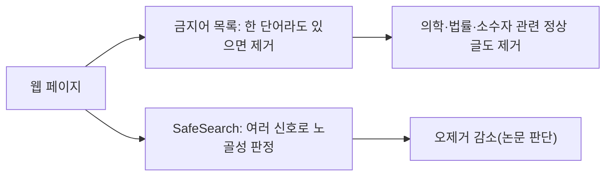
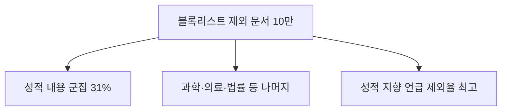

# SafeSearch vs 금지어 목록

> 학습 데이터에서 노골적인 콘텐츠를 걸러 낼 때, 단어 목록(블록리스트)으로 걸러 내는 방식은 소수 집단에 관한 정상적인 글까지 많이 지우는 문제가 있어, Gopher는 구글 SafeSearch 필터를 대신 썼다.

## 쉽게 말하면
"위험 단어가 한 번이라도 나오면 책 전체를 버리기"는 의학서나 인권 보고서도 버린다. 문맥과 여러 신호를 함께 보는 검사(SafeSearch)는 책 내용을 보고 판단하므로 덜 억울하게 버린다. 다만 SafeSearch 내부는 외부에서 볼 수 없다는 약점이 있다.

## 자세히
(Dodge 등 arXiv 2104.08758 PDF 본문 5절과 Gopher 논문 arXiv 2112.11446 부록 A.1을 직접 내려받아 확인.)
- **C4의 금지어 필터**: 목록에 있는 단어가 하나라도 있는 페이지는 통째로 제거([C4 데이터셋](#c4-dataset)).
- **감사 결과(Dodge 등)**: 블록리스트가 제외한 문서 10만 개 표본을 k-means(k=50)로 군집화하니 **성적 내용 군집은 16개, 제외 문서의 31%**였다. 나머지에는 과학·의학·건강, 법률·정치 군집이 있었다. 22개 정체성 표현의 PMI 분석에서 **성적 지향 언급(lesbian, gay, heterosexual, homosexual, bisexual)이 가장 높은 확률로 제외**됐고, 'lesbian'·'gay' 언급 문서 50개씩을 보니 비공격적·비성적 문서가 각각 22%·36%였다. 결혼·연애 등 동성 관계 주제 문서도 포함. 즉 목록 필터가 소수자 관련 정상 글을 불균형하게 지운다.
- **Gopher의 선택**: MassiveWeb에서 "구글의 SafeSearch 필터를 통과하지 못한 페이지"를 제거한다. SafeSearch는 노골적 콘텐츠를 식별하려고 여러 웹 신호를 쓴다. 논문은 이유를 "수동 금지어 필터가 소수 집단과 연관된 무해한 콘텐츠를 불균형하게 걸러 낸다고 알려졌기 때문(Dodge 등 2021)"이라고 쓴다.
- **트레이드오프(제안)**: SafeSearch는 외부 서비스 의존·비공개 기준·재현 곤란 문제가 있고, 완전히 편향 없는 것도 아니다. 오픈 대안으로는 오픈소스 분류기, 문서 단위 대신 줄 단위 제거, 사람이 샘플링 점검하는 방식이 있다.
- **점검 요령(제안)**: 필터가 지운 문서 표본을 읽고, 정체성·주제별 제거율을 비교한다([웹 크롤 품질 문제](#web-crawl-quality-issues)).
- 상위 설계: [사전학습 데이터 필터링](#pretraining-data-filtering), 사례: [Gopher·MassiveText](#gopher-massivetext).

## 그림으로 보기

## 예시
- 사내 학습 데이터 필터를 만들 때 금지어로 문서를 통째로 지우기 전에, 걸린 문서 100개를 읽고 정상 문서 비율을 측정한다.
- 교육 활용: "안전 필터가 누구를 더 지우는가"를 토론하는 AI 윤리 수업의 구체 사례.

## 헷갈리는 것과 비교
| 개념 | 차이 |
|---|---|
| 금지어 목록 | 단어 일치로 문서 제거, 문맥 무시 |
| SafeSearch | 구글의 노골성 판정(내부 비공개) |
| [웹 크롤 품질 문제](#web-crawl-quality-issues) | 오염·편중·필터 부작용 전반 |
| 독성 분류기(Perspective 등) | 독성 점수로 판정. Gopher는 독성 분석에 활용 |

## 더 읽을거리
- [Documenting Large Webtext Corpora (arXiv 2104.08758)](https://arxiv.org/abs/2104.08758) — 블록리스트 부작용 분석(PDF 본문 확인).
- [Gopher 논문 (arXiv 2112.11446)](https://arxiv.org/abs/2112.11446) — SafeSearch 선택 이유(PDF 본문 확인).
