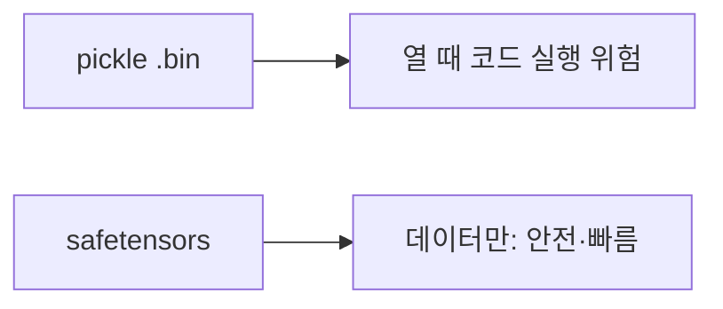
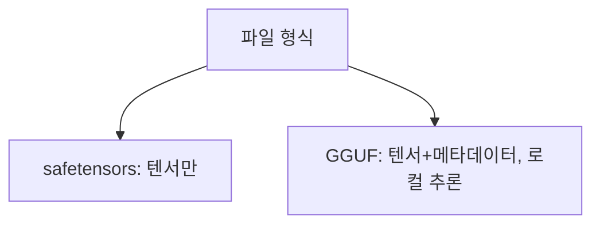

# safetensors

> Hugging Face가 만든 **텐서를 안전하게 저장하는 파일 형식.** 파이썬 pickle처럼 코드를 실행할 위험 없이 빠르게(zero-copy) 불러온다.

## 쉽게 말하면
모델 가중치를 담는 택배 상자인데, 상자 안에는 숫자 데이터만 들어 있다고 규격으로 보장한다. 예전 방식(pickle)은 상자를 열 때 안에 든 프로그램이 같이 실행될 수 있었다.

## 자세히
(Hugging Face safetensors 문서 열람 2026-11-28. 문서의 형식 설명 부분은 내가 받은 텍스트에서 비어 있었다.)
- 문서 첫 문장: "pickle과 달리 텐서를 **안전하게** 저장하면서도 **빠른(zero-copy)** 새 형식."
- 사용: `safe_open`으로 필요한 텐서만 읽을 수 있고, **일부만 슬라이스로 읽기**도 된다(다중 GPU에서 유용하다고 문서가 설명). 저장은 `save_file`.
- 채택: transformers, mlx, candle, ComfyUI, llama.cpp 변환 스크립트 등 폭넓게 사용(문서 목록).
- 허브 맥락: GGUF 문서는 safetensors를 **텐서만 담는 형식**, GGUF를 **텐서와 표준 메타데이터를 함께 담는 형식**으로 구분하고, safetensors도 Hub 권장 형식이라고 적는다.
- pickle 위험의 구체 메커니즘(역직렬화 시 임의 코드 실행)은 일반 지식이며 이 문서 본문에서 확인한 내용은 아니다.
- 한계: 형식 자체는 가중치의 출처·변조 여부를 보증하지 않는다. 신뢰할 수 있는 출처에서 받고 해시를 확인한다(일반 권고).

## 그림으로 보기



## 예시
```python
from safetensors.torch import save_file
save_file({"w": torch.zeros(2,2)}, "model.safetensors")
```
- 교육: 모델 저장소에서 `.safetensors`와 `.gguf` 파일을 구분해 보는 활동.

## 헷갈리는 것과 비교
| 개념 | 차이 |
|---|---|
| safetensors | 텐서만, 안전 |
| [GGUF](#quant-naming) | 메타데이터 포함, 양자화·로컬 추론 |
| pickle | 코드 실행 위험이 있는 파이썬 직렬화 |

## 더 읽을거리
- [safetensors 문서](https://huggingface.co/docs/safetensors/index) — 개요·사용법(읽음).
- [Hugging Face: GGUF](https://huggingface.co/docs/hub/gguf) — 형식 비교(읽음).
