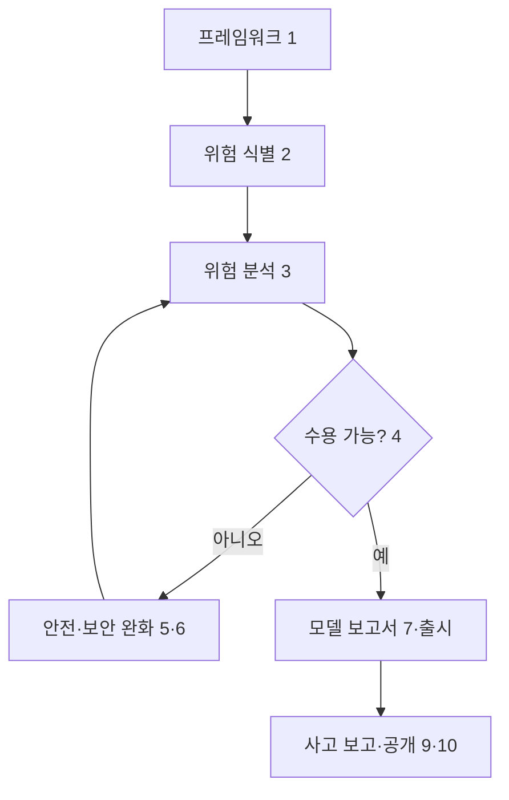
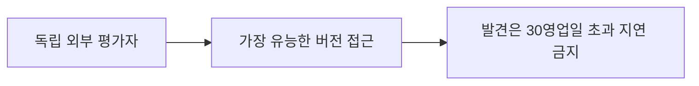

# 안전·보안 장 (GPAI 행동강령)

> EU의 범용 AI(GPAI) 행동강령 세 장 중, 시스템 리스크가 있는 최상위 모델 제공자만 대상으로 하는 장. 시스템 리스크를 식별·분석·수용 판단하고 안전·보안 완화 조치를 두며 모델 보고서와 사고 보고를 하는 최신 관행을 정리한다.

## 쉽게 말하면
원자력 발전소가 안전 보고서를 내고, 정기 점검과 사고 보고 체계를 갖추는 것과 비슷하다. 위험이 크다고 판단되는 모델만 이 무거운 절차를 지킨다.

## 자세히
출처는 code-of-practice.ai의 안전·보안 장(앞부분 열람)과 집행위 안내 페이지(열람). 행동강령은 자발적 도구이고 법률 자문이 아니다. 페이지 뒷부분(약 6.6만 자)은 읽지 못해 일부 약속(사고 보고 기한 등)은 확인하지 못했다.
- **적용 대상**: 55조에 따른 시스템 리스크 모델의 제공자만([시스템 리스크 모델](#systemic-risk-model)).
- **약속 1 안전·보안 프레임워크**: 프레임워크를 작성·이행·갱신하고 AI Office에 통지한다. 52조 1항에 따라 집행위에 통지한 뒤 4주 이내이자 시장 출시 2주 전까지 확정하고, 확정 후 5영업일 이내에 AI Office에 가리지 않은 접근을 준다. 출시 후 12개월마다(또는 훼손이 의심되면 더 빨리) 프레임워크를 평가한다.
- **약속 2 위험 식별**: 부속서 위험 유형(부록 1.1)과 명시된 위험(1.4)에 기반한 구조적 절차, 모델 독립 정보·출시 후 모니터링·중대 사고·아차 사고·AI Office 소통을 활용하고 위험마다 시나리오를 만든다.
- **약속 3 위험 분석**: 모델 독립 정보 수집, 모델 평가, 위험 모델링, 위험 추정, 출시 후 모니터링의 다섯 요소. 각 관련 평가의 입력·출력 표본을 최소 5개 무작위로 모델 보고서에 싣고, 독립 외부 평가자에게 가장 유능한 버전(그리고 비슷하게 안전한 모델이 없으면 완화가 가장 적은 버전)에 대한 자유 접근을 준다. 평가자의 발견은 제공자가 안 시점부터 30영업일을 넘겨 지연·차단할 수 없다(예외적으로 더 긴 일정이 필요한 경우 제외).
- **약속 4 위험 수용**: 모델 능력에 기반한 측정 가능한 위험 등급(최소 한 등급은 모델이 아직 도달하지 않은 것)을 정의하고 안전 여유를 둔다. 위험이 수용 가능할 때만 진행하며, 아니면 제한·철회·회수·완화 추가 후 재평가한다.
- **약속 5 안전 완화**: 미세조정 공격과 탈옥 같은 적대적 압력에도 견뎌야 한다. 예: 데이터 필터링, 입출력 모니터링, 거부 학습, 단계적 접근, 다른 행위자용 도구.
- **약속 6 보안 완화**: 비국가·내부자 등 위협 행위자를 포함한 보안 목표를 정의하고 무단 공개·접근·모델 탈취로부터 보호. 능력이 공개 다운로드 가능한 모델보다 낮으면 면제될 수 있다.
- **약속 7 모델 보고서**: 출시 전 작성하고 갱신하며 AI Office에 통지. 모델 설명, 진행 이유, 위험 문서, 외부 보고서, 향후 6개월 계획을 포함하고 SME·SMC는 상세 수준을 줄일 수 있다.
- **사고 보고·내부고발(약속 9 및 관련 문구)**: 중대 사고를 추적·문서화해 "지체 없이" AI Office(해당 시 국가 당국)에 보고한다. 구체 기한은 읽은 부분에 없다. 위원장 성명은 AI Office 전용 내부고발 채널을 권고했으나 이는 약속이 아닌 권고다.
- **공개(약속 10)**: 이행을 문서화하고 필요한 범위에서 프레임워크와 모델 보고서의 요약본을 공개한다.

## 그림으로 보기

## 예시
- 최상위 모델 제공자가 출시 2주 전까지 프레임워크를 확정하고 위험 등급 중 아직 도달하지 않은 상위 등급을 정의(조항 구조에 따른 설명 예).
- 교육 실습: 가상 모델의 위험 시나리오 3개를 쓰고 각각에 안전 완화 조치 한 가지를 짝지어 본다.

## 헷갈리는 것과 비교
| 개념 | 차이 |
|---|---|
| 안전·보안 장 | 시스템 리스크 모델만 대상 |
| 투명성 장·저작권 장 | 모든 GPAI 제공자 대상 |
| [시스템 리스크 모델](#systemic-risk-model) | 이 장의 적용 대상 정의 |
| [GPAI 저작권 정책](#copyright-policy-gpai) | 같은 행동강령의 다른 장 |

## 더 읽을거리
- [Code of Practice 안전·보안 장](https://code-of-practice.ai/?section=safety-security) — 약속 1~10(앞부분 열람)
- [Commission: GPAI Code of Practice 안내](https://digital-strategy.ec.europa.eu/en/policies/contents-code-gpai) — 세 장 구성(열람)
