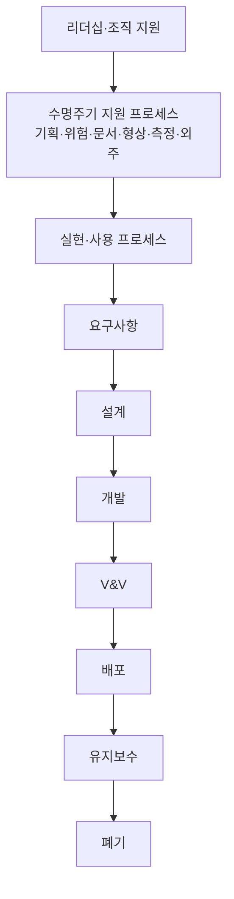
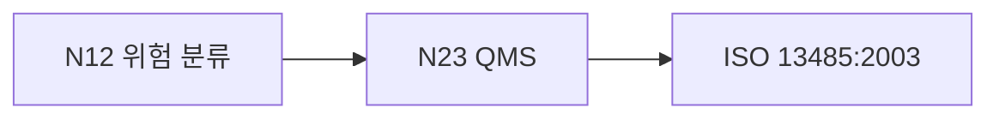

# SaMD 품질관리

> IMDRF가 2015년 낸 N23 문서(IMDRF/SaMD WG/N23 FINAL:2015). 의료기기 품질경영시스템(QMS) 요건을 소프트웨어 의료기기 개발 조직에 어떻게 적용하는지를 설명한다. 기준 규격은 ISO 13485:2003.

## 쉽게 말하면
식당이 위생 인증을 받으려면 "요리를 잘한다"로는 부족하고, 재료 입고부터 폐기까지 절차와 기록이 있어야 한다. N23은 소프트웨어 회사에게 같은 걸 요구하되, 소프트웨어 방식에 맞게 풀어 쓴 안내서다. 의료 소프트웨어는 "잘 돌아간다"보다 "어떤 과정으로 만들고 바꿨는지 증명할 수 있다"가 규제의 핵심이다.

## 자세히
출처: 브라질 ANVISA가 2022년 10월 N23을 요약한 발표 자료(직접 열어 읽음). N23 원문 PDF는 접속이 막혀 열지 못했다. 항목 이름은 ANVISA 요약을 따랐다.
- **동기**: 품질경영 준수는 환자 안전에 해가 되는 의도치 않은 결과를 줄이는 통제 수단으로 의료기기 분야에서 받아들여진다. 소프트웨어 업계에는 소프트웨어 품질·엔지니어링 관행이 따로 있다. N23은 두 세계를 잇는다.
- **범위**: SaMD 고유 실무 안내, QMS 적용 안내, 임상 환경과 기술·시스템 환경에서 고려할 점, 공통 어휘 형성, N12 위험 분류 틀의 보완. **좋은 소프트웨어 엔지니어링 방법이나 QMS를 구축하는 법 자체를 가르치지는 않는다.**
- **세 원칙(구조)**
  1. 리더십·책임·거버넌스를 주는 조직 구조 — 경영진이 자원과 인프라를 책임지고, 사람은 소프트웨어 공학과 임상 이해를 둘 다 갖춰야 한다.
  2. 조직 규모에 맞게 늘이고 줄일 수 있는 **수명주기 지원 프로세스**: 제품 기획, 위험 관리, 문서·기록 관리, 형상 관리, 측정·분석·개선, 외주 관리.
  3. SaMD 종류에 맞게 조정되는 **실현·사용 프로세스**: 요구사항 관리, 설계, 개발, 검증·확인(V&V; 환자 안전에 미치는 영향의 크기에 맞춤), 배포, 유지보수(변경 전 위험 평가), 폐기.
- 지원 프로세스는 실현·사용 프로세스 **전 구간에** 걸쳐 적용한다. 이때 환자 안전·임상 환경과 기술·시스템 환경을 함께 본다.
- 부록에 IMDRF 회원 관할의 QMS 규정 조항 대응표가 있다(ANVISA 요약).
- 관련 표준: 소프트웨어 수명주기는 보통 IEC 62304, 위험 관리는 ISO 14971과 함께 쓰이지만, 이 글의 출처에서 직접 확인한 건 아니다(일반 지식).

## 그림으로 보기

## 예시
- 의료 AI 스타트업이 모델을 재학습해 정확도를 올릴 때: 유지보수 프로세스에 따라 변경 전 위험 평가, 형상 관리로 버전 기록, V&V 재수행, 배포 기록을 남긴다.
- 클라우드 API를 외주로 쓰면 "외주 관리" 프로세스로 공급사 평가·변경 통지 조건을 문서화한다.

## 헷갈리는 것과 비교
| 개념 | 차이 |
|---|---|
| N23 (SaMD QMS) | 조직 차원의 품질경영 적용 안내 |
| [SaMD 위험 분류](#samd-risk-categorization) | 제품의 위험 수준을 매기는 틀 |
| [N10 SaMD 정의](#n10-samd-definition) | 용어 정의 |
| [IMDRF](#imdrf) | 세 문서를 낸 포럼 |

## 더 읽을거리
- [ANVISA: IMDRF/SaMD WG/N23 요약 발표 (PDF, 2022-10)](https://www.interamericancoalition-medtech.org/regulatory-convergence/wp-content/uploads/sites/4/2022/08/SaMD-29-08-2022-Webinar-FDA-Application-of-Quality-Management-System.pdf) — 이 글의 출처
- [IMDRF N23 원문](https://www.imdrf.org/sites/default/files/docs/imdrf/final/technical/imdrf-tech-151002-samd-qms.pdf) — 원 문서(이번에 열지 못함)
