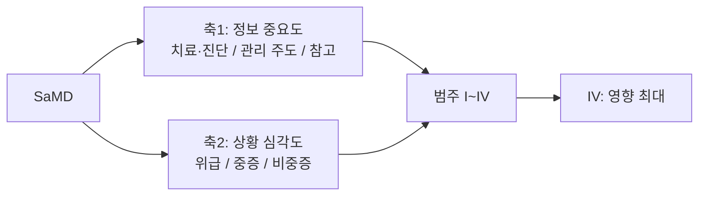

# SaMD 위험 분류

> IMDRF가 2014년 제안한 틀(N12). 소프트웨어가 주는 정보의 중요도와 환자 상황의 심각도 두 축으로 SaMD를 I~IV 범주로 나눈다. IV가 영향이 가장 크다.

## 쉽게 말하면
같은 계산기라도 "숙제 확인용"과 "수술 중 약 용량 계산용"은 위험이 다르다. 소프트웨어가 어떤 상황에서 얼마나 결정적인 정보를 주는지로 등급을 매긴다.

## 자세히
출처: 검색 결과(FDA의 IMDRF 표 재현 요약). IMDRF N12 원문 PDF의 표는 직접 열지 못했으므로 제출 전 원문 확인 필요.
- **두 축**: ① 정보의 중요도: 치료·진단 / 임상 관리 주도 / 임상 관리 참고 ② 상황의 심각도: 위급(critical) / 중증(serious) / 비중증(non-serious).
- **표(행=상황, 열=정보 중요도; 치료·진단 | 관리 주도 | 관리 참고)**
  - 위급: IV | III | II
  - 중증: III | II | I
  - 비중증: II | I | I
- 범주는 서로 상대적이며 IV가 가장 높은 영향. 여러 상황·정보 유형에 걸치면 대개 가장 높은 해당 수준으로 분류(발표 자료 요약).
- IMDRF는 이 틀이 제안 접근이며 소프트웨어 위험 관리 표준을 대체하지 않는다고 밝힌다. 싱가포르 HSA 등 규제기관이 참조한다. FDA 등급(I·II·III)과는 다른 체계다([의료기기 등급](#device-risk-classes)).
- AI 소프트웨어가 "진단"을 내고 환자 상태가 위급이면 IV 범주, 일상 건강 정보 참고용이면 I.

## 그림으로 보기

## 예시
- 중환자 패혈증 조기 경보 AI(위급, 임상 관리 주도) → III. 일상 수면 기록 앱(비중증, 참고) → I.
- 뇌졸중 영상을 보고 치료 결정을 내리는 AI(위급, 진단·치료) → IV.

## 헷갈리는 것과 비교
| 개념 | 차이 |
|---|---|
| IMDRF 범주 I~IV | 국제 포럼 제안, 두 축 |
| FDA 등급 I~III | 미국 규제 위험 분류 |
| [SaMD](#samd) | 분류 대상 |

## 더 읽을거리
- [IMDRF/SaMD WG/N12 (PDF)](https://imdrf.org/sites/default/files/docs/imdrf/final/technical/imdrf-tech-140918-samd-framework-risk-categorization-141013.pdf) — 원 문서(이번에 열지 못함)
