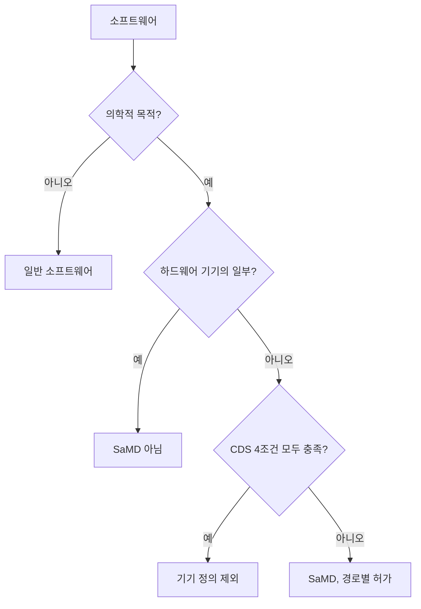

# SaMD 소프트웨어 의료기기

> 하드웨어 기기에 속하지 않고 소프트웨어만으로 의학적 목적(진단·치료 결정 등)을 수행해 의료기기로 규제받는 소프트웨어(Software as a Medical Device).

## 쉽게 말하면
체온계는 하드웨어 의료기기다. 사진 속 피부 병변을 보고 악성 가능성을 알려 주는 앱은 기기 없이 소프트웨어만으로 같은 진단 역할을 하므로 SaMD다. 반대로 인퓨전 펌프를 구동하는 소프트웨어는 하드웨어의 일부라 SaMD가 아니다.

## 자세히
- 정의는 IMDRF(국제의료기기규제당국자포럼)의 용어이고 FDA가 채택했다: 하드웨어 의료기기의 일부가 아닌 상태로 의학적 목적을 수행하는 소프트웨어.
- 예: 유방암 영상 후처리 소프트웨어(SaMD), 펌프 제어 소프트웨어(SaMD 아님)(FDA 사례).
- **임상 의사결정 지원(CDS) 예외**: FD&C Act 520(o)(1)(E)에 따라 4가지 조건을 모두 충족하면 의료기기 정의에서 제외된다. 요약: 영상·신호를 분석하지 않고, 의료 정보를 표시·분석하며, 의료 전문가를 보조하고, 전문가가 권고 근거를 독립적으로 검토할 수 있어야 한다. 시급한 결정용은 마지막 조건을 충족하지 못한다고 보는 해석이 있다.
- AI 모델이 영상 판독을 하면 SaMD로 분류되어 [510(k)·De Novo·PMA](#fda-510k-de-novo-pma) 경로를 탄다.
- 확인 못 한 주장: 한 자료는 FDA의 2017 SaMD 임상평가 가이드가 2026-01-06 철회됐다고 하나 FDA 페이지로 확인하지 못했다.

## 그림으로 보기

## 예시
- 흉부 X선에서 폐결절을 표시하는 AI: SaMD(영상 분석이므로 CDS 예외 아님).
- 환자 기록을 요약해 의사가 근거를 열어 볼 수 있게 한 도구: CDS 예외 후보(조건 검토 필요).

## 헷갈리는 것과 비교
| 개념 | 차이 |
| --- | --- |
| SaMD | 소프트웨어 단독 의료기기 |
| 기기 내장 소프트웨어(SiMD) | 하드웨어에 포함, 기기 규제에 속함 |
| CDS 예외 | 위 4조건 충족 시 규제 제외 |
| [PCCP](#fda-pccp) | SaMD 모델 갱신을 위한 사전 승인 틀 |

## 더 읽을거리
- [IMDRF: SaMD Key Definitions](https://www.imdrf.org/sites/default/files/docs/imdrf/final/technical/imdrf-tech-131209-samd-key-definitions-140901.pdf) — 정의 원문(검색 요약 확인)
- [IntuitionLabs: Intro to SaMD](https://intuitionlabs.ai/articles/samd-definition-and-scope) — 범위 해설(업체 블로그)
