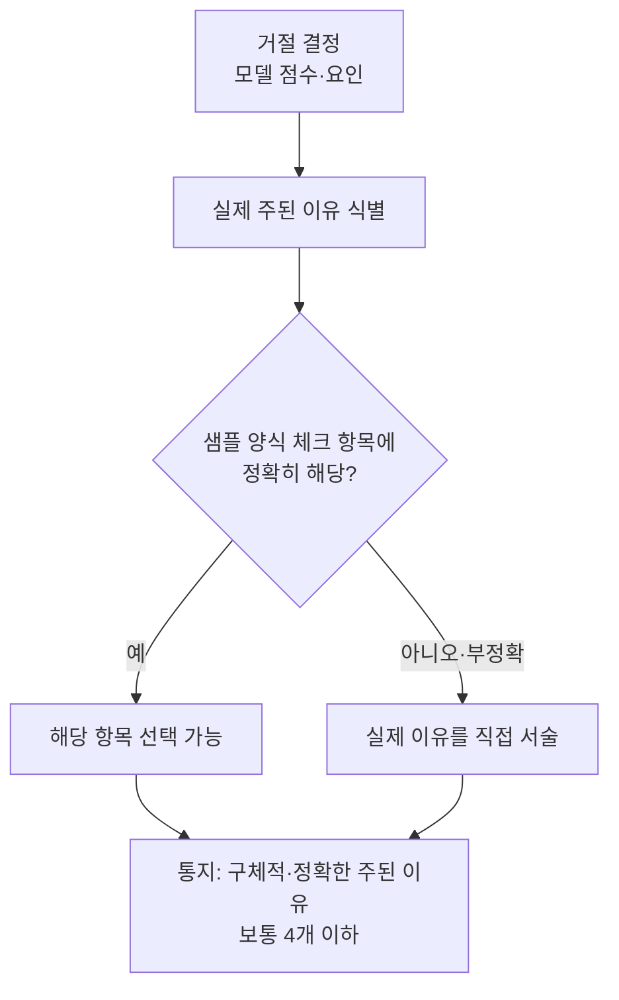

# 샘플 양식 체크리스트

> Reg B가 불리한 조치 통지용으로 제공하는 샘플 양식(부록 C)에는 흔한 거절 이유 체크 항목이 있다. 그러나 **체크리스트에서 비슷한 항목을 고르는 것만으로는** "실제로 고려·점수화된 주된 이유"를 알려야 한다는 요건을 충족하지 못할 수 있다. (법률 자문 아님)

## 쉽게 말하면
시험지에 "실력 부족/시간 부족/기타" 체크박스가 있다고 해서 아무 칸이나 골라 통지하면 안 된다. 실제로 점수를 깎은 이유를 정확히 적어야 하고, 체크리스트는 그 이유가 목록에 있을 때만 도움이 된다.

## 자세히
출처: Reg B §1002.9(b)(2)와 공식 해설(CFPB 사이트, 열어서 읽음). 회람 2023-03 본문은 열지 못했고, 해당 회람은 2025-05 철회 대상으로 보고된다([CFPB 지침 철회 2025](#cfpb-guidance-withdrawal-2025)).
- **구체성(조문)**: 이유는 "구체적이어야 하고 불리한 조치의 **주된 이유**를 나타내야" 한다. 내부 기준·정책에 따랐다거나 합격 점수에 못 미쳤다고만 하면 충족하지 못한다.
- **이유 개수(해설 9(b)(2)-1)**: 고정 개수는 없지만 "네 가지를 넘는 이유 공개는 신청자에게 도움이 될 가능성이 낮다".
- **정확성(해설 9(b)(2)-2)**: 이유는 채권자가 **실제로 고려하거나 점수화한 요인**과 관련되고 정확히 설명해야 한다.
- **실제 이유(해설 9(b)(2)-4)**: 신청자가 요인과 신용도의 연결을 이해하지 못해도 채권자는 **실제 거절 이유**를 공개해야 한다.
- **샘플 양식(해설 9(b)(2)-9)**: 양식 C-1~C-5는 ECOA와 FCRA 공시를 모두 제공하며, FCRA 공시가 ECOA의 구체적 이유 제시 의무를 대신하지 않는다고 같은 해설이 밝힌다. 부록 C 양식 본문은 이 페이지에 없어 확인하지 못했다.
- **AI 모델과의 연결(해설)**: 복잡한 모델의 상위 기여 요인(예: SHAP 기반)을 표준 이유 목록에 억지로 맞추면 실제 이유와 어긋날 수 있다. 조문이 요구하는 것은 "실제 이유"의 정확한 설명이며, 이유 코드 매핑의 정확성이 문제가 된다([이유 코드 매핑](#reason-code-mapping)). 이 연결은 조문 문구에서 이 지도가 추론한 것이다.
- **회람과 조문**: 회람이 철회돼도 위 조문과 해설은 그대로 있다([지침과 조문의 차이](#guidance-vs-regulation)).

## 그림으로 보기

## 예시
- 모델이 "최근 6개월 신용카드 한도 사용률"이 가장 큰 감점 요인이라면 "신용 이용률이 높음" 같은 정확한 이유를 적고, 목록에 비슷한 "신용 이력 부족"을 고르면 부정확하다.
- 점검: 통지된 이유가 모델 기여도 상위 요인과 일치하는지 표본 대조.

## 헷갈리는 것과 비교
| 개념 | 차이 |
|---|---|
| 샘플 양식 체크리스트 | 참고용 예시 목록 |
| 실제 주된 이유 | 조문이 요구하는 공개 내용 |
| [이유 코드 매핑](#reason-code-mapping) | 모델 요인을 통지 이유로 옮기는 작업 |
| [불리한 조치 통지](#adverse-action-notice) | 상위 노드 |

## 더 읽을거리
- [Reg B §1002.9 Notifications (CFPB)](https://www.consumerfinance.gov/rules-policy/regulations/1002/9/) — (b)(2)와 해설(열어서 확인)
