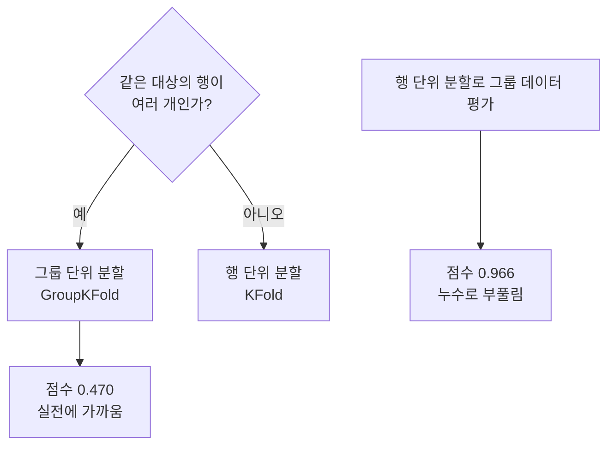
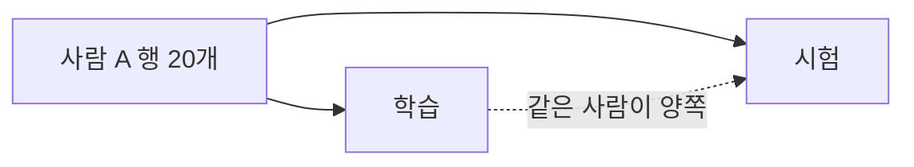

# 샘플 단위 vs 그룹 단위 분할

> 데이터 행이 서로 독립이면 행 단위로 무작위 분할해도 되지만, 같은 사람·기기·문서에서 나온 행이 여러 개면 그룹 단위로 나눠야 한다. 그렇지 않으면 같은 그룹이 학습과 시험에 모두 들어가 점수가 터무니없이 높아진다.

## 쉽게 말하면
같은 학생의 풀이 노트 20장을 학습 자료와 시험 문제에 섞어 넣으면, 시험에서 그 학생의 필체와 습관을 알아보고 맞힌다. 새 학생 앞에서도 맞히는 실력이 아니다. 학생 단위로 "시험 학생 / 학습 학생"을 나눠야 새 학생에 대한 실력을 잴 수 있다.

## 자세히
- **원칙(scikit-learn 교차검증 문서, 열람)**: 같은 그룹이 학습과 시험에 동시에 나오지 않게 하려면 `GroupKFold` 등 그룹 분할기를 쓴다. 그룹이 있는 데이터에서 일반 분할은 학습·시험 사이에 비합리적인 상관을 만든다고 문서가 설명한다.
- **직접 해 본 극단 실험(사람 60명 × 20행, 각 사람의 "지문" 특징 8개, 라벨은 사람마다 무작위로 정해 특징과 무관, 랜덤 포레스트)**: 행 단위 무작위 5겹 정확도는 0.966, `GroupKFold(5)`는 0.470이었다. 라벨에 진짜 신호가 없는데도 행 단위 분할은 사람을 알아보는 것만으로 0.97을 얻었고, 그룹 분할은 동전 던지기 수준이라는 정직한 답을 줬다. 극단적으로 만든 합성 데이터라 실제 차이는 이보다 작을 수 있다.
- **분할 단위 정하는 질문(해석)**: ① 새 데이터는 "새 사람·새 기기"에서 오는가(→ 그룹 단위) ② 같은 대상의 행이 여러 개인가 ③ 시간 순서가 있는가([시간을 그룹으로 쓰기](#time-as-group)) ④ 한 문서·사진에서 여러 조각을 잘랐는가. 하나라도 예이면 그룹 단위로 나눈다.
- **대가**: 그룹 단위로 나누면 점수가 낮아지지만 그것이 실전 성능에 가깝다. 그룹 수가 적으면 폴드 구성이 불균형해진다([그룹 크기 불균형](#group-size-imbalance)).
- **예방 습관**: 데이터 표에 그룹 열(환자 ID, 사용자 ID, 문서 ID)을 항상 남긴다.

## 그림으로 보기

## 예시
- 환자별로 여러 검사 기록이 있는 의료 데이터에서 `GroupKFold(5).split(X, y, groups=patient_id)`.
- 영상에서 프레임을 뽑아 학습한다면 영상 ID로 그룹을 만든다. 교육 활용: 합성 지문 데이터로 두 분할 점수가 0.97과 0.47로 갈리는 시연.

## 헷갈리는 것과 비교
| 개념 | 차이 |
| --- | --- |
| 행 단위 분할 | 행이 독립일 때 |
| 그룹 단위 분할 | 같은 그룹을 한쪽에만 |
| [시간을 그룹으로 쓰기](#time-as-group) | 시간 구간이 그룹 |
| [LeavePGroupsOut](#leave-p-groups-out) | P개 그룹을 시험에 |

## 더 읽을거리
- [scikit-learn: Cross-validation — Cross-validation iterators for grouped data](https://scikit-learn.org/stable/modules/cross_validation.html) — 그룹 분할기와 사용 이유
